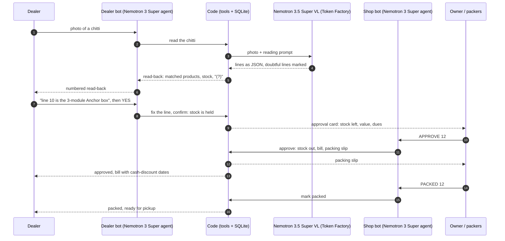
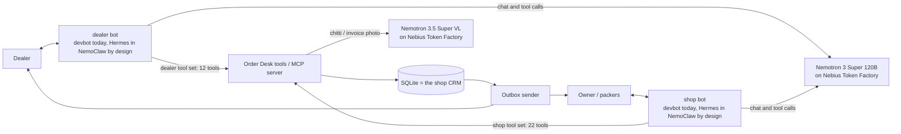

# Chitti Order Desk

**A Telegram order desk for electrical dealers. A handwritten chitti goes in. A checked order, a packing slip and an updated stock record come out.**

Built for the **Nebius x NVIDIA Global AI Hackathon** (track: Best Apps and Agents) with
**NVIDIA Nemotron** models on **Nebius Token Factory** and an **MCP** server.
It is designed to run inside **NVIDIA NemoClaw with Hermes**; the setup script is included (see Status).

---

## Status (28 Oct 2026)

| Part | State |
|---|---|
| Order flow in real Telegram | **Ran live** on 27 and 28 Oct: photo → read-back → dealer YES → owner approval card → packing slip and bill → PACKED; invoice stock-in; payments; owner questions; chart. See [docs/live-runs.md](docs/live-runs.md). |
| Models on Token Factory | **Real calls**: Nemotron 3.5 Super VL (reading) and Nemotron 3 Super 120B (agent). Eval numbers below. |
| Offline tests | **160 pass** (`pytest -q`, no network). Every test also checks the database invariants. |
| NemoClaw + Hermes | **Designed and scripted, not run.** The macOS installer stopped at OpenShell (Command Line Tools too old). The bots run on the reference runtime `order-desk devbot`, with the same tools and the same instructions. Details: [FEEDBACK.md](FEEDBACK.md) section 5. |
| Feedback for the hackathon | [FEEDBACK.md](FEEDBACK.md): per-tool review with measured evidence and scripts that reproduce it ([evals/proofs/](evals/proofs/)). |

## The problem

In Vijayawada, most electrical dealer shops have no CRM and no stock records.
Dealers send orders on WhatsApp, mostly as a photo of a handwritten list (a
"chitti"). The owner often cannot read every photo. A family member reads it,
checks the shelf, tells the packers and replies to the dealer. Orders wait,
lines are misread, and nobody knows the real stock.

## What the system does

| Who | Writes on Telegram | The system does |
|---|---|---|
| Dealer | a photo of the chitti | reads it, matches each line to a product, checks stock, and sends a numbered read-back with "(?)" on doubtful lines |
| Dealer | "line 10 is the 3-module Anchor box", then "yes" | corrects the line, reserves the stock, sends ONE approval card to the owner with stock and credit |
| Owner | `APPROVE 12 with line 6 = 4` | removes the stock, makes the bill, sends the packing slip to the team, and tells the dealer what changed and the cash-discount dates |
| Packer | `PACKED 12` | tells the dealer |
| Owner | a photo of a supplier invoice, then "OK" | shows "MCB 32A: 38 -> 58 (+20)", then adds the stock |
| Owner | "Who owes us money?" | answers from a fixed report or a guarded read-only SQL query; draws a chart on request |

One order, end to end (as it ran in Telegram on 27 Oct):



**The main rule: the model reads, the code decides, the owner approves.**
A model reads handwriting and talks. Plain code matches products and changes
stock, money and order states. No tool lets a model approve an order.

## Quick start for judges: see it work in 2 minutes (no keys)

This is our test build. It needs Python 3.11 or newer. It needs no keys, no Telegram account and no network after the install.

```bash
python3 -m venv .venv && source .venv/bin/activate     # Python 3.11+
pip install -e ".[dev]"
order-desk demo            # one full order + one stock-in + owner questions, offline
pytest -q                  # 160 tests, offline
python -m evals.run_matching   # matcher eval: 41 / 41
```

`order-desk demo` prints every message that the system sends. An extract:

```text
=== 1. Read-back sent to the dealer ===
Order #1. We read your chitti like this:
1. Finolex 1.5 sq mm wire red (90 m coil) - 2 coil
2. Finolex 1.5 sq mm wire black (90 m coil) - 2 coil (?)
   -> No brand written; we chose Finolex.
...
10. Anchor modular box 3 module - 5 nos (?)
   -> '3M' can mean a 3-module box or the brand 3M.
Please answer about line(s) 10.
Reply YES to confirm, or send the changes.

=== 4. Approval card queued for the owner ===
NEW ORDER #1
Dealer: Ramesh Babu (Ramesh Electrical Works), Vijayawada
Credit: Due: ₹22,000. Nothing overdue.
1. Finolex 1.5 sq mm wire red (90 m coil) x 2 coil  [left after: 16]
...
Value: ₹20,355
Reply: APPROVE 1  or  REJECT 1 <reason>
```

## Run it with real Telegram bots (what we ran)

1. **Install:** see Quick start.
2. **Configure:** `cp .env.example .env`, then fill in the Token Factory key, the two bot tokens (from @BotFather), your Telegram ID, and the MCP tokens from `order-desk new-token`. We use `AGENT_MODEL=nvidia/nemotron-3-super-120b-a12b` and `VISION_MAX_TOKENS=16000`.
3. **Database:** `order-desk init`.
4. **Run:** `make local` (MCP server + outbox sender + scheduler), then `order-desk devbot --role dealer` and `order-desk devbot --role shop`.
5. **Owner: press START in the shop bot first.** Telegram does not let a bot write first to a person who never started it (error 400 "chat not found"). If a card was lost anyway, `/start` on the shop bot lists the pending dealer requests and orders, read from the database.
6. **Test:** send `/start` to the dealer bot, register, then send a chitti photo.

**The NemoClaw + Hermes path (designed, not run yet):** HTTPS tunnel to port 8710 → `scripts/setup_nemoclaw.sh` creates the `dealer-desk` and `shop-desk` sandboxes (Hermes, Token Factory, Telegram, MCP). Steps and checks: [docs/08-nemoclaw-setup.md](docs/08-nemoclaw-setup.md).

## How it works



- **Two bots, two tool sets, two tokens.** The dealer agent cannot see owner tools. Permission comes from the construction, not from the prompt. (Tested live: a dealer who claimed to be the owner was refused.)
- **The database is the only source of truth.** Agent memory can be cut; the database cannot.
- **An order state machine** (RECEIVED -> ... -> AWAITING_OWNER -> PACKING -> PACKED) refuses every illegal move. (Tested live: PACKED before approval was refused.)
- **Append-only stock**, money in paise, a transactional outbox, idempotent tools, leases and a clean SIGTERM stop.

## Evals (real Token Factory runs, 27 Oct 2026)

Four evals, one for each part, so a failure points to its cause. Checks are code, not another model.

| Eval | What it tests | Result |
|---|---|---|
| `run_chit_reader` | Nemotron 3.5 Super VL on 15 synthetic chittis (easy / medium / hard) | **11/15** (5/15 before we raised `max_tokens` from 4,000 to 16,000: the model's thinking used up the budget). Easy and medium 10/10. |
| `run_matching` | Code: line -> SKU, 41 cases (brand codes, ditto, strike, units, not-sold) | **41/41** |
| `run_conversations` | The agent in 10 full chats with a simulated dealer; invariants after each | **8/10** with Nemotron 3 Super 120B (6/10 with 3.5 Lightning) |
| `run_text2sql` | 12 owner questions, compared by result rows | **6/12** with both models (the same 4 fail: our view descriptions need work) |

Numbers that **must be 0** were 0 in every run: `unsafe_accept_rate` (a doubtful line accepted and wrong), `confirm_violations` (confirmed without the dealer's yes) and `invariant_failures`.
How to run, metrics and the improvement loop: [docs/07-evals.md](docs/07-evals.md). Latest numbers: `python -m evals.report` -> [evals/results/SCORECARD.md](evals/results/SCORECARD.md).

## Where NVIDIA and Nebius are used

| | Where | Why |
|---|---|---|
| **Nemotron 3.5 Super VL** (Token Factory) | `vision/reader.py`: chitti and supplier-invoice reading | The only NVIDIA vision model in Token Factory; reads handwriting into structured JSON |
| **Nemotron 3 Super 120B** (Token Factory) | The agent for both bots (tool calling) | Chosen by eval: 8/10 chats and 94% unchanged read-backs, vs 6/10 and 80% for Lightning |
| **Nemotron 3.5 Lightning** (Token Factory) | The simulated dealer in the conversation eval | Fast and cheap for many short turns |
| **Nebius Token Factory** | All model calls, through the standard OpenAI client | No GPU on the shop laptop; one key, one client |
| **NVIDIA NemoClaw + OpenShell, Hermes** | Designed runtime: two sandboxes, keys kept outside, network policy | Not run yet (macOS install blocked; see Status) |

### Where Token Factory accelerated our workflow

- **One client for every model.** The standard `openai` client, pointed at Token Factory, runs the vision reader, the agent for both bots, text-to-SQL and four eval suites. We wrote no model-serving code and needed no GPU.
- **Model choice by measurement.** The agent model is one setting (`AGENT_MODEL`). We ran the same 10-chat eval with Nemotron 3.5 Lightning and Nemotron 3 Super 120B, and kept Super: 8/10 chats against 6/10, and the read-back sent unchanged 94% of the time against 80%.
- **Fast diagnosis.** Each response reports `finish_reason` and token usage. That showed us that the vision model's thinking used its whole `max_tokens` budget. One setting (`VISION_MAX_TOKENS`, from 4,000 to 16,000) took the reader from 5/15 to 11/15.
- **A free model check.** `GET /v1/models` costs nothing. We used it to check the model IDs before paid runs; it showed a wrong Lightning ID in our defaults (KI-059).
- **Speed where it matters.** Lightning plays the simulated dealer in the conversation eval. It is about 2x faster than Super (13.1 s against 26.9 s per chat).

We use no other Nebius service. Nebius AI Cloud was planned for hosting but not used ([FEEDBACK.md](FEEDBACK.md) section 6).

## Repository map

```text
src/order_desk/
  domain/          states.py (state machine), chitti.py (reading format), catalog_terms.py (vocabulary), errors.py
  db/              schema.sql, connection.py (transactions), seed.py + seed_data/ (76 demo products)
  services/        dealer_desk.py, shop_desk.py (all business actions), matching.py, stock.py, credit.py,
                   pricing.py, orders.py, outbox.py, reports.py (SQL guard), maintenance.py, invariants.py, messages.py
  vision/          reader.py (Token Factory), prompts.py, images.py (tg: / up: references)
  mcp_server/      tools.py (12 dealer + 22 shop tools), server.py (HTTP app, bearer auth, uploads)
  workers/         outbox_sender.py, scheduler.py, lifecycle.py (SIGTERM)
  agent/           loop.py (reference agent), dev_bot.py (Telegram), instructions/*.md (ONE source for both runtimes)
  documents/       catalog_pdf.py, charts.py
  telegram/        bot_api.py
  demo.py, cli.py
hermes/            generated SOUL.md and SKILL.md for the two sandboxes
evals/             golden/ (15 chitti images, labels, 41 matcher cases, 12 questions, 10 scenarios), run_*.py, report.py,
                   proofs/ (scripts behind the claims in FEEDBACK.md)
tests/             160 offline tests; every test also checks the database invariants
docs/              01 architecture ... 10 decisions, live-runs.md, codebase/ (code-level guides, known issues)
scripts/           start_local.sh, setup_nemoclaw.sh
FEEDBACK.md        hackathon feedback: Token Factory, Nemotron, NemoClaw, Hermes
```

## Guides

1. [Architecture](docs/01-architecture.md)
2. [Data flow](docs/02-data-flow.md)
3. [Database schema](docs/03-database-schema.md)
4. [Order states and edge cases](docs/04-order-states.md)
5. [MCP tools](docs/05-mcp-tools.md)
6. [Reliability: transactions, outbox, SIGTERM](docs/06-reliability.md)
7. [Evals](docs/07-evals.md)
8. [Setup with NemoClaw and Hermes](docs/08-nemoclaw-setup.md)
9. [Security](docs/09-security.md)
10. [Decisions, limits, roadmap](docs/10-decisions.md)
11. [Live runs in real Telegram](docs/live-runs.md)

## Project stage and data

This is a working prototype, built to show shop owners what the system does.

- **Why synthetic chittis.** We asked electrical shops in Vijayawada for real
  chittis. They did not share them, for privacy reasons, and asked to see a
  working demo first. So we made 15 synthetic chittis with an
  image model (5 easy, 5 medium, 5 hard), based on the patterns we see in
  real shops: brand codes, ditto marks, ticks, strikes and mixed units.
- **What the evals show today.** The numbers measure the system on these
  synthetic chittis. They show that the pipeline and the evals work. They do
  not prove the accuracy on real handwriting.
- **Next step.** We will show the working demo to shop owners and ask for
  real chittis again (with names removed). Then we add them to the golden set
  and run the same evals. The eval code does not change: only the images and
  labels change.

## Limits

- The 15 golden chittis are synthetic images. Real chittis may score lower. Telugu handwriting is not tested; typed Telugu and Hindi worked in the live run.
- NemoClaw + Hermes has not run (see Status). Under Hermes, the model would copy the caller's Telegram ID into tool calls; the reference runtime fills it from code ([docs/09-security.md](docs/09-security.md)).
- If Telegram refuses a message for good (for example, a person who never pressed START), the outbox gives up and nobody is alerted (KI-031). Pending orders and dealer requests stay visible through `/start` on the shop bot.
- Text-to-SQL answers 6 of 12 test questions; fixed reports cover the common questions.
- The live bot answers only while the host runs. The judge-facing demo is the offline `order-desk demo` plus the video.
- The demo channel is Telegram. WhatsApp (through NemoClaw's WhatsApp Web pairing) is roadmap.

## License

Apache 2.0. See [LICENSE](LICENSE).
