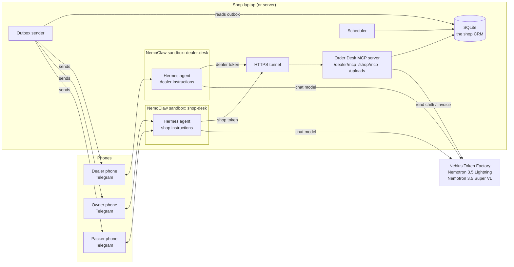

# 1. Architecture

This guide shows the parts of the system, what each part does, and why it exists.

## 1.1 The problem in one paragraph

Electrical dealers in Vijayawada send orders to a shop on WhatsApp, mostly as a
photo of a handwritten list (a "chitti"). In most shops, one educated family
member reads each photo, checks the shelf, writes the order for the packers
and tells the dealer. The shop has no CRM and no stock records. Chitti Order
Desk does this "intake clerk" work. The owner still approves every order.

## 1.2 The parts

| Part | What it does | Why it is separate |
|---|---|---|
| **Hermes agent (2 sandboxes)** | Talks with people. Decides which tool to call next. | Each sandbox holds one bearer token, so each agent sees only its own tools. |
| **NemoClaw / OpenShell** | Runs each agent in a sandbox with network, file and process limits. Keeps the API keys outside the sandbox. | An agent that reads text from strangers must not reach anything except the tools we give it. |
| **Order Desk MCP server** | All business rules: reading, matching, stock, credit, order states, reports. | The rules are plain code. They are the same for every agent and every model. |
| **SQLite database** | The only source of truth: catalog, stock, dealers, orders, bills, messages. | The agent's memory can be cut or summarized. The database is never lost. |
| **Outbox sender** | Sends the messages that the server queued (approval cards, packing slips, notices, PDFs, charts). | A message is queued in the same transaction as the state change, so no message is lost after a crash. |
| **Scheduler** | Expires unconfirmed orders. Reminds the owner. Reports stuck reads. | Time-based rules need a clock that runs when nobody writes. |
| **Token Factory** | Runs the NVIDIA Nemotron models. | Hackathon rule, and no GPU is needed on the laptop. |

## 1.3 The main rule: the model reads, the code decides, the owner approves

| Job | Done by | Example |
|---|---|---|
| Read handwriting | Nemotron 3.5 Super VL | "1.5 r - 2c (Fin)" -> wire, 1.5 sq mm, red, Finolex, 2 coil |
| Talk, ask, choose a tool | Hermes + Nemotron 3.5 Lightning | "Line 10: is '3M' a 3-module box?" |
| Match a product | Code (`services/matching.py`) | -> `WIRE-1.5-RED-FINOLEX` |
| Stock, price, credit, states | Code (`services/*.py`) | sellable = on hand - reserved - safety stock |
| Approve an order | The owner | "APPROVE 12" |

A model can make a mistake in reading or talking. A model cannot remove stock,
skip a state or approve an order, because no tool lets it do that.

## 1.4 Two runtimes, one set of tools

| | Hermes in NemoClaw (main) | Reference agent (`order-desk devbot`) |
|---|---|---|
| Where | Inside a sandbox | A plain Python process |
| Instructions | `hermes/*/SOUL.md`, `SKILL.md` | `src/order_desk/agent/instructions/*.md` (the same text) |
| Tools | MCP over HTTPS | The same tool functions, in-process |
| Caller identity | The model passes `telegram_user_id` | The code fills it from the Telegram update |
| Used for | The real deployment and the demo | Evals, and a fallback if a sandbox is not ready |

`order-desk export-skills` copies the one instruction source into the Hermes
files, so the two runtimes never drift apart.

## 1.5 On-premise path

Today the models run on Nebius Token Factory (a hackathon requirement).
NemoClaw can also route a sandbox to a local server (Ollama, vLLM, NVIDIA NIM),
and its validated Ollama models include `nemotron-3-nano:30b`. The tools, the
database and the evals do not change when the model moves. Only the provider
setting changes. See [10-decisions.md](10-decisions.md), "Roadmap".
