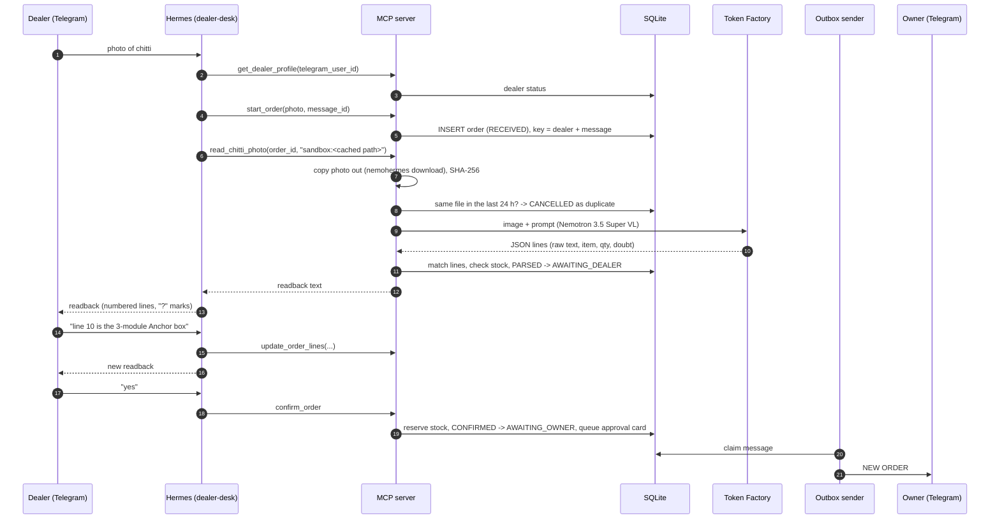
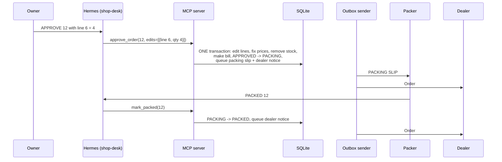
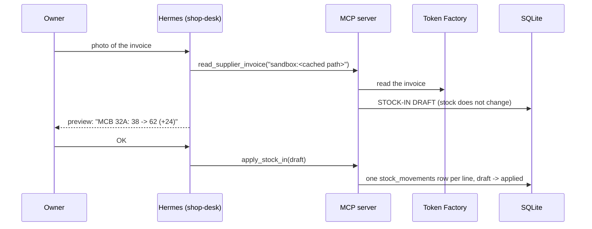

# 2. Data flow

This guide follows the data through the five main jobs. For each step it
shows where the data is, and what crosses the network.

## 2.1 A dealer sends a chitti

**What crosses the network**
- Telegram -> Hermes: the dealer's message and photo. Hermes caches the photo
  in the sandbox and tells the agent its path.
- Hermes -> MCP server: tool calls of a few hundred bytes. The photo itself
  never goes through the tool call: NemoClaw limits an MCP request to 128 KB,
  and a phone photo is larger. The server copies the cached photo out of the
  sandbox with `nemohermes <sandbox> download` (the reference runtime uses the
  Telegram file ID instead).
- MCP server -> Token Factory: the photo, made smaller (max 2000 px, JPEG).
- Outbox sender -> Telegram: the approval card.

**Steps 7 to 11 are safe to repeat.** If the laptop stops between them, the
order stays in RECEIVED and holds no stock. The next `read_chitti_photo`
call does the work again. See [06-reliability.md](06-reliability.md).

## 2.2 The owner approves

## 2.3 The owner adds stock from a supplier invoice

The same invoice (supplier + number) cannot be applied two times. A pack
("2 box") becomes sell units with the product's `pack_size` (2 x 12 = 24).

## 2.4 The owner asks a question

1. Common questions use a fixed report: `get_report("today" | "pending_orders" | "debtors" | "low_stock")`.
2. Other questions: the agent reads `describe_reporting_views`, writes one
   SELECT, and calls `run_readonly_query`. The guard lets it read only the
   `v_*` views, on a read-only connection, with a row and time limit.
3. "Show it as a chart": `send_chart` draws a PNG and queues it in the outbox.

## 2.5 Timed jobs

| Every minute | What happens |
|---|---|
| Expiry | AWAITING_DEALER past its deadline -> EXPIRED; the dealer is told. |
| Reminder | AWAITING_OWNER longer than 2 h -> one reminder per 2 h window. |
| Stuck reads | Orders in RECEIVED for 15 min are logged (they hold no stock). |
