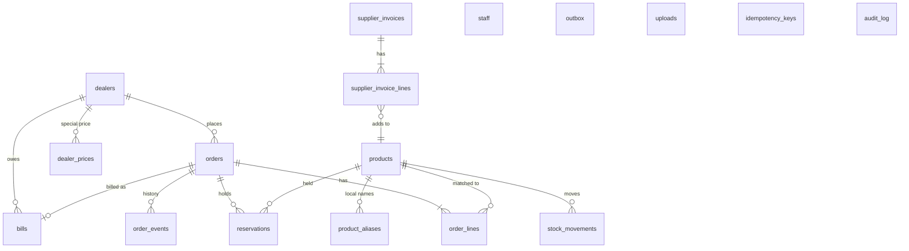

# 3. Database schema

The file is [`src/order_desk/db/schema.sql`](../src/order_desk/db/schema.sql).
This guide gives the reason for each table. The database is the shop's CRM:
the agent never states a fact that is not in it.

## 3.1 Conventions

| Rule | Why |
|---|---|
| Money is INTEGER paise (₹1 = 100 paise). | Floats lose paise in sums. |
| Time is TEXT, UTC, `YYYY-MM-DDTHH:MM:SSZ`. | Sorts correctly, and text-to-SQL can read it. |
| Stock is never one number that we overwrite. Each change is a row in `stock_movements`. | Full history. A wrong change is visible and can be corrected with a new row. |
| Every write uses `BEGIN IMMEDIATE`. | Two writers cannot interleave (see [06-reliability.md](06-reliability.md)). |
| Views start with `v_`. Text-to-SQL may read only views. | Base tables stay hidden from model-written SQL. |

## 3.2 Diagram

## 3.3 Tables

### People
| Table | Purpose | Key columns |
|---|---|---|
| `dealers` | One row per dealer. Telegram private chat ID = user ID. | `telegram_user_id` (unique), `status` pending/active/blocked, `payment_terms_days` |
| `staff` | Owner and packers. Role decides the shop tools a person may use. | `telegram_user_id`, `role` owner/packer |

### Catalog and price
| Table | Purpose | Key columns |
|---|---|---|
| `products` | What the shop sells. | `sku`, `category`, `brand`, `spec_json`, `unit` (sell unit), `pack_size`, `base_price_paise`, `safety_stock`, `is_default_brand` |
| `product_aliases` | Local names people write ("fin 1.5 red"). Used by `search_catalog`. | `alias`, `sku` |
| `dealer_prices` | A special price for one dealer and one product. | `dealer_id`, `sku`, `price_paise` |

`spec_json` holds the facts that decide a match: `size_sqmm`, `color`,
`rating_amp`, `watt`, `size_mm`, `ways`, `modules`. The list lives in one place:
`domain/catalog_terms.py`.

### Stock
| Table | Purpose | Key columns |
|---|---|---|
| `stock_movements` | Append-only. `+` for opening, stock-in, count up; `-` for orders, count down. | `qty_delta`, `reason`, `ref_type`, `ref_id`, `actor` |
| `reservations` | Stock held for a confirmed order until the owner decides. | `order_id`, `sku`, `qty`, `status` active/consumed/released |

A unique index `ux_moves_order_deduct (ref_id, sku) WHERE reason = 'order_deduct'`
makes it impossible to remove stock for the same order and SKU two times.

### Orders
| Table | Purpose | Key columns |
|---|---|---|
| `orders` | One row per chitti or typed order. | `state`, `idempotency_key` (dealer + Telegram message), `image_sha256`, `dealer_check_deadline`, `version`, `linked_order_id`, `possible_duplicate_of` |
| `order_lines` | One row per line on the chitti. | `line_index`, `raw_text` (as read), `item_json`, `sku`, `qty`, `status`, `note`, `candidates_json`, `unit_price_paise` |
| `order_events` | Every state change: from, to, who, when. Also the audit trail. | `from_state`, `to_state`, `actor` |

Line `status` values: `ok`, `assumed` (shop chose the brand; dealer can change),
`unclear` (dealer must answer), `unmatched` (not in the catalog), `short`
(not enough stock), `removed`.

### Credit
| Table | Purpose | Key columns |
|---|---|---|
| `bills` | One bill per approved order, plus opening balances. | `amount_paise`, `issued_at`, `due_at`, `paid_paise`, `paid_at`, `discount_paise` |
| `discount_tiers` | Cash discount: pay within N days, get P %. Demo: 30 d -> 3 %, 60 d -> 2 %. | `within_days`, `percent_bp` |

### Stock-in
| Table | Purpose | Key columns |
|---|---|---|
| `supplier_invoices` | A draft, then applied (or discarded). Unique supplier + invoice number. | `supplier`, `invoice_no`, `state` |
| `supplier_invoice_lines` | Lines read from the invoice. | `packs` (as printed), `sell_units`, `status` |

### Reliability
| Table | Purpose |
|---|---|
| `uploads` | Every image that reached the server, with SHA-256 (finds "same file two times"). |
| `idempotency_keys` | A repeated call with the same key returns the first result (used for payments). |
| `outbox` | Messages to send, written in the same transaction as the change. Leases for crash recovery. |
| `audit_log` | Staff actions that are not order state changes (prices, payments, stock counts). |

## 3.4 Views (the only objects text-to-SQL may read)

| View | Columns (short) |
|---|---|
| `v_stock` | sku, name, category, brand, unit, safety_stock, on_hand, reserved, sellable, is_low |
| `v_orders` | order_id, state, dealer_name, dealer_shop, created_at, created_date, line_count, bill_amount_rupees |
| `v_order_lines` | order_id, order_state, line_index, raw_text, sku, product_name, category, brand, qty, unit, line_status, unit_price_rupees |
| `v_dealer_credit` | dealer_name, dealer_status, outstanding_rupees, overdue_bills, oldest_overdue_due_at |
| `v_sales_daily` | sale_date, bills, amount_rupees |

## 3.5 Rules that must always hold

`services/invariants.py` checks these after every test and every eval
conversation:

1. On-hand stock is never negative, and reserved stock is never more than on-hand stock.
2. Stock is removed for an order only if the order reached APPROVED.
3. Every approved order has stock movements and a bill.
4. An active reservation exists only for CONFIRMED or AWAITING_OWNER orders.
5. Every recorded state change is a legal move.
6. No order reaches the owner with an unanswered line.
