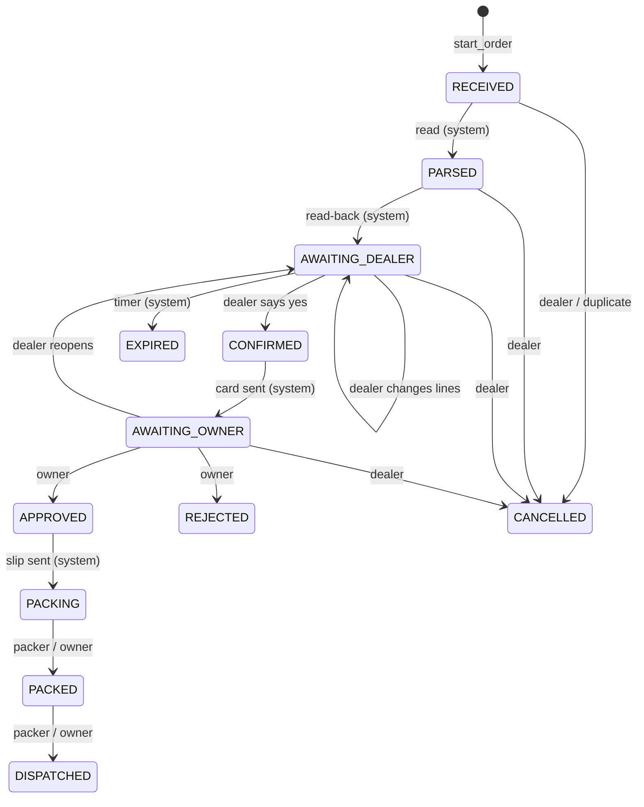

# 4. Order states

The state machine is in [`domain/states.py`](../src/order_desk/domain/states.py).
Every state change goes through `check_transition()`. A move that is not in the
table fails, whatever a model asks for.

## 4.1 Why each state exists

| State | Meaning | Stock |
|---|---|---|
| RECEIVED | The photo or text arrived. Nothing is read yet. A crash here is harmless. | not touched |
| PARSED | Lines are read and matched. A short, internal step. | checked, not held |
| AWAITING_DEALER | The read-back is with the dealer. Expires after `DEALER_CHECK_HOURS`. | not held |
| CONFIRMED | The dealer said yes. | **reserved** |
| AWAITING_OWNER | The approval card is with the owner. Reminders every `OWNER_REMINDER_HOURS`. | reserved |
| APPROVED | The owner said yes. Prices are fixed, the bill is made. | **removed** |
| PACKING | The packing slip is with the team. | removed |
| PACKED | The team finished. The dealer is told. | removed |
| DISPATCHED | Left the shop. The demo can end at PACKED. | removed |
| REJECTED / EXPIRED / CANCELLED | Final. Reservations are released. | released |

## 4.2 Who may move an order

| Move | Allowed actors |
|---|---|
| RECEIVED -> PARSED -> AWAITING_DEALER | system |
| AWAITING_DEALER -> AWAITING_DEALER (edit) | dealer, system |
| AWAITING_DEALER -> CONFIRMED | dealer |
| CONFIRMED -> AWAITING_OWNER | system |
| AWAITING_OWNER -> AWAITING_DEALER (reopen) | dealer |
| AWAITING_OWNER -> APPROVED / REJECTED | owner |
| APPROVED -> PACKING | system |
| PACKING -> PACKED, PACKED -> DISPATCHED | packer, owner |
| AWAITING_DEALER -> EXPIRED | system |
| early states -> CANCELLED | dealer (system for a duplicate photo) |

## 4.3 Edge cases and the state change that handles each

| Edge case | Handling |
|---|---|
| The photo never arrives (network) | Nothing is created, and nothing can be. The fix is a fast reply: the reference runtime sends "Got your chitti" from code at once, and Hermes replies with the read-back. No reply tells the dealer to send again. |
| The same file sent two times | Same SHA-256 from the same dealer within 24 h -> the new order goes RECEIVED -> CANCELLED (duplicate). |
| The same chitti photographed again | Similar SKUs (Jaccard >= 0.8) within 6 h -> `possible_duplicate_of`; the read-back asks "is this a new order?". |
| Chitti on two photos | `read_chitti_photo(append=true)` adds lines while AWAITING_DEALER. |
| Unclear line, tick, strike, ditto mark | Line status `unclear`; `confirm_order` refuses until the dealer answers. |
| "Yes" while two orders are open | The agent asks for the order number (instructions). |
| Reply after the deadline | EXPIRED; the dealer sends the chitti again. |
| Change after confirming | `reopen_order`: AWAITING_OWNER -> AWAITING_DEALER, stock released, owner told. |
| "Add 2 more" after approval | A new order with `linked_order_id`. |
| Two dealers want the last units | `BEGIN IMMEDIATE` + reservation: the second confirm sees the line as `short`. |
| Owner changes quantities | Approval edits are listed in the dealer's message. |
| Owner silent | Reminders; the order waits in AWAITING_OWNER. |
| Blocked dealer | `start_order` refuses. No order is created. |
| Approval sent two times | The second call returns "already approved"; stock is removed once (unique index). |
