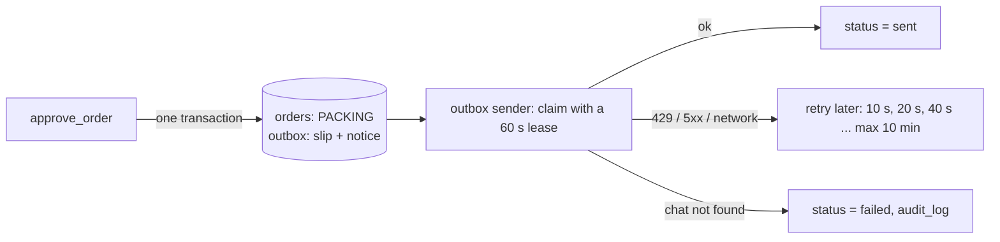

# 6. Reliability

This guide explains how the system stays correct when two things happen at
the same time, when a call is repeated, and when the laptop stops.

## 6.1 One writer at a time: `BEGIN IMMEDIATE`

Every write runs inside `db.write()`, which starts with `BEGIN IMMEDIATE`.
SQLite then takes its write lock at the start of the transaction. A second
writer waits (up to 10 s) until the first one commits.

This does the same job as a Postgres advisory lock (`pg_advisory_xact_lock`,
often keyed with `hashtext(...)`). Example: two dealers confirm the last five
fans at the same moment. The first transaction reserves them. The second one
starts after the commit, sees `sellable = 0`, and marks its line `short`.

**Rule:** never call the network inside `db.write()`. The tools do this:

```text
short transaction (check)  ->  network (download, model)  ->  short transaction (write)
```

The second transaction checks the order `version`. If somebody changed the
order in the meantime, it raises `conflict` and writes nothing.

## 6.2 Repeated calls (idempotency)

A model or a network can repeat a call. Each tool is safe to repeat:

| Tool | How |
|---|---|
| `start_order` | Unique `idempotency_key` = dealer + Telegram message ID |
| `read_chitti_photo` | If the order is already read, return the existing read-back (no second model call) |
| `confirm_order`, `approve_order` | If the order is already past that state, return "already done" |
| stock removal | Unique index on (order, SKU) for `order_deduct` |
| `apply_stock_in` | Unique supplier + invoice number; an applied draft returns "already added" |
| `record_payment` | `idempotency_keys` row for `payment_ref` |
| messages | Unique `outbox.dedupe_key` |

## 6.3 No lost messages: the transactional outbox

A tool writes the state change AND the message rows in the same transaction.
The outbox sender sends them later:



Delivery is **at-least-once**. Telegram has no "exactly once" API. If the
sender dies after Telegram accepted a message but before the row is marked
`sent`, the message is sent again after the lease ends. The lease keeps this
window short.

## 6.4 SIGTERM and crashes

| What happens | Result |
|---|---|
| SIGTERM / Ctrl-C to a worker | The handler only sets a flag. The worker finishes the current item, gives back its other leased rows at once, then stops. |
| SIGTERM to the MCP server | uvicorn stops new requests and lets running requests finish (20 s limit). |
| Power cut, `kill -9` | No handler runs. Leases end by time; the next start claims those rows again. |
| Crash during `read_chitti_photo` | The order stays RECEIVED and holds no stock. The next call reads again. The scheduler logs orders stuck in RECEIVED. |
| Crash during `approve_order` | The transaction rolls back. Nothing is half-done: no stock removed without a bill, no bill without a message. |
| Laptop off for a night | At start, the scheduler runs every job once: expired orders are closed and reminders are sent. |

All timed jobs are written so that running them two times does the same as
running them one time. So "recover on boot" is simply "run every job now".

## 6.5 Backups

The whole business is one SQLite file (`data/order_desk.sqlite3`). Copy it
every day while the system runs. SQLite's online backup is safe during writes:

```bash
sqlite3 data/order_desk.sqlite3 ".backup 'data/backup-$(date +%F).sqlite3'"
```
