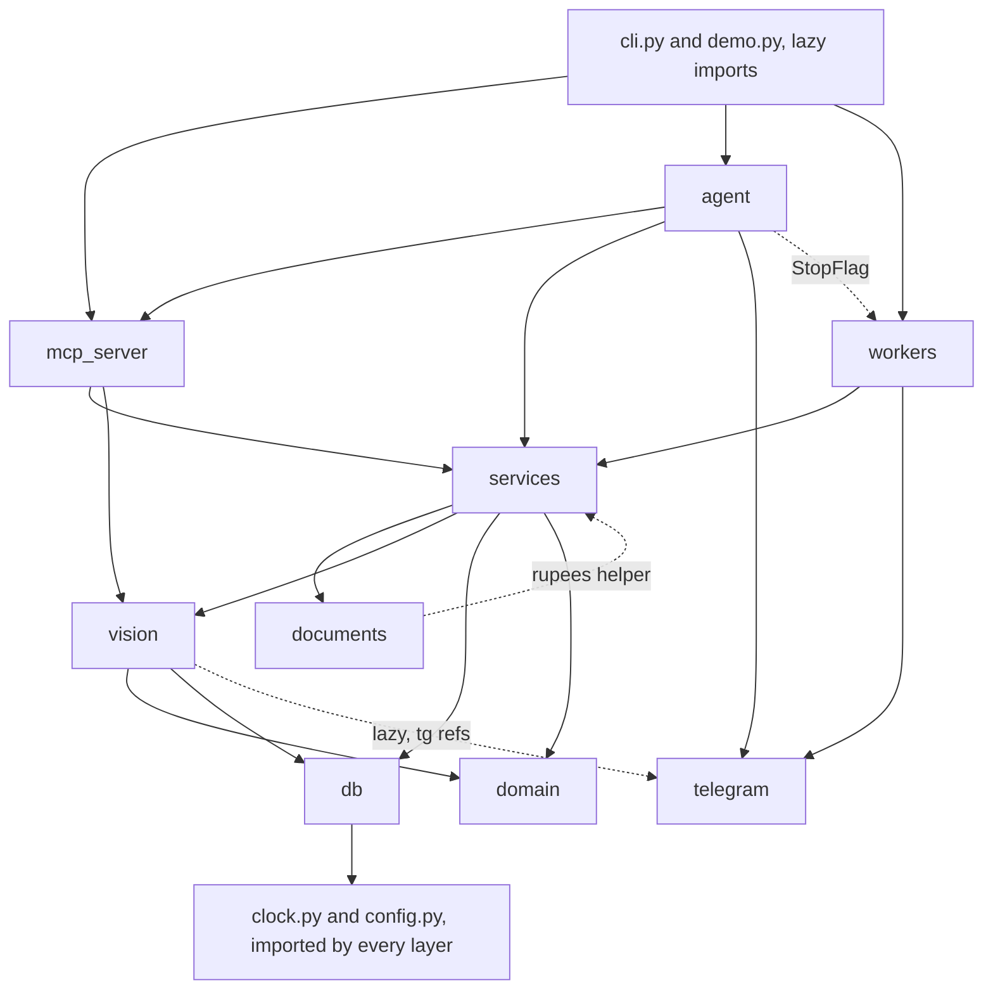

# Change Guide

> Verified against code on 2026-10-26 · Scope: conventions, tests, evals, decisions and reliability rules, FEEDBACK.md status, change recipes, gotchas, definition of done · Related: [CODEBASE_MAP](CODEBASE_MAP.md), [DOMAIN_AND_DATA_MODEL](DOMAIN_AND_DATA_MODEL.md), [DATA_FLOW](DATA_FLOW.md), [AGENT_MCP_AND_VISION](AGENT_MCP_AND_VISION.md), [RUNTIME_AND_OPERATIONS](RUNTIME_AND_OPERATIONS.md), [KNOWN_ISSUES](KNOWN_ISSUES.md)

Before you change a schema, a state, a tool or a message, read §6 (what to touch) and §7 (gotchas).

## 1. Conventions (verified in code)

### 1.1 Layering and imports



| Rule | Evidence |
|---|---|
| `domain/` is pure. It imports only `domain/*`: no DB, no I/O, no clock. | `domain/states.py`, `domain/chitti.py`, `domain/catalog_terms.py`, `domain/errors.py` |
| These modules import nothing from the package. | `clock.py`, `config.py`, `db/connection.py`, `telegram/bot_api.py` |
| **conn helpers** take an open `sqlite3.Connection`. They never open or commit a transaction and never call the network. | `services/orders.py`, `stock.py`, `credit.py`, `pricing.py`, `outbox.py` `enqueue()`/`notify_staff()`, `matching.py` `load_products()` |
| **Facades** have one method per user action. A method opens `db.read()`/`db.write()`, checks the caller, combines helpers and queues messages. | `services/dealer_desk.py` `DealerDesk`, `services/shop_desk.py` `ShopDesk` |
| Shared dependencies are built once. | `services/deps.py` `Deps.build()`: settings, `Database`, two `ImageResolver`s, and a `TokenFactoryReader` made on first use |
| The tool layer is thin. It holds only argument types and descriptions. | `mcp_server/tools.py` `dealer_tools()`, `shop_tools()` |
| Both runtimes use one tool list. | `agent/loop.py` `openai_tool_schemas()` reuses `mcp_server/server.py` `build_mcp()` |
| Existing cross-edges. Do not add more. | `documents/catalog_pdf.py` → `services.pricing.rupees`; `services/shop_desk.py` imports the private `services.matching._convert_quantity` |

### 1.2 Naming
| Thing | Pattern | Where |
|---|---|---|
| Money | DB `*_paise` INTEGER; views `*_rupees` (`/ 100.0`); tool args `price_rupees`/`amount_rupees` → `_rupees_to_paise()`; percent as basis points `percent_bp` | `db/schema.sql`, `services/shop_desk.py` |
| Time / JSON columns | `*_at` TEXT `YYYY-MM-DDTHH:MM:SSZ`; `*_json` TEXT, decoded by `orders.get_lines()` into `item` and `candidates` | `db/schema.sql`, `services/orders.py` |
| Actor labels | `system`, `dealer:<telegram id>`, `staff:<telegram id>` (in `order_events`, `stock_movements`, `audit_log`, `supplier_invoices.created_by`) | `services/*_desk.py` |
| Idempotency keys | order `dealer:<dealer_id>:src:<source_ref>`; payment `payment:<payment_ref>` | `orders.create()`, `ShopDesk.record_payment()` |
| Outbox dedupe keys | `<event>:<order_id>[:<version>]`, e.g. `approval:`, `packing:`, `approved:`, `rejected:`, `packed:`, `expired:`, `reminder:<id>:<bucket>`, `withdrawn:<id>:<version>`, `catalog:<tg>:<YYYY-MM-DDTHH>`, `chart:<file>`; `notify_staff()` adds `:<chat_id>` | facades, `services/maintenance.py` |
| SKU | `CATEGORY-SPEC-BRAND` in upper case, e.g. `WIRE-1.5-RED-FINOLEX`, `SW-6A-ANCHOR` | `db/seed_data/catalog.csv` |
| Caller-ID parameter | `telegram_user_id` (dealer) / `staff_telegram_user_id` (shop). It is the first argument of every method that needs to know the caller. These names are load-bearing (§7). | facades, `mcp_server/tools.py` |
| Private helpers / tests | `_name` module functions; tests are `test_<rule as a sentence>` | everywhere |

### 1.3 Types and data shapes
- `from __future__ import annotations` is in every module except `__init__.py` and `domain/errors.py`. Unions use PEP 604 (`X | None`); generics use built-ins (`list[dict]`).
- `@dataclass(frozen=True)` value objects: `Settings`, `StockLevel`, `CreditSummary`, `Product`, `StoredImage`, `ToolSpec`. Mutable `@dataclass`: `ChitLine`, `ChitReading`, `MatchResult`, `InvoiceReading`, `OutboxMessage`, `Deps`, `Trace`.
- `typing.Protocol` marks the parts that tests swap: `vision/reader.py` `Reader` and `workers/outbox_sender.py` `Sender`. A fake needs no base class.
- `State` and `Actor` are `(str, Enum)`. The DB stores `.value`. Pydantic appears only at the tool boundary (`Annotated[T, Field(description=...)]`). There are no pydantic models and no TypedDicts.
- A DB row becomes a dict with `dict(row)`. Facade results are plain dicts with `"ok": True`, plus a `message` written for people.

### 1.4 Database access
- Use raw SQL with `?` placeholders through `db/connection.py` `Database`:
  - `read()` has no transaction.
  - `write()` runs `BEGIN IMMEDIATE` … `COMMIT` and rolls back on any exception.
  - `read_only()` opens with `mode=ro` plus `query_only`. It is for text-to-SQL only.
- Each call opens a new connection with `row_factory=sqlite3.Row`, `foreign_keys=ON` and `busy_timeout=10000`. `initialize()` sets WAL mode.
- IN-lists use `",".join("?" * len(xs))`: `stock.levels()`, `orders.product_names()`, `invariants._marks()`.
- An order changes state only through `orders.transition()`. It checks the state machine, runs the optimistic `version` check (a mismatch raises `Conflict`) and writes `order_events`.
- Idempotency comes from UNIQUE constraints plus `INSERT OR IGNORE` / `ON CONFLICT … DO UPDATE`. Stock is append-only through `stock.add_movement()`; no code runs UPDATE or DELETE on `stock_movements`. The only DELETE is in `orders.replace_lines()`.

### 1.5 Errors
- Raise subclasses of `domain/errors.py` `OrderDeskError`: `NotFound`, `NotAllowed`, `IllegalTransition`, `InvalidInput`, `NotEnoughStock`, `Conflict`, `ExternalServiceError`. Give each a message a person can read. Each class has a `code` and `to_dict()`.
- `mcp_server/tools.py` `_safe()` turns them into `{"ok": False, "error": code, "message": ...}`. Any other exception is logged and returns `internal_error`.
- Two soft failures come back as a return value:
  - `DealerDesk.confirm()` returns `ok: False, error: "needs_dealer_answer"` and commits the `short` marks. The `NeedsDealerAnswer` class is never used.
  - Another dealer's order raises `NotFound`, not `NotAllowed` (`orders.order_owned_by()`), so a dealer cannot tell that the order exists.
- Telegram failures raise `TelegramError(retryable=...)`. The outbox then decides whether to retry or give up.

### 1.6 Time, money, quantity
- **Time.** Use only `clock.now()`, `now_iso()`, `iso_in()`, `from_iso()` and `to_iso()`. Tests freeze the clock with `set_clock()`. Exceptions: trace timing in `agent/loop.py` (`time.time()`), the query time limit in `services/reports.py` (`time.monotonic()`), and the `v_dealer_credit` view, which uses SQLite `'now'` (§7).
- **Money.** Store INTEGER paise. Show it only through `services/pricing.py` `rupees()`, which uses Indian grouping (₹1,23,456.78). Discounts use integer maths: `amount * percent_bp // 10_000` (`services/credit.py`).
- **Quantity.**
  - The DB stores INTEGER sell units: `order_lines.qty`, `reservations.qty`, `stock_movements.qty_delta`.
  - The model returns a float in `ChitLine.quantity`. `matching._convert_quantity()` converts it: a box becomes `pack_size` units, and only whole numbers pass.
  - Tool input goes through `orders._valid_qty()` and `shop_desk._positive_int()`.

### 1.7 Logging, config, comments, formatting
- Each module has `log = logging.getLogger(__name__)`. Only the process `main()` functions call `logging.basicConfig`: `mcp_server/server.py`, `workers/outbox_sender.py`, `workers/scheduler.py`, `agent/dev_bot.py`. Only `cli.py`, `demo.py` and the evals use `print`.
- Only `config.py` reads `os.environ`. `load_settings()` loads `.env` without overriding variables that are already set. Code reads `deps.settings.<field>`. Tests build `Settings(...)` directly or use `dataclasses.replace`.
- Each module starts with a docstring that explains *why*, in short ASD-STE100-style sentences, and often links `docs/0N-*.md`. Sections use ruler comments: `# ===== name` / `# ----- name`. Text for people follows the same style (see the `services/messages.py` docstring).
- No formatter, linter or type checker is configured (none in `pyproject.toml`, no config files). The code uses 4-space indents and double quotes. Lines are mostly ≤120 characters (the longest is 165). Imports that must follow `sys.path` or `matplotlib.use` get `# noqa: E402`.

## 2. Testing

### 2.1 Run the tests
| What | Command (from the repo root; `pyproject.toml` sets `testpaths=["tests"]`, `pythonpath=["src"]`) |
|---|---|
| Setup | Use Python ≥3.11 (`requires-python`): `python3 -m venv .venv && . .venv/bin/activate && pip install -e ".[dev]"` (`make install`). Verified on this Mac on 2026-10-27: `/opt/homebrew/bin/python3.13 -m venv .venv && .venv/bin/python -m pip install -q -e ".[dev]"` (23 s) |
| All | `python3 -m pytest -q`. `make test` runs a bare `pytest -q`, so it uses whichever `pytest` is first on PATH. |
| One file | `python3 -m pytest -q tests/test_order_flow.py` |
| One test | `python3 -m pytest -q tests/test_order_flow.py::test_approve_twice_deducts_once` |
| One param case | `python3 -m pytest -q "tests/test_readonly_sql.py::test_dangerous_or_off_limits_sql_is_refused[DROP TABLE orders]"` |
| By keyword | `python3 -m pytest -q -k reopen` |

**Baseline (2026-10-27):** Python 3.13.7 in `.venv`, installed with the Makefile steps (`PY=python3.13`): `pytest` 9.1.1, `mcp` 2.3.0, `openai` 3.39.0, `reportlab` 5.1.0, `matplotlib` 3.11.2, `pillow` 13.0.0. `.venv/bin/python -m pytest -q --tb=line` gave **84 passed, 0 failed** in 4.3 s before any change, and **86 passed, 0 failed** in 3.3 s after the KI-001 fix and its two tests (`MPLCONFIGDIR` pointed at a temp folder for these runs). After the live-run fixes (KI-066 to KI-069) the suite went from **125 passed** to **159 passed, 0 failed** in about 4 s (34 new tests in `tests/test_pending_work.py` and `tests/test_dev_bot.py`). The 84 matches the ids in the old `.pytest_cache`. The default `python3` (pyenv 3.10.0) still cannot run the suite (`No module named 'reportlab'` while importing `tests/conftest.py`) and `make install` without `PY=` still fails (KI-055). Before the venv, none of the interpreters at 3.11 or newer on this Mac had the dependencies, and `uv` is not installed.

The suite is hermetic by design:
- each test gets a temp DB under `tmp_path`;
- no test calls a model or Telegram;
- `tests/test_mcp_http.py` starts uvicorn on a free `127.0.0.1` port (loopback only).

Side effects outside `tmp_path`:
- the eval tests leave `tempfile.mkdtemp()` folders behind;
- matplotlib may write its font cache (set `MPLCONFIGDIR` to prevent this);
- `evals/common.py` `fresh_deps()` loads the repo `.env` if the file exists.

### 2.2 Fixtures and fakes (`tests/conftest.py`)
| Name | What it gives |
|---|---|
| `fixed_clock` | `clock.set_clock()` set to 2026-10-25 06:00 UTC. Move time with `fixed_clock["now"] += timedelta(...)`. Teardown calls `reset_clock()`. |
| `deps` | `Settings` with every path under `tmp_path`. `Deps.build(settings, reader=FakeReader(), allow_local_files=True)` → `initialize()` → `seed_demo()`. **At teardown it asserts `services/invariants.py` `check(db) == []`.** |
| `dealer`, `shop` | `DealerDesk(deps)`, `ShopDesk(deps)` |
| `photo` | Factory. Each call writes a unique JPEG and returns `file:<path>`. |
| `FakeReader` | Queues `chits` / `invoices` and pops one per call. `calls` counts model calls. If no reading is queued, the test fails with IndexError. |
| `line()`, `reading()` | Build a line dict in the model's shape and a `ChitReading` (`ChitReading.from_model_json`) |
| `stock_of()`, `outbox_rows()` | A `v_stock` row and all `outbox` rows as dicts |
| Constants | `OWNER`, `PACKER` (seeded as staff from `Settings`), `RAMESH` (active), `SURESH` (one overdue bill), `VENKAT` (blocked). The dealers are seeded from `db/seed_data/dealers.csv`. |

Fakes in the test files:
- `test_agent_loop.py` `ScriptedModel`: a fake OpenAI client.
- `test_reliability.py` `RecordingSender`: a Telegram `Sender`.
- `test_images.py` `FakeNemohermes`: the subprocess runner.
- `test_evals.py` `LabelReader`, `LazyReader`, `SqlOracle`, `RuleAgentAndDealer`.

No test uses `unittest.mock`. `monkeypatch` changes only module constants: `reports.TIME_LIMIT_S`, `evals.common.RESULTS`. Async code runs through `asyncio.run` inside sync tests; there is no pytest-asyncio.

### 2.3 What each test file covers
| File (tests) | Behaviour / modules |
|---|---|
| `test_order_flow.py` (19) | Chitti → read-back → confirm → approve → pack. Stock only after approval; idempotent start and read; same-file and similar-chitti duplicates; unclear lines block confirm; short stock; ownership; packer cannot approve; overdue credit on the card; owner edits; approve twice; reject and reopen release stock; confirm again after a reopen (same SKU, changed quantity, removed and new SKUs, two rounds; KI-001); illegal pack; the last units. Modules: `DealerDesk`, `ShopDesk`, `orders`, `stock`, `credit.summary`, `messages`, `outbox`. |
| `test_stock_in.py` (8) | Invoice draft → `update_stock_in` → `apply_stock_in` (once only); duplicate invoice → `Conflict`; pack-unit questions; missing supplier or number; packer refused; `adjust_stock`; `record_payment` idempotency |
| `test_matching.py` (12) | `matching.match_line()` statuses and notes (brand codes, default brand, unknown brand, missing colour, unit conversion and refusal, strike, fractions); `ChitReading.from_model_json()` cleans fenced JSON and bad values |
| `test_readonly_sql.py` (16) | `reports.run_readonly_query()` guards: views only, no writes/PRAGMA/ATTACH/`sqlite_master`/extensions/2 statements, time limit, 200-row limit; owner-only `run_query`; `make_chart` → outbox photo |
| `test_reliability.py` (8) | `outbox` dedupe, `claim_due` lease and crash recovery, backoff, permanent failure; `outbox_sender.run_batch()` with `StopFlag`; `maintenance.expire_unconfirmed_orders()` and `remind_owner()` |
| `test_images.py` (6) | `ImageResolver` `sandbox:` path guard and `nemohermes download` runner; copy failure → `ExternalServiceError`; `file:` refused in the server |
| `test_mcp_http.py` (6) | `create_app()`: `/health`, `BearerAuth` 401s, scope separation, a tool call through the official MCP client, error dict, `/uploads` |
| `test_agent_loop.py` (4) | `openai_tool_schemas()` hides the identity param; `ToolAgent` puts in the real caller ID, converts "999" → int, returns `unknown_tool` |
| `test_invariants.py` (1) | `invariants.check()` finds stock removed without approval and an illegal move |
| `test_evals.py` (6) | The eval harness itself (§3.4) |

**Untested or weakly tested:**
- `vision/reader.py` `TokenFactoryReader`: `_ask` JSON retry, `_json_object`, `prepare_image`.
- `vision/prompts.py`; `telegram/bot_api.py` (`_split`, mapping of retryable errors).
- `ImageResolver._from_telegram`/`_from_upload`.
- `documents/catalog_pdf.py`.
- `agent/dev_bot.py`, `agent/skills_export.py`, `cli.py`, `demo.py`.
- `config.load_settings()`.
- worker `main()` loops; `maintenance.report_stuck_reads()`/`run_once()`.
- fixed reports in `services/reports.py`; `pricing` dealer-price override.
- Never called in tests:
  - `DealerDesk`: `register`, `search_catalog`, `send_catalog`, `read_text_order`, `cancel`, `read_chit(append=True)`, linked orders.
  - `ShopDesk`: `list_orders`, `order_details`, `mark_dispatched`, `set_dealer_status`, `set_dealer_price`, `dealer_bills`, `add_product`, `add_alias`, `discard_stock_in`, `report`, `describe_views`.

pytest does not run the golden matcher set; run `python3 -m evals.run_matching`.

### 2.4 Writing a new test (house pattern)
```python
from conftest import OWNER, RAMESH, line, outbox_rows, reading, stock_of

def test_rule_in_one_sentence(dealer, shop, deps, photo, fixed_clock):
    deps.reader.chits.append(reading(line("6A sw - 10", "switch", {"rating_amp": 6}, "Anchor", 10, "nos")))
    order_id = dealer.start_order(RAMESH, "photo", "msg-new")["order_id"]
    dealer.read_chit(RAMESH, order_id, photo())
    assert dealer.confirm(RAMESH, order_id)["state"] == "AWAITING_OWNER"
    assert stock_of(deps, "SW-6A-ANCHOR")["reserved"] == 10
```
- Test one rule per test. Name the test after the rule and give the module a docstring.
- Call the facades directly. Errors raise, so use `pytest.raises(NotAllowed)`. Use the MCP or agent layers only to test the tool boundary.
- Use fakes, not mocks. Move time with `fixed_clock`. Assert on DB views and `outbox_rows()`. The `deps` teardown checks invariants for you.

## 3. Evals (`evals/`, run as modules from the repo root)

| Runner | Measures | Inputs | Metrics (rule) | Run | Needs |
|---|---|---|---|---|---|
| `run_chit_reader` | Vision model: each field of a reading, then the order lines after matching | `golden/labels/*.checked.json` (plus `*.example.json` with `--include-examples`) and `golden/chits/<chit_id>.*` | line_recall, line_precision, text_similarity, qty/item_accuracy, **order_line_accuracy**, clarify_recall, **unsafe_accept_rate (must be 0)**, decision_accuracy, chitti_pass_rate, avg_seconds | `python3 -m evals.run_chit_reader [--include-examples] [--model ID] [--limit N]` | network, `NEBIUS_API_KEY`, paid calls (inferred) |
| `run_matching` | `matching.match_line()`: status, SKU, quantity | `golden/matching.jsonl` (41 cases: ok 25, unclear 11, assumed 3, unmatched 2) | accuracy, accuracy_<status> (docs/07: must stay 41/41) | `python3 -m evals.run_matching` (`make eval-offline`) | nothing (offline, seconds) |
| `run_text2sql` | Agent model: question → one SELECT → result rows (row order, column names and float rounding ignored) | `golden/text2sql.jsonl` (12) run on the history from `scenario.build_history()` | execution_accuracy, valid_sql_rate, refused_rate (should be 0) | `python3 -m evals.run_text2sql [--model ID]` | network, key, paid (inferred) |
| `run_conversations` | Reference agent plus a simulated dealer, ≤8 turns (`MAX_TURNS`). Code checks the DB and the trace. | `golden/conversations.jsonl` (10) | task_success_rate, **confirm_violations (0)**, **invariant_failures (0)**, readback_fidelity, avg_turns/tool_calls/seconds, invalid_argument_calls | `python3 -m evals.run_conversations [--only ID] [--model] [--sim-model]` | network, key, paid (inferred) |
| `scenario.py` | Not a runner. It builds a fixed history through the real facades: orders in PACKED/PACKING/AWAITING_OWNER/AWAITING_DEALER/REJECTED, a stock-in, and a shelf count that makes `EXH-CROMPTON` low. It defines `QueueReader`. | — | — | imported | — |
| `make_review.py` | Writes `golden/review.html`: each image next to its label | labels + chits | — | `python3 -m evals.make_review` | nothing |
| `report.py` | Writes `results/SCORECARD.md` from the last two runs in each `results/<eval>/history.jsonl`; `LOWER_IS_BETTER` decides better/WORSE | history files | — | `python3 -m evals.report` (`make scorecard`) | nothing |
| `common.py` | Paths (`GOLDEN`, `RESULTS`), adds `src` to `sys.path`, `read_jsonl`, `fresh_deps()` (seeded DB in a temp folder, settings from `REPO/.env`, default owner and packer IDs that must equal `scenario.py` `OWNER`/`PACKER`), `Run`, `ratio()` | — | — | imported | — |

- **Outputs:** each run writes `evals/results/<eval>/<UTC stamp>/results.jsonl` (one line per case, with the reason) and `summary.json`, and appends a line to `history.jsonl`. Git ignores all of `evals/results/*` except `SCORECARD.md`.
- **No thresholds in code.** Each `main()` returns a summary, and the process exits 0 even when a "must be 0" metric is not 0.
- **State today:** only draft labels exist (`labels/*.example.json`, 15 files; each `_note` says Claude wrote it from the image and a person must check it) and there is no `*.checked.json`. So `run_chit_reader` without `--include-examples` exits with "No labels found", and with it the scores would compare the model with unchecked drafts. `SCORECARD.md` still shows the matcher run with **40** cases (2026-10-25); `matching.jsonl` now has 41.
- **Run log, 2026-10-27** (one run each, no retries, no paid tokens spent):
  - `python -m evals.run_matching`: **41 of 41** cases pass (accuracy 1.0; ok, unclear, assumed and unmatched all 1.0), offline, 0 s. Written to `evals/results/matching/20261027-045853/`. `SCORECARD.md` was not regenerated (`python -m evals.report`).
  - Before any paid run: a free `GET https://api.tokenfactory.nebius.com/v1/models` with the key returned 200 and 30 models. `VISION_MODEL=nvidia/Nemotron-3.5-Super-VL` is listed. `AGENT_MODEL=nvidia/Nemotron-3.5-Lightning` is not; the list has `nvidia/Nemotron-3_5-Lightning` (KI-059).
  - `run_chit_reader`: skipped, no checked labels (above). `run_text2sql` and `run_conversations`: skipped, the configured agent model is not listed and no other ID was substituted.

**Adding a golden case**
- **Matcher:** append `{"id", "line": <model-shaped line>, "expect": {"status", "sku"?, "qty"?}}` to `matching.jsonl` with a unique id. Run `run_matching`, then update the case counts in the README and docs/07.
- **Text2SQL:** append `{"id", "question", "reference_sql"}`. The reference SQL must pass the guard (views only). If the question needs new data, extend `scenario.build_history()` through the facades, not raw SQL. Run `test_evals.py`: the oracle test runs every case offline.
- **Conversation:** append `{"id", "dealer" (a seeded dealer ID), "reading" [lines], "persona", "truth", "goal", "expect": {"final_state", "lines": [{"line_index", "sku"|"qty"|"status"}], "must_call", "must_not_call"}}`, then run `--only <id>`.
- **Chitti:**
  1. Add `chits/<id>.png` and `labels/<id>.example.json`, following the format and 9 rules in `evals/golden/README.md`. Real images use the `real_` prefix.
  2. Run `make_review` and check the label against the image.
  3. Rename the label to `<id>.checked.json`. Do not do this to `easy_01` (§7).

**What `tests/test_evals.py` exercises (offline):**
- `run_chit_reader.evaluate()` with a perfect and a broken reader on `easy_01.example.json` (`limit=1`), and `similarity()`;
- `run_text2sql.evaluate()` with an oracle (accuracy 1.0) and a base-table query (refused 1.0);
- `run_conversations.run_scenario()` on `clean-confirm` (passes) and `cancel` (fails with "final state AWAITING_OWNER, expected CANCELLED").

It never runs `run_matching`, `make_review`, `report` or any `main()`.

## 4. Decisions and reliability rules, as rules for changes
| Rule (source) | Verified in code |
|---|---|
| SQLite is the only store, with one writer at a time (`docs/10` #1, `docs/06` 6.1) | `Database.write()` `BEGIN IMMEDIATE`, `timeout=10`. Moving to Postgres would need new versions of `write()`, the authorizer SQL guard (`set_authorizer`, `mode=ro`) and SQLite-only SQL. |
| The model reads, code decides, the owner approves (#2) | Only `ShopDesk.approve()` removes stock (`stock.deduct_for_order`), only for `_staff(..., OWNER)`, only through `TRANSITIONS[(AWAITING_OWNER, APPROVED)] = {OWNER}` |
| Two scopes, two tokens (#3) | `dealer_tools()` has 12 tools and `shop_tools()` has 22. `BearerAuth` checks per path prefix. A new tool goes into exactly one scope unless it is read-only (`search_catalog` is in both, so 12 + 22 = 34 registrations but 33 distinct tool names). |
| The matcher is deterministic (#4) | `services/matching.py` has no model call. Explain every non-ok status with a `note`. |
| Read-back before confirm (#5) | `messages.readback()` marks lines with `STATUS_MARK`. `confirm()` refuses while lines are unclear/unmatched/short. |
| One approval card, with stock and credit (#6) | `_send_approval_card()` uses dedupe key `approval:<id>:<version>`, so a confirm after a reopen sends a new card |
| Credit is shown, not enforced, except blocked or pending dealers (#7) | `orders.require_dealer_can_order()`. `credit_limit_paise` exists in the schema but no code uses it. |
| Stock movements are append-only (#8) | Correct a mistake with a new `adjustment` row (`ShopDesk.adjust_stock`) |
| Money in paise, time as UTC text (#9) | §1.6 |
| Transactional outbox (#10, 6.3) | Queue a message in the same `db.write()` as the change. The sender is at-least-once: `LEASE_SECONDS=60`, backoff `10·2^(n-1)` s with a 600 s cap, `MAX_ATTEMPTS=6`, then `failed` plus `audit_log`. |
| Stateless MCP behind an HTTPS tunnel (#11) | `streamable_http_app(stateless_http=True, json_response=True)`. The server serves plain HTTP on `MCP_HOST`. |
| Images by reference (#12) | `image_ref` takes `sandbox:` (main Hermes path), `tg:`, `up:`, or `file:` (tests only). Never put bytes in tool arguments: the request limit is 128 KB. |
| One instruction source (#13) | Edit `agent/instructions/*.md`, then run `order-desk export-skills`. The generated `hermes/*` files match the source today. |
| Evals check with code (#14, `docs/07` 7.1) | Keep new checks exact (state, SKU, rows). A model may play the dealer but never grades. |
| Never call the network inside `db.write()` (6.1) | Pattern: check transaction → resolve image / call model → write transaction with a `version` re-check (`read_chit()`/`_save_reading()`, `read_supplier_invoice()`, `send_catalog()`, `make_chart()`) |
| Every tool is safe to repeat (6.2) | Keys and "already done" results: `orders.create()`, `_already_read()`, `confirm()`, `approve()`, `ux_moves_order_deduct`, `UNIQUE(supplier, invoice_no)`, `idempotency_keys`, `outbox.dedupe_key` |
| SIGTERM stops a worker cleanly; every timed job is idempotent (6.4) | `StopFlag` sets a flag only. `run_batch()` → `release_leases()`. uvicorn `timeout_graceful_shutdown=20`. The scheduler runs `run_once()` at start. |

## 5. `FEEDBACK.md`: what it is and the status of each item
It is a hackathon feedback log for the vendors (NemoClaw, Token Factory, Hermes), not a task list for this repo. Many items have a workaround in the code.

| # | Item | Status in this repo | Evidence |
|---|---|---|---|
| 1 | How Hermes passes inbound media | Workaround done; not confirmed on a real bot (B6 is empty) | `vision/images.py` `_from_sandbox`, `SANDBOX_MEDIA_DIRS`; `ImageRef` description; `instructions/*.md` |
| 2 | Verified sender ID outside the model | Partly done: only the reference runtime hides and fills it. Under Hermes the model passes it. | `agent/loop.py` `openai_tool_schemas()`, `ToolAgent._execute()`; nothing in `BearerAuth`; roadmap #2 |
| 3 | Recipe for local MCP development | In docs and config: tunnel, `MCP_ALLOWED_HOSTS` → `TransportSecuritySettings` | `mcp_server/server.py` `create_app()`, `docs/08` |
| 4 | 128 KB MCP request limit | Done (decision #12) | `image_ref`, `POST /uploads` |
| 5, 8, 9, 11, 13 | Vendor docs, prices page, praise | No code action. #13 holds: the same `openai` client is used everywhere. | `vision/reader.py`, `agent/dev_bot.py`, `evals/run_*.py` |
| 6 / 6b / 7 | SOUL.md path / pairing / non-interactive onboarding | Scripted but not checked on a real machine (B1–B5 are empty) | `scripts/setup_nemoclaw.sh` `onboard()`, `instructions()` (uploads to `/sandbox/`), the pairing commands it prints |
| 10 | Model IDs vs display names | Mitigated: env overrides and `--model`. The default IDs are unverified. | `config.py` `vision_model`/`agent_model`, `VISION_MODEL`/`AGENT_MODEL` |
| 12 | Smaller OCR model | Not done. A swap is possible through `VISION_MODEL`. | `run_chit_reader --model` |
| 14 | A colon in a skill description breaks YAML | Done: the description is quoted. The repo has no SKILL.md validator. | `agent/skills_export.py` `json.dumps(DESCRIPTIONS[role])` |
| B1–B8 | Hands-on Mac setup table | Not filled in | `FEEDBACK.md` Part B |

## 6. Change recipes
Each recipe: **Touch** → **Verify** → **Docs**. Every recipe also ends with the checklist in §8.

**6.1 Add a DB column or table**
1. **Touch** `db/schema.sql`. Follow the conventions in §1.2 and §1.4: CHECK for enums, REFERENCES, UNIQUE for idempotency.
2. **Existing DBs.** `Database.initialize()` runs again each time `init`, `serve`, `sender`, `scheduler` or `devbot` starts. New tables, indexes and all views (they use DROP + CREATE) apply then. A **new column on an existing table does not** apply: there is no migration code, and `SCHEMA_VERSION` is written to `meta` but never read.
   - Add an idempotent upgrade in `Database.initialize()` *before* `executescript()`: check `PRAGMA table_info` (skip a table that does not exist yet), then run `ALTER TABLE … ADD COLUMN`. Then bump `SCHEMA_VERSION`.
   - Dev-only alternative: delete `data/order_desk.sqlite3` and run `order-desk init`. This deletes data.
3. Use the column in the conn helpers and expose it through a facade method. For text-to-SQL, add it to a `v_*` view. A new view also goes into `services/reports.py` `REPORT_VIEWS`, and its base tables into `_VIEW_BASE_TABLES`. If it is seed data, change `db/seed.py` and `db/seed_data/*.csv`.
4. A new must-hold rule goes into `services/invariants.py` `check()`, with a negative test in `tests/test_invariants.py`.
5. **Verify:** pytest (every test uses a fresh DB, so add an explicit upgrade test that builds the old shape in `tmp_path`), plus `run_matching`. If views changed, run `run_text2sql` (key). **Docs:** `docs/03-database-schema.md`, [DOMAIN_AND_DATA_MODEL](DOMAIN_AND_DATA_MODEL.md).

**6.2 Add an order state or transition**
1. **Touch** `domain/states.py`: the `State` member, the `TRANSITIONS` entry with its allowed `Actor`s, the groups `OPEN_FOR_DEALER`/`HOLDS_RESERVATION`/`FINAL` (no code reads them today), and the docstring diagram.
2. Grep for the state literals (`grep -rnE "RECEIVED|PARSED|AWAITING_|CONFIRMED|APPROVED|PACKING|PACKED|DISPATCHED|REJECTED|EXPIRED|CANCELLED" src evals`) and update:
   - `services/invariants.py`: `AFTER_APPROVAL`, `HOLDS` and the last query;
   - `ShopDesk.approve()`: the already-approved tuple;
   - `DealerDesk.profile()`, `start_order()` (linked parents) and `_same_file_recently()`;
   - `orders.similar_recent_order()`, `reports.today_summary()`/`pending_orders()`, the `maintenance.py` queries;
   - `evals/run_text2sql.py` `PROMPT` (the state list and the definition of "Sold"), `golden/text2sql.jsonl` (`mcb-sold`), and the `list_orders` description.
3. Make the move inside `db.write()` with `orders.transition(conn, order, State.X, Actor.Y, label)`. Handle reservations so that invariant 4 still holds. Queue the notice with a new dedupe key; the text goes into `services/messages.py`.
4. You need no schema change (`orders.state` has no CHECK). Never remove a transition that existing DBs have used: `invariants.check()` flags every stored `order_events` move.
5. **Verify:** `tests/test_order_flow.py`, with the legal path plus `pytest.raises(IllegalTransition)`. If the agent must know about the state, update the instructions and run export-skills. **Docs:** `docs/04-order-states.md`, [DOMAIN_AND_DATA_MODEL](DOMAIN_AND_DATA_MODEL.md).

**6.3 Add an MCP tool**
1. **Facade method** in `DealerDesk`/`ShopDesk`, with the caller ID as the first parameter.
   - Check permission: `_dealer()` + `orders.order_owned_by()`, or `_staff(conn, id, OWNER)` (or `ANY_STAFF`).
   - Make it safe to repeat. Return `{"ok": True, ...}`.
2. **Wrapper** inside `mcp_server/tools.py` `dealer_tools()` or `shop_tools()`.
   - Type each parameter as `Annotated[..., Field(description=...)]`. Reuse `DealerId`, `StaffId`, `OrderId`, `ImageRef`.
   - Write a short docstring: the model reads it. Mark owner tools with "OWNER ONLY".
   - Append the function to `fns`.
3. **The identity parameter must be named `telegram_user_id` (dealer) or `staff_telegram_user_id` (shop).** `ToolSpec.identity_param` finds it by name, and the reference agent hides and fills it.
4. You do not register the tool anywhere else: `create_app()` and `openai_tool_schemas()` read the same list. Take images only as an `image_ref`, and resolve the ref outside `db.write()`.
5. Describe when to call the tool in `agent/instructions/<role>.md`, then run `order-desk export-skills`. Live sandboxes need the skill installed and SOUL.md uploaded again (`scripts/setup_nemoclaw.sh` `instructions()`, inferred).
6. **Verify:**
   - a facade test;
   - the scope assertion in `test_mcp_http.py::test_dealer_scope_cannot_see_owner_tools`;
   - for dealer tools, `test_agent_loop.py`, and `run_conversations` when a key is available.
7. **Docs:** `docs/05-mcp-tools.md`, the tool counts in the README (12/22/34; the 34 counts `search_catalog` twice, so there are 33 distinct tools), [AGENT_MCP_AND_VISION](AGENT_MCP_AND_VISION.md).

**6.4 Add a service function**
- **Pure DB logic:** a conn helper in `services/orders.py`/`stock.py`/`credit.py`/`pricing.py`. It takes `conn` and has no transaction and no network.
- **User action:** a facade method. It opens the transaction, checks the caller, changes state only through `orders.transition()`, queues messages in the same transaction and raises `OrderDeskError`s. Use `clock` for time and paise for money.
- **Network** (model, Telegram, `nemohermes`): call it between two transactions, and re-check `version` in the second one (`DealerDesk.read_chit`).
- **Verify:** a facade test using `deps` (invariants are checked for you).

**6.5 Change a Telegram message or template**
1. **Touch** `services/messages.py`. Some texts are inline: the `DealerDesk.confirm/reopen/cancel` results, `ShopDesk._invoice_preview()`, and error strings such as `orders.require_dealer_can_order()`. Keep the ASD-STE100 style.
2. **Keep the commands in sync.** The commands printed on the approval card, the packing slip and the dealer request must match the "Short commands" table in `agent/instructions/shop.md`: `APPROVE <id>`, `REJECT <id> <reason>`, `APPROVE <id> with line 3 = 10`, `PACKED <id>`, `APPROVE DEALER`/`BLOCK DEALER`. "Reply YES" must match `dealer.md` rule 5.
3. **Coupled assertions:**
   - substrings in tests: `Reply YES`, `NEW ORDER`, `PACKING SLIP`, `is packed`, `OVERDUE`, `is approved`, `20 -> 15`, `already approved`, `order #N`, `closed`, `Reminder`, `+24`, `already`;
   - the exact blocked-dealer text in `test_mcp_http.py`;
   - the `demo.py` `_last_outbox()` search strings;
   - `run_conversations.readback_fidelity()`, which reads lines that match `^\d+\.`;
   - `test_evals.py` `RuleAgentAndDealer`, which looks for `Order #N` and `is confirmed`.
4. Telegram limits: `bot_api.send_message()` splits texts longer than 4000 characters, and captions are cut at 1000. Keep the `dedupe_key` formats the same.
5. **Verify:** pytest and `order-desk demo`; run `run_conversations` if the read-back changed. **Docs:** the README demo extract.

**6.6 Change matching logic**
1. **Touch:**
   - `services/matching.py` `match_line()`, `_spec_agrees()`, `_convert_quantity()` (stock-in also uses it), `_reader_doubt()`, `SPEC_WORDS`;
   - the vocabulary in `domain/catalog_terms.py`, which also feeds the vision prompt (`vocabulary_for_prompt()`), the filtering in `ChitReading.from_model_json()` and the allowed values in the golden README (update that README by hand);
   - the data in `db/seed_data/catalog.csv` (`spec_json`, `is_default_brand`, `pack_size`). Seeding runs only on an empty catalog, so existing DBs need `add_product`/SQL.
2. `product_aliases` do **not** affect matching. Only `search_products()` reads them.
3. Stock-in is stricter (`ShopDesk._insert_invoice_line()`): a line is ok only with status ok and certain units.
4. **Verify:** `pytest tests/test_matching.py tests/test_order_flow.py tests/test_stock_in.py`. Tests hard-code SKUs, stock counts and candidate counts, for example 6 mcb rows and 3 wire candidates. Then `python3 -m evals.run_matching` must stay 100%; add cases to `matching.jsonl`. Run `python3 -m evals.report` only after the run.

**6.7 Change the vision prompt**
1. **Touch** `vision/prompts.py` (chitti and invoice prompts). Change the same rule in `evals/golden/README.md` as well; the docstring of `prompts.py` requires it.
2. Keep the JSON shape the same as the label shape, which is parsed by `domain/chitti.py` `ChitReading.from_model_json()`/`_parse_line()`. Reader settings live in `vision/reader.py`: `temperature=0`, `max_tokens=4000`, one retry on bad JSON, `MAX_SIDE_PX=2000`.
3. **Verify:** `test_matching.py::test_model_json_with_fences_and_bad_values_is_cleaned` and `test_evals.py` (offline harness). Then run `python3 -m evals.run_chit_reader --include-examples` (key, paid): `unsafe_accept_rate` must stay 0. The invoice prompt has no eval.

**6.8 Add a worker or scheduled job**
- **Timed job:**
  1. Write an idempotent function `(db, settings)` in `services/maintenance.py` that uses `clock` and stable dedupe keys.
  2. Add it to `run_once()`. `workers/scheduler.py` logs only when `expired` or `reminders` is non-zero, so extend that condition.
  3. Test it like `test_reliability.py`: move `fixed_clock`, run the job twice, and assert that the second run changes nothing.
- **New process:**
  1. Write `workers/<name>.py` `main(settings)`: `logging.basicConfig`, `Database(...).initialize()`, `StopFlag().install()`, `while not stop.stopped: …; stop.sleep(n)`. Give back leased work on stop.
  2. Add `cmd_<name>` + a subparser in `cli.py` (lazy import), a `Makefile` target, and a line in `scripts/start_local.sh`.
  3. **Docs:** [RUNTIME_AND_OPERATIONS](RUNTIME_AND_OPERATIONS.md), `docs/06`.

**6.9 Add a config or env var**
1. **Touch** `config.py`: add a `Settings` field with a safe default (tests build `Settings(db_path=...)`), and a `load_settings()` line `e("NAME", "default")` with a type conversion (`int`, `_int_list`, comma split).
2. Add the name to `.env.example` with an empty value and a comment. Read it through `deps.settings`.
3. If the sandboxes need it, update `scripts/setup_nemoclaw.sh`.
4. **Verify:** set it in tests with `dataclasses.replace` (see the `test_mcp_http.py` `server` fixture). Never log `Settings`: its automatic repr includes the tokens. **Docs:** README step 2, `docs/08`.

**6.10 Add an eval or golden case:** see §3 "Adding a golden case". After the run, run `python3 -m evals.report` and commit the new `SCORECARD.md`.

## 7. Gotchas
1. **Existing DBs do not get upgraded** (§6.1). If an index or view in `schema.sql` names a column that an old DB does not have yet, `initialize()` fails, and the server, sender and scheduler do not start. `executescript` runs one statement at a time, so a failing view statement leaves that view dropped (inferred).
2. **Fixed 2026-10-27 (KI-001): reopen, then confirm again.** `stock.release()` only marks rows `released`, and `reservations` has `UNIQUE(order_id, sku)` over all statuses, so the old `reserve()` INSERT raised `IntegrityError` → `internal_error` on the second confirm. Now `reserve()` first makes the order's `released` row `active` again (new quantity) and INSERTs only a SKU the order never held. Any new writer of `reservations` must keep to one row per order and SKU for the order's whole life. Tests: `test_confirm_again_after_reopen_*` in `tests/test_order_flow.py`.
3. State names are copied as literals in ~12 places (§6.2), and the group constants in `states.py` are never used.
4. `v_dealer_credit` uses the SQLite clock `'now'`, so `fixed_clock` does not move it. `credit.summary()` uses `clock`. The two can disagree in tests.
5. Tool identity is found by parameter name (`tools.py` uses `__code__.co_varnames`). A shop tool with a parameter named `telegram_user_id` would **not** be hidden from the model.
6. `confirm()` reports unanswered lines as a return value (`ok: False`), not as an exception. Callers must check `ok`.
7. `tests/test_evals.py` hard-codes `labels/easy_01.example.json` and metric values that come from its 10 lines. Renaming it to `.checked.json`, as the labelling workflow says, breaks the test.
8. `python3 -m evals.report` builds the scorecard from `history.jsonl` files, which git ignores and which are missing now. If you run it before an eval, it overwrites the matcher numbers with "Not run yet".
9. The eval runners exit 0 whatever the metrics are. The evals read `REPO/.env` and must run as `python3 -m evals.X` from the repo root.
10. `agent/loop.py` depends on MCP SDK v2 internals (`mcp.server.mcpserver.tools.base.Tool.from_function(...).fn_metadata`); the pin is `mcp>=2.3,<3`. `tests/test_mcp_http.py` imports `httpx2`, which is not declared in `pyproject.toml` (unverified whether `mcp` brings it).
11. `tests/*` import helpers with `from conftest import ...`. This needs pytest's default (prepend) import mode, and pytest runs against `src/` through `pythonpath`, not an installed package.
12. The outbox gives up after 6 attempts, about 5 minutes in total (10+20+40+80+160 s), so a longer Telegram outage leaves rows `failed`. No tool re-queues them.
13. `record_payment` idempotency is global for each `payment_ref`, not per bill. If the same reference is given for another bill, the call returns the old result with `repeat: True`.
14. Relative defaults (`data/...`, `--env .env`) resolve against the current directory. `order-desk demo --workdir X` deletes X first (`shutil.rmtree`).
15. `outbox.claim_due()` uses `UPDATE … RETURNING`, which needs SQLite ≥3.35 (the bundled version here is 3.51.0).

## 8. Definition of done
- [ ] The change follows §1: layering, `clock`, paise, transactions with no network inside them, `orders.transition()`, outbox + dedupe key, `OrderDeskError`.
- [ ] `python3 -m pytest -q` passes on Python ≥3.11 with `.[dev]` (160 tests today plus yours). New behaviour has a test that names one rule.
- [ ] Matcher, catalog or vocabulary changed → `run_matching` is 100% and the golden set is updated. Prompt, instruction, tool-text or read-back changed → you ran the relevant paid eval and every "must be 0" metric is still 0, or you said clearly that it was not run.
- [ ] Instructions changed → `order-desk export-skills` and the regenerated `hermes/*` files are committed. Tools added → scope test and tool counts updated.
- [ ] Schema changed → an upgrade path exists for existing DB files (or a documented reset), plus views/`REPORT_VIEWS`. Env var added → `config.py` (both places) and `.env.example`.
- [ ] `order-desk demo` still runs offline. There are no secrets in code, docs or logs. `docs/0N-*.md` and `docs/codebase/*` are updated.

## Keep this doc current
- Update §2 when `tests/conftest.py`, the test files or `pyproject.toml` (pytest settings, dependencies, Python version) change. The baseline is recorded (159 passed on 2026-10-27); update the counts when tests are added.
- Update §3 when `evals/*.py`, golden file formats or the case counts change.
- Update §1, §6 and §7 when layering, `db/connection.py`, `domain/states.py`, `mcp_server/tools.py` identity handling or `services/messages.py` change, or when the migration gap (KI-043) is fixed (the reopen bug, KI-001, was fixed on 2026-10-27).
- Update §4 and §5 when `docs/06`, `docs/10` or `FEEDBACK.md` change.
