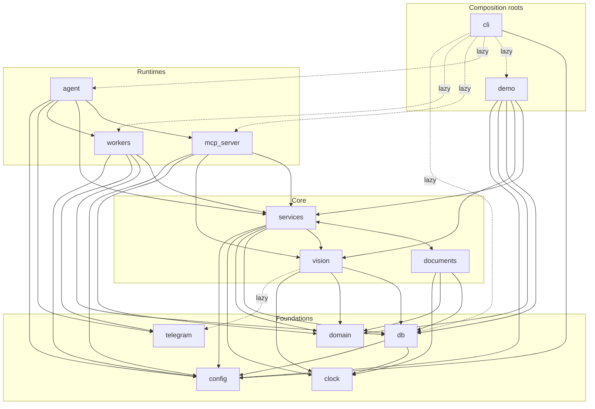

# Codebase Map

> Verified against code on 2026-10-26 · Scope: annotated tree, per-file index (LOC, symbols, importers), package dependency graph, "where is X?" lookups, non-code assets · Related: [RUNTIME_AND_OPERATIONS](RUNTIME_AND_OPERATIONS.md), [DOMAIN_AND_DATA_MODEL](DOMAIN_AND_DATA_MODEL.md), [AGENT_MCP_AND_VISION](AGENT_MCP_AND_VISION.md), [DATA_FLOW](DATA_FLOW.md), [CHANGE_GUIDE](CHANGE_GUIDE.md), [KNOWN_ISSUES](KNOWN_ISSUES.md)

**Size.** `src/order_desk`: 47 Python files, 4,869 LOC (+ `schema.sql` 372). `tests/`: 11 files, 1,155 LOC, 86 test cases (75 functions). `evals/`: 9 files, 833 LOC. Python >= 3.11, SQLite, no ORM.

**Conventions used below.** LOC = `wc -l`. Imports are absolute (`from order_desk.services import orders`); every sub-package `__init__.py` is empty, so there are no re-exports: import the concrete module. "Imported by" lists internal importers (function-level imports included); `T:x` = `tests/test_x.py` (or `conftest`), `E:x` = `evals/x.py`; braces group modules of one package.

## 1. Annotated directory tree

```text
chitti-order-desk 2/        repo root; NOT a git repo; has a .venv (Python 3.13.7, built 2026-10-27); the path has a space (quote it)
├── pyproject.toml          setuptools; deps; console script `order-desk`; pytest: testpaths=tests, pythonpath=src
├── Makefile                shortcuts (`make help`): init demo test serve sender scheduler local devbot-* skills eval-* scorecard
├── .env.example            template of every env var (real .env is git-ignored)
├── .gitignore              ignores .env, data/, evals/results/* (except SCORECARD.md), caches
├── README.md  FEEDBACK.md  LICENSE      pitch + quick start | hackathon feedback log | Apache-2.0
├── docs/01..10-*.md        human-written guides (one line each in section 6)
├── docs/codebase/          this knowledge base
├── scripts/                start_local.sh (init + serve + sender + scheduler in background, logs data/logs/)
│                           setup_nemoclaw.sh (creates the dealer-desk / shop-desk NemoClaw+Hermes sandboxes; sources .env)
├── hermes/                 GENERATED by `order-desk export-skills`; do not hand-edit
│   ├── dealer-desk/        SOUL.md, skills/dealer-desk/SKILL.md
│   └── shop-desk/          SOUL.md, skills/shop-desk/SKILL.md
├── src/order_desk/
│   ├── __init__.py  cli.py  config.py  clock.py  demo.py     version | `order-desk` command | Settings | "now" | offline demo
│   ├── domain/             states.py errors.py chitti.py catalog_terms.py       pure rules/data shapes, stdlib only
│   ├── db/                 connection.py schema.sql seed.py seed_data/{catalog,aliases,dealers}.csv
│   ├── services/           dealer_desk.py shop_desk.py (facades)  deps.py orders.py stock.py matching.py pricing.py
│   │                       credit.py messages.py outbox.py reports.py invariants.py maintenance.py
│   ├── vision/             images.py prompts.py reader.py                       image_ref -> bytes, prompts, model client
│   ├── documents/          catalog_pdf.py charts.py                             PDF + PNG generators
│   ├── mcp_server/         tools.py (tool registry) server.py (HTTP app + auth)
│   ├── agent/              loop.py dev_bot.py skills_export.py  instructions/{dealer,shop}.md (single source of persona/rules)
│   ├── telegram/           bot_api.py                                           Telegram Bot API client
│   └── workers/            lifecycle.py outbox_sender.py scheduler.py           background loops
├── tests/                  conftest.py + 10 test_*.py; offline; no __init__.py
├── evals/                  common.py scenario.py run_{matching,chit_reader,text2sql,conversations}.py report.py make_review.py
│   ├── golden/             chits/ (15 PNG), labels/ (15 draft JSON), matching|text2sql|conversations .jsonl, review.html, README.md
│   └── results/            SCORECARD.md (tracked); per-run folders are git-ignored
└── data/                   runtime only (git-ignored, absent in the repo): order_desk.sqlite3, uploads/, generated/, logs/, traces/, demo/
```

## 2. Entry points

| Command | Defined in | Starts |
|---|---|---|
| `order-desk init` | `src/order_desk/cli.py` `cmd_init` | `Database.initialize()` + `seed_demo()` (also (re)writes `staff` from env IDs) |
| `order-desk demo [--workdir D]` | `cmd_demo` | `demo.run_demo()`; deletes `D` (default `data/demo`) first |
| `order-desk serve` | `cmd_serve` | `mcp_server/server.py` `main()` -> `create_app()` + uvicorn |
| `order-desk sender` | `cmd_sender` | `workers/outbox_sender.py` `main()` |
| `order-desk scheduler` | `cmd_scheduler` | `workers/scheduler.py` `main()` |
| `order-desk devbot --role dealer` or `shop` | `cmd_devbot` | `agent/dev_bot.py` `main()` |
| `order-desk export-skills [--out hermes]` | `cmd_export_skills` | `agent/skills_export.py` `export()` |
| `order-desk new-token` | `cmd_new_token` | prints `secrets.token_hex(32)` |
| `make local` | `Makefile` -> `scripts/start_local.sh` | init, then serve + sender + scheduler in background |
| `python -m evals.<name>` | `evals/` | `run_matching` (offline), `run_chit_reader`, `run_text2sql`, `run_conversations` (need `NEBIUS_API_KEY`), `report`, `make_review` |
| `pytest -q` | `pyproject.toml` `[tool.pytest.ini_options]` | `tests/` |

Global CLI option: `--env <path>` (default `.env`) goes before the subcommand. Details: [RUNTIME_AND_OPERATIONS](RUNTIME_AND_OPERATIONS.md).

## 3. File index by package

### 3.1 Top level `src/order_desk/`

| File | LOC | Purpose | Key public symbols | Imported by |
|---|---|---|---|---|
| `__init__.py` | 6 | Package docstring + version. | `__version__` | - |
| `cli.py` | 106 | `order-desk` argparse entry point; every `cmd_*` imports its dependency lazily. | `main(argv)`, `cmd_init`, `cmd_demo`, `cmd_serve`, `cmd_sender`, `cmd_scheduler`, `cmd_devbot`, `cmd_export_skills`, `cmd_new_token` | - (console script `order_desk.cli:main`) |
| `config.py` | 110 | Frozen `Settings` (24 env-backed fields); `.env` parsed by `_load_dotenv` without overriding real env vars. | `Settings`, `load_settings(env_file)` | cli; demo; agent.dev_bot; db.seed; mcp_server.server; services.{deps,maintenance}; workers.{outbox_sender,scheduler}; E:common,run_chit_reader,run_conversations,run_text2sql; T:conftest,invariants |
| `clock.py` | 47 | The only source of "now" (UTC strings `%Y-%m-%dT%H:%M:%SZ`); replaceable for tests. | `now()`, `now_iso()`, `iso_in(hours,days,seconds)`, `to_iso`, `from_iso`, `set_clock(fn)`, `reset_clock()`, `ISO_FORMAT` | db.seed; documents.{catalog_pdf,charts}; services.{credit,dealer_desk,maintenance,orders,outbox,reports,shop_desk,stock}; vision.images; T:conftest,invariants |
| `demo.py` | 138 | `order-desk demo`: full offline walkthrough with canned readings; prints every message. | `run_demo(workdir)`, `StaticReader`, `HARD_01`, `INVOICE` | cli |

### 3.2 `domain/` (imports only inside `domain`; stdlib otherwise)

| File | LOC | Purpose | Key public symbols | Imported by |
|---|---|---|---|---|
| `states.py` | 88 | Order state machine. | `State`, `Actor`, `TRANSITIONS`, `check_transition(current,target,actor)`; unused: `OPEN_FOR_DEALER`, `HOLDS_RESERVATION`, `FINAL` | services.{dealer_desk,invariants,maintenance,orders,shop_desk} |
| `errors.py` | 48 | Error family; each has `code` and `to_dict()` (`{"ok": False, "error": code, "message": ...}`). | `OrderDeskError`, `NotFound`, `NotAllowed`, `IllegalTransition`, `InvalidInput`, `NotEnoughStock`, `Conflict`, `ExternalServiceError`, `NeedsDealerAnswer` (never raised) | documents.charts; domain.states; mcp_server.{server,tools}; services.{credit,dealer_desk,orders,pricing,reports,shop_desk,stock}; vision.{images,reader}; T:images,order_flow,readonly_sql,stock_in |
| `chitti.py` | 158 | Shape of one read chitti/invoice, shared with golden labels; tolerant JSON parser. | `ChitLine` (`needs_question`), `ChitReading` (`to_dict`, `from_model_json`), `MARKS`, `LEGIBILITY` | demo; services.{dealer_desk,matching,orders,shop_desk}; vision.reader; E:run_chit_reader,run_matching,scenario; T:conftest,evals,matching,stock_in |
| `catalog_terms.py` | 98 | The single vocabulary list: 21 categories, 5 units, 7 spec keys, 17 brands, brand/colour/unit code maps. | `CATEGORIES`, `UNITS`, `SPEC_KEYS`, `BRANDS`, `BRAND_CODES`, `COLOR_CODES`, `UNIT_CODES`, `normalize_brand`, `normalize_unit`, `vocabulary_for_prompt` | domain.chitti; services.shop_desk; vision.prompts |

### 3.3 `db/`

| File | LOC | Purpose | Key public symbols | Imported by |
|---|---|---|---|---|
| `connection.py` | 92 | New SQLite connection per call (FK on, busy timeout 10 s). `write()` = `BEGIN IMMEDIATE`, commit/rollback. `read_only()` = `mode=ro` + `query_only`. | `Database` (`initialize`, `read`, `write`, `read_only`), `SCHEMA_VERSION` | cli; db.seed; documents.catalog_pdf; services.{deps,invariants,maintenance,outbox,reports}; vision.images; workers.{outbox_sender,scheduler}; T:invariants |
| `schema.sql` | 372 | 19 tables + 5 `v_*` views; `CREATE ... IF NOT EXISTS`, views dropped and recreated on every init. | - | read by `Database.initialize` via `importlib.resources` |
| `seed.py` | 104 | Demo catalog, opening stock, aliases, dealers, staff, discount tiers (30 d 3 %, 60 d 2 %), opening bills. Re-run only refreshes staff. | `seed_demo(db,settings)` | cli; demo; E:common; T:conftest,invariants |

### 3.4 `services/`

| File | LOC | Purpose | Key public symbols | Imported by |
|---|---|---|---|---|
| `dealer_desk.py` | 346 | Facade for dealer actions; network calls happen outside transactions (check -> network -> write with `version` re-check). | `DealerDesk` (profile, register, search_catalog, send_catalog, start_order, read_chit, read_text_order, update_lines, confirm, reopen, cancel, order_status), `search_products` | demo; agent.dev_bot; mcp_server.{server,tools}; E:run_conversations,scenario; T:agent_loop,conftest |
| `shop_desk.py` | 545 | Facade for owner/packer actions; `_staff()` role gate on every method. | `ShopDesk` (list_orders, order_details, approve, reject, mark_packed, mark_dispatched, set_dealer_status, set_dealer_price, dealer_bills, record_payment, adjust_stock, add_product, add_alias, read_supplier_invoice, update_stock_in, apply_stock_in, discard_stock_in, report, describe_views, run_query, make_chart), `OWNER`, `ANY_STAFF` | demo; agent.dev_bot; mcp_server.{server,tools}; E:scenario; T:conftest |
| `deps.py` | 44 | Shared bundle; the vision `reader` is built on first use so the server starts without a key. | `Deps` (`reader`, `build(settings,reader,allow_local_files)`) | demo; agent.dev_bot; mcp_server.server; services.{dealer_desk,shop_desk}; E:common,scenario; T:conftest |
| `orders.py` | 279 | Order/line operations on an open transaction. | `create`, `transition`, `get_order`, `get_lines`, `product_names`, `active_items`, `order_owned_by`, `replace_lines`, `apply_stock_check`, `apply_dealer_changes`, `lines_needing_answers`, `require_dealer_can_order`, `similar_recent_order` | services.{dealer_desk,maintenance,shop_desk} |
| `stock.py` | 127 | Stock math over `v_stock`, `stock_movements`, `reservations`. | `StockLevel`, `levels`, `level`, `add_movement`, `reserve`, `release`, `deduct_for_order` | services.{dealer_desk,orders,shop_desk} |
| `matching.py` | 177 | Deterministic chitti line -> SKU (category, spec, brand, unit/pack conversion, reader doubt). | `Product`, `MatchResult`, `load_products(conn)`, `match_line(line,products)`, `SPEC_WORDS` | services.{dealer_desk,orders,shop_desk}; E:run_chit_reader,run_matching; T:matching |
| `pricing.py` | 46 | Price lookup and rupee text. | `unit_price_paise(conn,dealer_id,sku)`, `rupees(paise)` | documents.catalog_pdf; services.{credit,dealer_desk,messages,reports,shop_desk} |
| `credit.py` | 104 | Credit summary, discount offers, bills, payments. | `CreditSummary`, `summary`, `discount_offers`, `create_bill`, `record_payment` | services.{dealer_desk,reports,shop_desk} |
| `messages.py` | 135 | Every message text code sends or returns. | `readback`, `approval_card`, `packing_slip`, `dealer_{approved,rejected,packed,dispatched,expired,welcome_active}`, `owner_{reminder,withdrawn,cancelled}`, `new_dealer_request`, `STATUS_MARK` | services.{dealer_desk,maintenance,shop_desk} |
| `outbox.py` | 158 | Transactional outbox: queue side (inside txn) and worker side (lease, retry). | `OutboxMessage`, `enqueue`, `notify_staff`, `staff_chat_ids`, `claim_due`, `mark_sent`, `mark_failed_attempt`, `release_leases`, `MAX_ATTEMPTS=6`, `LEASE_SECONDS=60` | services.{dealer_desk,maintenance,shop_desk}; workers.outbox_sender; T:reliability |
| `reports.py` | 193 | Fixed reports and the read-only SQL guard. | `today_summary`, `pending_orders`, `debtors`, `low_stock`, `pending_work`, `describe_views`, `run_readonly_query(db,sql)`, `REPORT_VIEWS`, `MAX_ROWS=200`, `TIME_LIMIT_S=3.0` | services.shop_desk; E:run_text2sql; T:readonly_sql |
| `invariants.py` | 55 | SQL checks of rules that must always hold. | `check(db) -> list[str]` | E:run_conversations; T:conftest,invariants |
| `maintenance.py` | 76 | Timer jobs; each is safe to re-run. | `expire_unconfirmed_orders`, `remind_owner`, `report_stuck_reads`, `run_once(db,settings)` | workers.scheduler; T:reliability |

### 3.5 `vision/`, `documents/`

| File | LOC | Purpose | Key public symbols | Imported by |
|---|---|---|---|---|
| `vision/images.py` | 155 | `image_ref` -> stored image (kinds `sandbox:`, `tg:`, `up:`, `file:`); writes file named by SHA-256 + `uploads` row. | `ImageResolver` (`resolve`), `StoredImage`, `store(db,upload_dir,data,source)`, `sniff_mime`, `MAX_IMAGE_BYTES`, `SANDBOX_MEDIA_DIRS` | mcp_server.server; services.deps; T:images |
| `vision/prompts.py` | 86 | Prompt strings; JSON shape equals the golden-label shape. | `CHIT_SYSTEM`, `CHIT_INSTRUCTIONS`, `INVOICE_SYSTEM`, `INVOICE_INSTRUCTIONS`, `chit_instructions()`, `invoice_instructions()` | vision.reader |
| `vision/reader.py` | 135 | Model client over the `openai` SDK (temperature 0, one retry on bad JSON, image resized to 2000 px JPEG). | `Reader` (protocol), `TokenFactoryReader`, `InvoiceReading`, `prepare_image`, `MAX_SIDE_PX` | demo; services.deps; E:run_chit_reader,scenario; T:conftest,stock_in |
| `documents/catalog_pdf.py` | 85 | Catalog PDF (reportlab) with the dealer's own prices. | `build_catalog_pdf(db,out_dir,shop_name,dealer_id)`, `CATEGORY_TITLES` | services.dealer_desk |
| `documents/charts.py` | 54 | Bar/line PNG (matplotlib, Agg) from 2-column rows. | `draw_chart(rows,kind,title,out_dir)` | services.shop_desk |

### 3.6 `mcp_server/`, `agent/`, `telegram/`, `workers/`

| File | LOC | Purpose | Key public symbols | Imported by |
|---|---|---|---|---|
| `mcp_server/tools.py` | 354 | Tool registry. Tool functions are closures inside `dealer_tools()` / `shop_tools()`; name = function name; schema from type hints; description = docstring (inferred from SDK behaviour). | `ToolSpec`, `dealer_tools(desk)`, `shop_tools(desk,dealer_desk)` (private `_safe`) | agent.{dev_bot,loop}; mcp_server.server; E:run_conversations; T:agent_loop |
| `mcp_server/server.py` | 153 | Starlette app: `/dealer/mcp`, `/shop/mcp`, `POST /uploads`, `GET /health`, wrapped by `BearerAuth`. | `create_app(settings,deps)`, `main(settings)`, `BearerAuth`, `build_mcp`, `DEALER_INSTRUCTIONS`, `SHOP_INSTRUCTIONS` | cli; agent.loop; T:mcp_http |
| `agent/loop.py` | 161 | Reference agent: in-process tool-calling loop over the same `ToolSpec`s; hides and forces the identity argument. | `ToolAgent` (`run`), `Trace`, `openai_tool_schemas`, `load_instructions`, `MAX_TOOL_ROUNDS=10` | agent.{dev_bot,skills_export}; E:run_conversations; T:agent_loop |
| `agent/dev_bot.py` | 151 | Telegram long-poll runtime for the reference agent; per-user in-memory history (30 messages); traces to `data/traces/<role>.jsonl`; replies go out as plain text with a 3-try retry (KI-068, KI-069). | `main(settings,role)`, `build_agent`, `describe_update`, `plain_text`, `_safe_send`, `HISTORY_MESSAGES`, `SEND_RETRY_WAITS` | cli |
| `agent/skills_export.py` | 52 | Writes Hermes `SOUL.md` and `SKILL.md` for both roles from `instructions/*.md`. | `export(out_dir)` | cli |
| `agent/instructions/dealer.md`, `shop.md` | 79, 57 | Persona, rules, procedures. The one source for both runtimes. | - | read by `load_instructions` (package data) |
| `telegram/bot_api.py` | 111 | Telegram Bot API over httpx; `TelegramError.retryable` drives outbox retry. | `BotApi` (send_message, send_document, send_photo, download_file, get_updates, close), `TelegramError` | agent.dev_bot; vision.images; workers.outbox_sender; T:reliability |
| `workers/lifecycle.py` | 44 | SIGTERM/SIGINT -> flag; interruptible sleep. | `StopFlag` (`install`, `set`, `stopped`, `sleep`) | agent.dev_bot; workers.{outbox_sender,scheduler}; T:reliability |
| `workers/outbox_sender.py` | 78 | Claim -> deliver -> mark sent / retry; unsent rows handed back on stop. | `main(settings,make_api,poll_seconds)`, `run_batch(db,senders,stop)`, `deliver`, `Sender` | cli; T:reliability |
| `workers/scheduler.py` | 34 | `maintenance.run_once` every 60 s, first run at start. | `main(settings,every_seconds)` | cli |

### 3.7 `tests/` (159 cases; all offline)

| File | LOC | Cases | Covers | Notes |
|---|---|---|---|---|
| `conftest.py` | 125 | - | fixtures `fixed_clock`, `deps`, `dealer`, `shop`, `photo`; `FakeReader`; helpers `line`, `reading`, `stock_of`, `outbox_rows`; ID constants `OWNER`, `PACKER`, `RAMESH`, `SURESH`, `VENKAT` | `deps` teardown asserts `invariants.check(db) == []` |
| `test_agent_loop.py` | 90 | 6 | `agent.loop` with `ScriptedModel` | identity arg hidden/forced, arg coercion, unknown tool; the dealer instruction rule; the `hermes/` sync check |
| `test_dev_bot.py` | 153 | 26 | `dev_bot.plain_text`, `dev_bot._safe_send` (retry), `BotApi` error marks over `httpx.MockTransport` | KI-068, KI-069; no network |
| `test_evals.py` | 171 | 8 | `evals.run_*` scoring code with fake models | inserts repo root into `sys.path`; autouse `results_in_tmp` |
| `test_images.py` | 64 | 6 | `vision.images.ImageResolver` | fake `nemohermes` runner; path guards |
| `test_invariants.py` | 27 | 1 | `services.invariants.check` on a hand-broken DB | no `deps` fixture; real clock |
| `test_matching.py` | 94 | 12 | `match_line`, `ChitReading.from_model_json` | |
| `test_mcp_http.py` | 114 | 6 | `create_app` over real HTTP (uvicorn thread) + MCP client | imports `httpx2` (not declared in `pyproject.toml`; unverified) |
| `test_order_flow.py` | 254 | 19 | dealer + shop flow rules | |
| `test_pending_work.py` | 125 | 8 | `reports.pending_work`, `ShopDesk.report`, the shop agent through `shop_tools`, `shop.md` text | KI-066, KI-067; imports `ScriptedModel` from `test_agent_loop` |
| `test_readonly_sql.py` | 111 | 21 | `run_readonly_query`, `ShopDesk.run_query`, `make_chart` | 10 refused-SQL params |
| `test_reliability.py` | 112 | 8 | outbox, `run_batch`, `StopFlag`, `maintenance` jobs | |
| `test_stock_in.py` | 87 | 8 | stock-in, `adjust_stock`, `record_payment` | |
| `test_vision_reader.py` | 208 | 30 | `vision.reader`: how the model's answer is parsed, cut-off answers, retries (`FakeClient`) | KI-060 |

### 3.8 `evals/` (run from the repo root; not an installed package)

| File | LOC | Purpose | Key public symbols | Imported by |
|---|---|---|---|---|
| `common.py` | 84 | Paths, `fresh_deps` (seeded temp DB using real `.env` model settings), `Run` (writes `results.jsonl`, `summary.json`, `history.jsonl`); inserts `src/` into `sys.path`. | `Run`, `fresh_deps`, `read_jsonl`, `ratio`, `GOLDEN`, `RESULTS`, `REPO` | E:make_review,report,run_*; T:evals |
| `scenario.py` | 91 | Shop history built through real services, for text-to-SQL. | `QueueReader`, `build_history` | E:run_conversations,run_text2sql |
| `run_matching.py` | 51 | Eval 2 (offline): `matching.jsonl` vs `match_line`. | `main` | - |
| `run_chit_reader.py` | 181 | Eval 1: vision model vs labels, then through the matcher. | `evaluate`, `main`, `similarity`, `align` | T:evals |
| `run_text2sql.py` | 96 | Eval 3: question -> model SQL -> guard -> compare rows. | `evaluate`, `main`, `extract_sql`, `canonical` | T:evals |
| `run_conversations.py` | 201 | Eval 4: reference agent vs simulated dealer, DB/trace checks. | `run_scenario`, `main`, `simulate`, `readback_fidelity` | T:evals |
| `report.py`, `make_review.py` | 55, 74 | Write `results/SCORECARD.md`; write `golden/review.html`. | `main` | - |

## 4. Dependency graph



Solid = module-level import, dotted = function-level (lazy) import. `services <--> documents` is the only package-level cycle (below). `domain`, `clock`, `config` and `telegram` import nothing from `order_desk` outside themselves.

**Observed layering rule.** Imports point downward: `cli`/`demo` (composition roots) -> `agent` -> `mcp_server` and `workers` -> `services` -> `vision`/`documents` -> `db` -> `clock`/`config`. `domain` (pure rules and data shapes) is imported by `services`, `vision`, `documents`, `mcp_server` and `demo` only. `telegram` is a leaf client used by `vision` (lazily), `workers` and `agent`. Within `services`: leaves `pricing`, `stock`, `matching`, `outbox`, `invariants`, `deps`; then `credit`, `messages`, `orders`, `reports`, `maintenance`; the two desk facades sit on top and never import each other. The shop-scope `search_catalog` tool is the one place where both desks meet (`mcp_server/tools.py` `shop_tools(desk, dealer_desk)`). Nothing in `src/` imports `tests` or `evals`.

**Wiring (who builds what).** `Deps.build()` (`services/deps.py`) is the composition root used by `mcp_server/server.py` `create_app`, `agent/dev_bot.py` `main`, `demo.py` `run_demo`, `tests/conftest.py` `deps` and `evals/common.py` `fresh_deps`. `DealerDesk(deps)` / `ShopDesk(deps)` are wrapped by `dealer_tools()` / `shop_tools()` into `ToolSpec`s, which are served over HTTP by `build_mcp()` (Hermes path) or called in-process by `ToolAgent` (reference path). `workers/*` build their own `Database` from `Settings` and do not use `Deps`.

**Cycles.** Module level: none (strongly-connected-component scan over all `order_desk.*` imports, including function-level ones). Package level: `documents` <-> `services`: `services/dealer_desk.py` imports `documents/catalog_pdf.py`, `services/shop_desk.py` imports `documents/charts.py`, and `documents/catalog_pdf.py` imports `services/pricing.py` (`rupees`). It stays acyclic per module because `services/pricing.py` only imports `domain/errors.py`.

**Layer violations and smells.**
- `documents` -> `services.pricing` runs upward if `documents` is meant to sit below `services` (the cycle above).
- `services/shop_desk.py` imports a private name: `from order_desk.services.matching import _convert_quantity`.
- `agent/skills_export.py` imports `agent/loop.py` only for `load_instructions`, so `export-skills` loads the MCP SDK and the server module (`agent/loop.py` imports `mcp_server/server.py` and `mcp.server.mcpserver.tools.base.Tool`).
- `agent/dev_bot.py` imports `workers/lifecycle.py` (`StopFlag` lives in `workers` but is shared).
- `vision` is not a leaf: `vision/images.py` uses `db.connection` and `domain.errors` (it persists `uploads`); `services/deps.py` depends on `vision`.
- Lazy imports: every `cmd_*` in `cli.py`; `vision/images.py` `ImageResolver._from_telegram`; third-party `openai` (`vision/reader.py`, `agent/dev_bot.py`), `PIL` (`vision/reader.py` `prepare_image`), `uvicorn` (`mcp_server/server.py` `main`).
- Path hacks: `evals/common.py` inserts `src/` into `sys.path`; `tests/test_evals.py` inserts the repo root; `evals/` is outside `[tool.setuptools.packages.find] where = ["src"]`.

**External packages -> modules.**

| Package | Used in |
|---|---|
| `mcp` | `mcp_server/server.py` (`MCPServer`, `TransportSecuritySettings`), `agent/loop.py` (`Tool.from_function`); client side in `tests/test_mcp_http.py` |
| `starlette`, `uvicorn` | `mcp_server/server.py` (uvicorn imported inside `main`); `tests/test_mcp_http.py` |
| `openai` | `vision/reader.py` `TokenFactoryReader.__init__`, `agent/dev_bot.py` `build_agent`, `evals/run_text2sql.py`, `evals/run_conversations.py` |
| `httpx` | `telegram/bot_api.py`; `tests/test_mcp_http.py` |
| `pillow` (`PIL`) | `vision/reader.py` `prepare_image`, `demo.py`; tests and evals that fabricate JPEGs |
| `reportlab`, `matplotlib` | `documents/catalog_pdf.py`; `documents/charts.py` |
| `pydantic` (not in `pyproject.toml`) | `mcp_server/tools.py` (`Field`), `agent/loop.py` (`ValidationError`) |
| `httpx2` (not in `pyproject.toml`; unverified) | `tests/test_mcp_http.py` only |

## 5. Where is X?

### 5.1 Orders and rules

| Looking for | Where | Notes |
|---|---|---|
| Order states, legal moves, who may move | `src/order_desk/domain/states.py` `State`, `Actor`, `TRANSITIONS`, `check_transition()` | `OPEN_FOR_DEALER`, `HOLDS_RESERVATION`, `FINAL` are unused |
| Doing a state change | `services/orders.py` `transition()`, `_event()` | `version` check -> `Conflict`; writes `order_events` |
| Creating an order, idempotency key | `services/orders.py` `create()` | key `dealer:<dealer_id>:src:<source_ref>` |
| Dealer flow: read, edit, confirm, reopen, cancel | `services/dealer_desk.py` `DealerDesk.read_chit` -> `_save_reading`, `update_lines`, `confirm`, `reopen`, `cancel` | `confirm` returns an `ok: False` dict (not an exception) when lines need answers |
| Dealer line edits (qty, sku, accept, remove, add_sku) | `services/orders.py` `apply_dealer_changes()`, `apply_stock_check()` | |
| Owner approval (edits, prices, stock, bill, slip, notices) | `services/shop_desk.py` `ShopDesk.approve()`, `_apply_owner_edits()` | one transaction; repeat call -> "already approved" |
| Reject / packed / dispatched | `ShopDesk.reject()`, `mark_packed()`, `mark_dispatched()` via `_simple_move()` | |
| Expiry, reminders | `services/maintenance.py` `expire_unconfirmed_orders()`, `remind_owner()` | deadline written in `DealerDesk._save_reading`, `update_lines`, `reopen` from `Settings.dealer_check_hours` |
| Duplicate photo / similar chitti | `DealerDesk._same_file_recently()` (sha256, 24 h); `orders.similar_recent_order()` (Jaccard >= 0.8) | `possible_duplicate_of`; `Settings.duplicate_window_hours` |
| Dealer sign-up and approval | `DealerDesk.register()`, `ShopDesk.set_dealer_status()`, `orders.require_dealer_can_order()`, `messages.new_dealer_request()` | `dealers.status` pending/active/blocked |
| Staff roles and permission gate | `services/shop_desk.py` `_staff()`, `OWNER`, `ANY_STAFF`; `db/seed.py` `_seed_staff()` | no code ever sets `staff.active = 0` |
| Error codes -> tool result | `domain/errors.py` `OrderDeskError.to_dict()`; `mcp_server/tools.py` `_safe()` | unknown exceptions -> `internal_error` |

### 5.2 Matching, stock, money, stock-in

| Looking for | Where | Notes |
|---|---|---|
| Chitti line -> SKU | `services/matching.py` `match_line()`, `_convert_quantity()`, `_reader_doubt()`, `load_products()` | never reads `product_aliases`; offline eval `evals/run_matching.py` |
| Parsing/cleaning model JSON | `domain/chitti.py` `ChitReading.from_model_json()` | unknown category/spec/mark values are dropped |
| Vocabulary (categories, brands, codes) | `domain/catalog_terms.py` | also injected into the vision prompt |
| Stock numbers | `services/stock.py` `levels()`, `reserve()`, `release()`, `deduct_for_order()`, `add_movement()`; view `v_stock` | sellable = on_hand - reserved - safety_stock, floor 0 |
| Prices, rupee text | `services/pricing.py` `unit_price_paise()`, `rupees()` | `dealer_prices` override else `products.base_price_paise` |
| Bills, credit, discounts, payments | `services/credit.py` `summary()`, `create_bill()`, `record_payment()`, `discount_offers()`; `ShopDesk.record_payment()` | payment idempotency key `payment:<payment_ref>` in `idempotency_keys` |
| Stock-in from supplier invoice | `ShopDesk.read_supplier_invoice()` -> `_insert_invoice_line()`; `update_stock_in()`, `apply_stock_in()`, `discard_stock_in()` | `_refuse_known_invoice()`, `_invoice_preview()` |
| Shelf count, new product, alias | `ShopDesk.adjust_stock()`, `add_product()`, `add_alias()` | |
| Message wording | `services/messages.py` | tests assert on substrings such as "Reply YES", "NEW ORDER", "is approved", "Reminder" |

### 5.3 Outbox, Telegram, workers

| Looking for | Where | Notes |
|---|---|---|
| Queue a Telegram message | `services/outbox.py` `enqueue()`, `notify_staff()` | call inside the state-change transaction; `dedupe_key` UNIQUE; packer messages fall back to owners |
| Outbox retry / lease / give-up | `services/outbox.py` `claim_due()`, `mark_sent()`, `mark_failed_attempt()`, `release_leases()` | backoff `min(10 * 2^(attempts-1), 600)` s; `MAX_ATTEMPTS`=6; give-up writes `audit_log` `outbox_gave_up` |
| Sender loop | `workers/outbox_sender.py` `main()`, `run_batch()`, `deliver()` | poll 2 s; `TelegramError.retryable` decides retry |
| Telegram send / download / poll | `telegram/bot_api.py` `BotApi.send_message`, `send_document`, `send_photo`, `download_file`, `get_updates` | text split at 4000 chars, caption cut at 1000 |
| Scheduler loop and jobs | `workers/scheduler.py` `main()`; `services/maintenance.py` `run_once()` | every 60 s |
| Clean shutdown | `workers/lifecycle.py` `StopFlag` | rows handed back in `run_batch` `finally` |

### 5.4 Database

| Looking for | Where | Notes |
|---|---|---|
| Schema | `src/order_desk/db/schema.sql`; applied by `db/connection.py` `Database.initialize()` | no migrations; `SCHEMA_VERSION` is only stored in `meta` |
| Write transaction / locking | `db/connection.py` `Database.write()`, `read()` | `BEGIN IMMEDIATE`; never call the network inside `write()` |
| Read-only SQL guard | `services/reports.py` `run_readonly_query()` + `db/connection.py` `Database.read_only()` | `REPORT_VIEWS`, `MAX_ROWS`, `TIME_LIMIT_S`, `_SAFE_FUNCTIONS`, `_VIEW_BASE_TABLES`; tests `tests/test_readonly_sql.py` |
| Reporting views, fixed reports | `db/schema.sql` `v_*`; `services/reports.py` `describe_views()`, `today_summary()`, `pending_orders()`, `debtors()`, `low_stock()`, `pending_work()` | `ShopDesk.report()` picks by name |
| DB invariants | `services/invariants.py` `check()` | run by `tests/conftest.py` `deps` teardown and `evals/run_conversations.py` `run_scenario` |
| Seed / demo data | `db/seed.py` `seed_demo()`, `_seed_old_bills()`; `db/seed_data/*.csv` | section 6 |

### 5.5 Config and time

| Looking for | Where | Notes |
|---|---|---|
| Config loading, env var names | `config.py` `Settings`, `load_settings()`, `_load_dotenv()`; template `.env.example` | 24 env vars read; `MCP_PUBLIC_URL` is read only by `scripts/setup_nemoclaw.sh` |
| Clock freezing | `clock.py` `set_clock()`, `reset_clock()`; fixture `tests/conftest.py` `fixed_clock` | SQL views use SQLite `'now'`, not this clock |

### 5.6 MCP, agents, vision

| Looking for | Where | Notes |
|---|---|---|
| MCP auth | `mcp_server/server.py` `BearerAuth`, token map in `create_app()` | `/dealer/` DEALER_MCP_TOKEN; `/shop/` SHOP_MCP_TOKEN; `/uploads` dealer, shop or UPLOAD_TOKEN; `/health` open; `hmac.compare_digest` |
| HTTP app, routes, lifespan | `mcp_server/server.py` `create_app()`, `main()` | stateless streamable HTTP; DNS-rebinding guard only when `MCP_ALLOWED_HOSTS` is set |
| Tool registry and scopes | `mcp_server/tools.py` `dealer_tools()`, `shop_tools()`, `ToolSpec` | registration order = the `fns` list at the end of each function |
| Caller-identity argument | `ToolSpec.identity_param`; hidden in `agent/loop.py` `openai_tool_schemas()`, forced in `ToolAgent._execute()` | `telegram_user_id` (dealer) / `staff_telegram_user_id` (shop), found via `__code__.co_varnames` |
| Vision prompt | `vision/prompts.py` `CHIT_SYSTEM`, `CHIT_INSTRUCTIONS`, `INVOICE_*`, `chit_instructions()` | |
| Vision model call | `vision/reader.py` `TokenFactoryReader._ask()`, `read_chit_image()`, `read_chit_text()`, `read_invoice_image()`, `prepare_image()` | model id `Settings.vision_model` |
| Image references | `vision/images.py` `ImageResolver.resolve()`, `store()` | `sandbox:` (copies via `nemohermes ... download`), `tg:`, `up:`, `file:` (off unless `allow_local_files`) |
| Persona / instructions | `agent/instructions/dealer.md`, `shop.md` -> `agent/skills_export.py` `export()` -> `hermes/*` | also `mcp_server/server.py` `DEALER_INSTRUCTIONS`, `SHOP_INSTRUCTIONS`; no test checks `hermes/` is in sync |
| Reference agent loop / Telegram runtime | `agent/loop.py` `ToolAgent.run()`; `agent/dev_bot.py` `main()`, `describe_update()` | |
| Catalog PDF, chart | `documents/catalog_pdf.py` `build_catalog_pdf()`; `documents/charts.py` `draw_chart()` | triggered by `DealerDesk.send_catalog()` / `ShopDesk.make_chart()` |

### 5.7 Tests and evals

| Looking for | Where | Notes |
|---|---|---|
| Fixtures and fakes | `tests/conftest.py` `deps`, `fixed_clock`, `FakeReader`, `line()`, `reading()`; `demo.py` `StaticReader`; `evals/scenario.py` `QueueReader` | three separate fake readers |
| Eval plumbing, results | `evals/common.py` `fresh_deps()`, `Run` | writes `evals/results/<eval>/<timestamp>/` |

### 5.8 MCP tool -> implementation

Tool closures live in `src/order_desk/mcp_server/tools.py`: 12 dealer + 22 shop = 34 registrations, 33 distinct names (`search_catalog` is registered in both scopes). "Pytest" lists `tests/test_<name>.py` files with a direct call site (static grep); `-` = none. Argument and description catalog: [AGENT_MCP_AND_VISION](AGENT_MCP_AND_VISION.md).

Dealer scope (`dealer_tools`, endpoint `/dealer/mcp`, identity arg `telegram_user_id`):

| Tool | Desk method | Helpers / tables | Pytest |
|---|---|---|---|
| `get_dealer_profile` | `DealerDesk.profile` | `dealers`, `orders` | mcp_http, agent_loop |
| `register_dealer` | `DealerDesk.register` | `dealers`; `outbox.notify_staff`; `messages.new_dealer_request` | pending_work |
| `search_catalog` | `DealerDesk.search_catalog` -> `search_products` | `products`, `product_aliases`, `v_stock`; no identity arg | - |
| `send_catalog_pdf` | `DealerDesk.send_catalog` | `documents.catalog_pdf`; `outbox.enqueue` (document, one per hour) | - |
| `start_order` | `DealerDesk.start_order` | `orders.create`, `require_dealer_can_order` | order_flow, mcp_http |
| `read_chitti_photo` | `DealerDesk.read_chit` | `ImageResolver.resolve`; `Reader.read_chit_image`; `_save_reading` (`match_line`, `replace_lines`, `apply_stock_check`, `transition`) | order_flow, reliability |
| `read_text_order` | `DealerDesk.read_text_order` | `Reader.read_chit_text`; `_save_reading` | - |
| `update_order_lines` | `DealerDesk.update_lines` | `apply_dealer_changes`, `apply_stock_check` | order_flow |
| `confirm_order` | `DealerDesk.confirm` | `apply_stock_check`; `stock.reserve`; `transition` x2; `_send_approval_card` | order_flow, reliability |
| `reopen_order` | `DealerDesk.reopen` | `stock.release`; `notify_staff` | order_flow |
| `cancel_order` | `DealerDesk.cancel` | `transition` -> CANCELLED; `stock.release` if it was AWAITING_OWNER | - |
| `get_order_status` | `DealerDesk.order_status` | `_readback_result` | order_flow, agent_loop |

Shop scope (`shop_tools`, endpoint `/shop/mcp`, identity arg `staff_telegram_user_id`):

| Tool | Desk method | Helpers / tables | Pytest |
|---|---|---|---|
| `list_orders` | `ShopDesk.list_orders` | `v_orders` | - |
| `get_order_details` | `ShopDesk.order_details` | `credit.summary`, `stock.levels`, `order_events` | - |
| `approve_order` | `ShopDesk.approve` | `_apply_owner_edits`; `stock.deduct_for_order`; `credit.create_bill`; `notify_staff`; `messages.packing_slip`, `dealer_approved` | order_flow |
| `reject_order` | `ShopDesk.reject` | `stock.release`; `messages.dealer_rejected` | order_flow |
| `mark_packed` | `ShopDesk.mark_packed` -> `_simple_move` | `messages.dealer_packed` | order_flow |
| `mark_dispatched` | `ShopDesk.mark_dispatched` -> `_simple_move` | `messages.dealer_dispatched` | - |
| `set_dealer_status` | `ShopDesk.set_dealer_status` | `dealers`, `audit_log` | pending_work |
| `set_dealer_price` | `ShopDesk.set_dealer_price` | `dealer_prices`, `audit_log` | - |
| `get_dealer_bills` | `ShopDesk.dealer_bills` | `bills`, `credit.summary` | - |
| `record_payment` | `ShopDesk.record_payment` | `credit.record_payment`, `idempotency_keys`, `audit_log` | stock_in |
| `adjust_stock` | `ShopDesk.adjust_stock` | `stock.add_movement` (reason `adjustment`) | stock_in |
| `add_product` | `ShopDesk.add_product` | `products`, `audit_log` | - |
| `add_product_alias` | `ShopDesk.add_alias` | `product_aliases` | - |
| `read_supplier_invoice` | `ShopDesk.read_supplier_invoice` | `shop_images.resolve`; `Reader.read_invoice_image`; `_insert_invoice_line`; `_invoice_preview` | stock_in |
| `update_stock_in` | `ShopDesk.update_stock_in` | `_draft_invoice`, `_refuse_known_invoice` | stock_in |
| `apply_stock_in` | `ShopDesk.apply_stock_in` | `stock.add_movement` (reason `stock_in`) | stock_in |
| `discard_stock_in` | `ShopDesk.discard_stock_in` | `supplier_invoices` | - |
| `get_report` | `ShopDesk.report` | `reports.today_summary`, `pending_orders`, `debtors`, `low_stock`, `pending_work` | pending_work |
| `describe_reporting_views` | `ShopDesk.describe_views` | `reports.describe_views` | - |
| `run_readonly_query` | `ShopDesk.run_query` | `reports.run_readonly_query` | readonly_sql |
| `send_chart` | `ShopDesk.make_chart` | `run_readonly_query`; `charts.draw_chart`; `outbox.enqueue` (photo) | readonly_sql |
| `search_catalog` | `DealerDesk.search_catalog` (the `dealer_desk` argument of `shop_tools`) | no staff check, no identity arg | - |

### 5.9 Schema object -> code that touches it

Static scan of SQL string literals (dynamic SQL is not detected). W = INSERT/UPDATE/DELETE, R = SELECT/JOIN. `demo.py` only contains an intentionally refused `DELETE FROM orders`.

| Object | W | R |
|---|---|---|
| `orders` | services.{dealer_desk,orders,shop_desk} | services.{dealer_desk,invariants,maintenance,orders,reports} |
| `order_lines` | services.{orders,shop_desk} | services.{orders,invariants,shop_desk} |
| `order_events` | services.orders (`_event`) | services.{invariants,shop_desk} |
| `products` | db.seed, services.shop_desk | db.seed, documents.catalog_pdf, services.{dealer_desk,matching,orders,pricing,shop_desk} |
| `product_aliases` | db.seed, services.shop_desk | services.dealer_desk (`search_products`) |
| `dealers` | db.seed, services.{dealer_desk,shop_desk} | db.seed, services.{dealer_desk,maintenance,reports,shop_desk} |
| `dealer_prices` | services.shop_desk | documents.catalog_pdf, services.pricing |
| `staff` | db.seed | services.{outbox,shop_desk} |
| `stock_movements` | db.seed, services.stock | services.invariants (and via `v_stock`) |
| `reservations` | services.stock | services.{stock,invariants} |
| `bills`, `discount_tiers` | db.seed, services.credit | services.{credit,invariants,reports,shop_desk} |
| `supplier_invoices`, `supplier_invoice_lines` | services.shop_desk | services.shop_desk |
| `outbox` | services.outbox | services.outbox |
| `uploads` | vision.images | vision.images |
| `idempotency_keys` | services.shop_desk | services.shop_desk |
| `audit_log` | services.{outbox,shop_desk} | none |
| `meta` | db.connection | none |
| `v_stock` | view | documents.catalog_pdf, services.{dealer_desk,invariants,reports,stock} |
| `v_orders` | view | services.{reports,shop_desk} |
| `v_order_lines`, `v_sales_daily`, `v_dealer_credit` | views | only via text-to-SQL (`reports.REPORT_VIEWS`); `demo.py` queries `v_dealer_credit` |

## 6. Non-code assets

### 6.1 Seed CSVs (`src/order_desk/db/seed_data/`, packaged via `[tool.setuptools.package-data]`)

| File | Data rows | Columns | Loaded by |
|---|---|---|---|
| `catalog.csv` | 76 | sku, name, category, brand, spec_json, unit, pack_size, base_price_rupees, safety_stock, is_default_brand, opening_stock | `db/seed.py` `_seed_catalog` -> `products` + one `opening` row in `stock_movements` |
| `aliases.csv` | 184 | alias, sku | `_seed_catalog` -> `product_aliases` (every SKU has at least one alias) |
| `dealers.csv` | 4 | telegram_user_id, name, shop_name, phone, city, status, payment_terms_days | `_seed_dealers` -> `dealers` |

Catalog facts: 20 of the 21 categories are used (not `other`); 17 brands; 27 wire SKUs sold per `coil`, 47 per `nos`, 1 `pcs`, 1 `box`; 40 SKUs have `pack_size` > 1; prices are demo prices in whole rupees (x100 -> paise). Dealers: three `active` (payment terms 60, 30, 60 days) and one `blocked`; IDs are synthetic. Not in CSV: discount tiers and opening bills are hard-coded in `seed_demo` / `_seed_old_bills`.

### 6.2 Golden eval data (`evals/golden/`)

| Path | Content |
|---|---|
| `chits/` | 15 synthetic chitti PNGs: `easy_01..05`, `medium_01..05`, `hard_01..05` |
| `labels/` | 15 `<id>.example.json` drafts (155 labelled lines), 0 `*.checked.json`, `.keep`; `run_chit_reader` only reads `*.checked.json` unless `--include-examples` |
| `matching.jsonl` | 41 cases `{id, line, expect{status, sku?, qty?}}`: ok 25, assumed 3, unclear 11, unmatched 2 |
| `text2sql.jsonl` | 12 cases `{id, question, reference_sql}` |
| `conversations.jsonl` | 10 scenarios `{id, dealer, reading, persona, truth, goal, expect}` |
| `review.html` | generated by `evals/make_review.py` (about 36 KB) |
| `README.md` | labelling rules, label JSON format, prompts for drafting labels |

`evals/results/SCORECARD.md` (tracked) shows only a matching run with 40 cases; the other three evals say "Not run yet".

### 6.3 `hermes/`

Four generated files (`hermes/<role>-desk/SOUL.md`, `hermes/<role>-desk/skills/<role>-desk/SKILL.md`). Each starts with a "GENERATED ... Do not edit here" comment; `SKILL.md` adds YAML front matter. Content equals `agent/instructions/<role>.md` byte for byte after the header (verified 2026-10-26). Consumed by `scripts/setup_nemoclaw.sh` (`skill install`, `upload ... SOUL.md`).

### 6.4 `docs/*.md` (human-written; may lag the code)

| File | One line |
|---|---|
| `01-architecture.md` | Components, "model reads / code decides / owner approves", two runtimes, on-prem path |
| `02-data-flow.md` | Sequence diagrams: chitti intake, approval, stock-in, owner questions, timed jobs |
| `03-database-schema.md` | Conventions, ER diagram, per-table reasons, views, six invariants |
| `04-order-states.md` | State diagram, state meanings and stock effect, actor table, edge cases |
| `05-mcp-tools.md` | Scopes/URLs/tokens, error codes, tool tables, `image_ref` forms |
| `06-reliability.md` | `BEGIN IMMEDIATE`, idempotency, outbox, SIGTERM/crash behaviour, backups |
| `07-evals.md` | Eval approach, four evals, metrics, golden sets, improvement loop |
| `08-nemoclaw-setup.md` | Mac setup: tunnel, sandboxes, MCP add, photo path, fallback, troubleshooting |
| `09-security.md` | Risk/control/limit table, caller-identity limit under Hermes, privacy |
| `10-decisions.md` | 14 decisions with cost, limits, roadmap |
| `../README.md`, `../FEEDBACK.md` | Pitch + quick start + repo map; hackathon feedback log (Part B table empty) |

Other root files: `.env.example` (24 settings read by `load_settings` + `MCP_PUBLIC_URL` for the setup script), `Makefile` (17 targets), `pyproject.toml`, `scripts/*.sh`, `LICENSE` (Apache-2.0).

## Keep this doc current

- Add, remove, rename or move a module, or change which package imports which: update sections 1, 3 and 4 (re-run an AST import scan; do not hand-edit the importer lists).
- Add or change an MCP tool, a desk method or a tool's helpers: update section 5.8 and the desk rows in 3.4.
- Change `schema.sql` or add SQL in a new module: update sections 3.3 and 5.9.
- Change seed CSVs, golden files, `hermes/` generation or `docs/`: update section 6.
