# Data Flow

> Verified against code on 2026-10-26 · Scope: every end-to-end journey traced from its entry point through services, DB, workers and external APIs, plus transactions, idempotency, the outbox and error propagation · Related: [RUNTIME_AND_OPERATIONS](RUNTIME_AND_OPERATIONS.md), [DOMAIN_AND_DATA_MODEL](DOMAIN_AND_DATA_MODEL.md), [AGENT_MCP_AND_VISION](AGENT_MCP_AND_VISION.md), [CHANGE_GUIDE](CHANGE_GUIDE.md), [CODEBASE_MAP](CODEBASE_MAP.md), [KNOWN_ISSUES](KNOWN_ISSUES.md)

## 0. Legend

- **Code refs use module stems** (all unique): `orders.transition()` = `src/order_desk/services/orders.py` `transition()`.
  - `src/order_desk/services/`: `dealer_desk` `shop_desk` `orders` `stock` `outbox` `credit` `pricing` `matching` `messages` `reports` `maintenance` `invariants` `deps`
  - `src/order_desk/mcp_server/`: `tools` `server` · `src/order_desk/vision/`: `images` `reader` `prompts` · `src/order_desk/domain/`: `states` `errors` `chitti` `catalog_terms`
  - `src/order_desk/db/`: `connection` `seed` `schema.sql` · `src/order_desk/workers/`: `outbox_sender` `scheduler` `lifecycle` · `src/order_desk/telegram/`: `bot_api`
  - `src/order_desk/agent/`: `loop` `dev_bot` `skills_export` `instructions/*.md` · `src/order_desk/documents/`: `catalog_pdf` `charts` · `src/order_desk/`: `cli` `demo` `clock` `config`
- **Txn tags**: **R** = `connection.Database.read()` (autocommit, no txn) · **W** = `Database.write()` (`BEGIN IMMEDIATE`, commit on success, rollback on any exception) · **RO** = `Database.read_only()` (`mode=ro` + `query_only`) · **NET** = network, subprocess or file I/O outside any txn.
- `→ {…}` = key fields of the dict a tool returns. "outbox `k`" = an outbox row with `dedupe_key` `k` (catalogue in 3.8).

## 1. System context

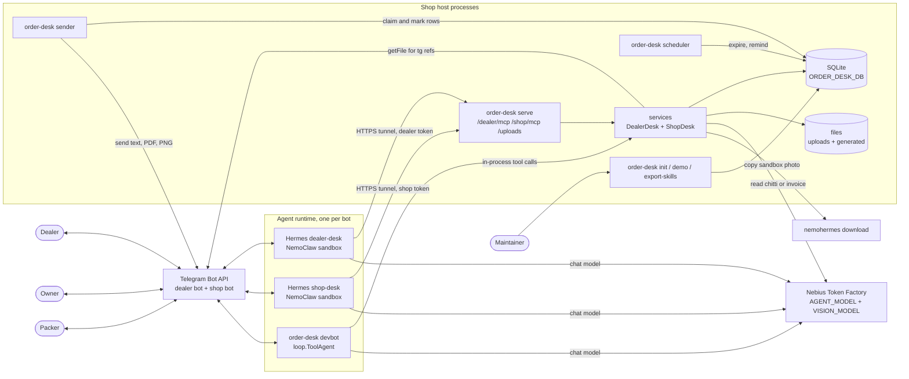

- **Two interchangeable runtimes per bot**: Hermes (main; outside this repo, fed by `hermes/*/SOUL.md` + `SKILL.md` that `skills_export.export()` writes from `agent/instructions/*.md`) or `order-desk devbot` (`dev_bot.main()`). Never both on one bot token (`dev_bot` docstring: one `getUpdates` reader per bot).
- **Host processes**: `server.main()`, `outbox_sender.main()`, `scheduler.main()` (started together by `scripts/start_local.sh`); each calls `Database.initialize()` first. Agents reach the DB only through tools. Telegram sends happen in two places only: the outbox sender (tool side effects) and the agent runtime itself (its replies: Hermes internally, `dev_bot._safe_send()`).
- **Photos never travel inside a tool call** (NemoClaw 128 KB MCP limit, `images` docstring): tools take `image_ref` (`sandbox:` / `tg:` / `up:` / `file:` tests only) and the server fetches the bytes.
- **`demo.run_demo()`** drives 3.1→3.4, 3.5 and 3.9 in-process with `demo.StaticReader` and `file:` refs; it never runs the sender (it prints queued rows via `demo._last_outbox()`).

## 2. Front half shared by every journey: message → tool call → reply

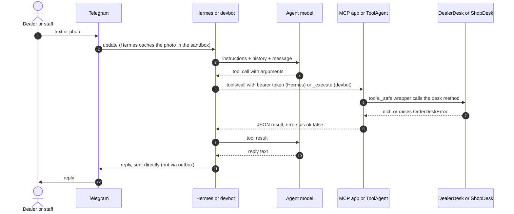

**Hermes path**
1. Hermes (per `docs/08-nemoclaw-setup.md` 8.6, unverified in code) caches a photo under `/sandbox/.hermes/image_cache/`, adds `[Image attached at: <path>]`, and puts the sender ID in the system prompt; the model copies it into `telegram_user_id` / `staff_telegram_user_id`.
2. `POST /dealer/mcp` or `/shop/mcp` → `server.BearerAuth.__call__()` (`hmac.compare_digest` against `DEALER_MCP_TOKEN` / `SHOP_MCP_TOKEN` by path prefix; else 401 `{"error":"unauthorized"}`) → Starlette `Mount` → MCP streamable-HTTP app (`stateless_http=True`, `json_response=True`, built by `server.build_mcp()`) → function from `tools.dealer_tools()` / `tools.shop_tools()` wrapped by `tools._safe()` → desk method.
3. The returned dict comes back as JSON text content (`tests/test_mcp_http.py` `_call()` reads `result.content[0].text`); Hermes replies on its own Telegram connection.

**devbot path**
1. `dev_bot.main()` long-polls `bot_api.BotApi.get_updates()` (25 s, `allowed_updates=["message"]`), private chats only; offset kept in memory.
2. `dev_bot.describe_update()` → `"[telegram message_id=… from_user_id=… first_name=…]\n<text>"`; a photo becomes `image_ref=tg:<largest file_id>` (image documents too). Dealer photos get an instant code ack "Got your chitti. Checking it now..." (`dev_bot._safe_send()`).
3. `loop.ToolAgent.run(history, content, caller_id)` → up to `MAX_TOOL_ROUNDS`=10 `chat.completions.create(model=AGENT_MODEL, temperature=0.2)` turns; the identity param is removed from the schemas (`loop.openai_tool_schemas()`) and `ToolAgent._execute()` sets it to `caller_id`, validates with the MCP SDK `fn_metadata.validate_arguments()`, then calls the same `_safe` function.
4. Reply → `_safe_send()`; history → `loop._compact()` (user/assistant text only, last `HISTORY_MESSAGES`=30, memory only); trace appended to `<ORDER_DESK_DB dir>/traces/<role>.jsonl`.

**Upload variant**: `POST /uploads` (either MCP token or `UPLOAD_TOKEN`) raw bytes → `images.store(source="upload")` → `{"ok":true,"image_ref":"up:up_<hex>"}`; bad bytes → HTTP 400 + error dict. Nothing in the repo creates `up:` refs except tests.

## 3. Journeys

### 3.1 Chitti photo → order (page 2, duplicates, typed variant)

**Trigger**: dealer sends a photo; `agent/instructions/dealer.md` makes the agent call `start_order(source_kind="photo", source_ref=<message id>)` then `read_chitti_photo(order_id, image_ref)`.

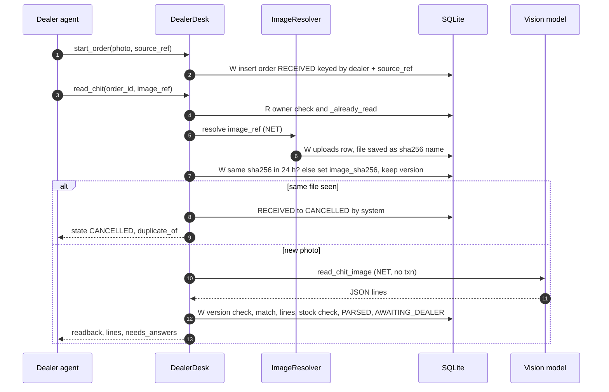

1. `tools.start_order` → `dealer_desk.DealerDesk.start_order()` **W**: `_dealer()` (unregistered → `not_allowed`) → `orders.require_dealer_can_order()` (pending/blocked → `not_allowed`) → `orders.create()` (key `dealer:{dealer_id}:src:{source_ref}`; existing → returned) → INSERT `orders` RECEIVED + `orders._event()` → `{ok, order_id, state, created}`.
2. `tools.read_chitti_photo` → `DealerDesk.read_chit()` **R**: `orders.order_owned_by()` (other dealer's order → `not_found`) → `DealerDesk._already_read()` (PARSED/AWAITING_DEALER → existing read-back, no model call; not RECEIVED → `illegal_transition`).
3. **NET** `deps.dealer_images.resolve()` → `images.ImageResolver._from_sandbox()` (`nemohermes <DEALER_SANDBOX> download <path> <tmp>/`, media-cache prefixes only, 60 s) | `_from_telegram()` (`BotApi.download_file()`, ≤20 MB) | `_from_upload()` → `images.store()` (≤15 MB; JPEG/PNG/WEBP magic; PDF refused; **W** INSERT `uploads`) → `StoredImage{upload_id, sha256, path, mime}`.
4. **W** re-read order → `DealerDesk._same_file_recently()` (same dealer, other order, same `image_sha256`, created ≤24 h, not CANCELLED/EXPIRED/REJECTED) → hit: `orders.transition(RECEIVED→CANCELLED, SYSTEM, reason="duplicate photo of order #N")` → `{ok:true, state:"CANCELLED", duplicate_of}`; else UPDATE `orders.image_sha256`, remember `version`.
5. **NET** `reader.TokenFactoryReader.read_chit_image()` → `_ask()`: `prepare_image()` (EXIF rotate, ≤2000 px JPEG) → `chat.completions.create(model=VISION_MODEL, temperature=0, max_tokens=4000)`; non-JSON → one corrective re-ask; API failure or 2× non-JSON → `ExternalServiceError` → `chitti.ChitReading.from_model_json()` → `ChitReading{lines[ChitLine{raw_text, mark, category, spec, brand, brand_raw, quantity, unit, uses_ditto, legibility, ambiguity}], model}`.
6. **W** `DealerDesk._save_reading()`: no lines → `invalid_input`; `version` changed → `conflict` → `matching.load_products()` + `matching.match_line()` per line → `orders.replace_lines()` (`order_lines` with `item_json`, `candidates_json`) → `orders.apply_stock_check()` → RECEIVED→PARSED→AWAITING_DEALER (SYSTEM) → `orders.similar_recent_order()` (SKU-set Jaccard ≥0.8 within `DUPLICATE_WINDOW_HOURS`) → UPDATE `dealer_check_deadline` (now + `DEALER_CHECK_HOURS`), `possible_duplicate_of` → `DealerDesk._readback_result()` → `{ok, order_id, state, readback, lines[{line_index, raw_text, sku, product, qty, unit, status, note, candidates}], needs_answers, possible_duplicate_of}`.
7. The agent sends `readback` as its own reply (not outboxed).

- **Page 2** (`append=true`): `_already_read()` requires AWAITING_DEALER; no hash check, no `image_sha256` update; `replace_lines(append=True)` continues `line_index`; self-move AWAITING_DEALER (SYSTEM); deadline reset.
- **Typed order**: `start_order(source_kind="text")` + `read_text_order(text)` → `DealerDesk.read_text_order()`: empty → `invalid_input`; **R** checks → **NET** `reader.read_chit_text()` (same prompt + the text, no image, no hash check) → step 6. `source_kind` is not checked against the tool used (inferred).
- **Tables**: R `dealers`, `orders`, `order_lines`, `products`, `v_stock` · W `orders`, `order_events`, `uploads`, `order_lines`. **Messages**: none queued.
- **Failure / idempotency**: replays of 1 and 2 are safe (key; `_already_read()`). A crash or `external_service_error` after step 4 leaves the order RECEIVED with `image_sha256` and an `uploads` row written, no stock held; the agent retries once (`dealer.md` rule 7) and `maintenance.report_stuck_reads()` logs it after 15 min. **If the dealer instead re-sends the same file as a new message, step 4 matches the stuck RECEIVED order and CANCELS the new one as its duplicate** (RECEIVED is not excluded); the agent then stops per `dealer.md`. **A repeated `append=true` call adds the lines twice.** Valid JSON with a bad shape (e.g. `lines` not a list) raises a plain `ValueError` → `internal_error`.

### 3.2 Item matching and the clarification loop

**Trigger**: the read-back has lines marked `(?)`, `(NOT IN CATALOG)` or `(LOW STOCK)` (`messages.readback()`); the dealer answers in chat.

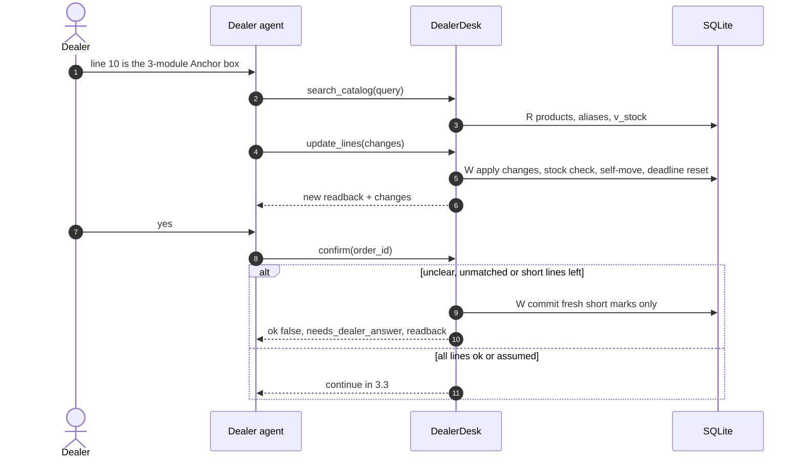

1. Matching (in 3.1 step 6) — `matching.match_line()`: unreadable → `unclear`; no category + reader doubt → `unclear`; no category / `other` → `unmatched`; category + spec filter (`_spec_agrees()`) empty → `unmatched`; known brand absent → `unclear` + candidates; unknown `brand_raw` → `unclear`; spec keys that vary and are missing → `unclear` ("Please give the …"); several left → `is_default_brand` product → `assumed`, else `unclear`; `_convert_quantity()` (box → nos/pcs × `pack_size`) problem → `unclear`; reader doubt (`ambiguity`, tick/strike/unclear `mark`, partial `legibility`) → `unclear` with SKU kept. `orders.apply_stock_check()` then sets `short` (qty > sellable) or back to `ok`.
2. `search_catalog` → `dealer_desk.search_products()` **R**: word overlap over name/category/brand/aliases joined to `v_stock` → `{results[{sku, name, unit, price, in_stock}]}` (top 10; no caller check).
3. `update_order_lines` → `DealerDesk.update_lines()` **W**: `_require_state(AWAITING_DEALER)` → `orders.apply_dealer_changes()` (`{line_index,qty}` | `{line_index,sku}` | `{line_index,accept}` | `{line_index,remove}` | `{add_sku,qty}`; `_valid_sku()` active product, `_valid_qty()` whole >0; answered line → `ok`) → `apply_stock_check()` → self-move (DEALER, detail `changes`) → deadline reset → read-back + `changes[str]`.
4. `confirm_order` with open lines (`orders.lines_needing_answers()`: `unclear`/`unmatched`/`short`) **returns** `{ok:false, error:"needs_dealer_answer", …readback}` instead of raising, so the new `short` marks commit. `assumed` lines never block. `errors.NeedsDealerAnswer` is never raised.

- **Tables**: R `products`, `product_aliases`, `v_stock` · W `order_lines`, `orders`, `order_events`. **States**: AWAITING_DEALER self-moves only. **Messages**: none.
- **Failure / idempotency**: one invalid change rolls back the whole call; repeated `{add_sku}` adds a second line; qty/sku/accept/remove repeats are harmless.

### 3.3 Dealer confirm, reopen, cancel, "add more"

**Trigger**: the dealer says yes / asks for a change / cancels / adds to an approved order (`dealer.md` "After the confirmation").

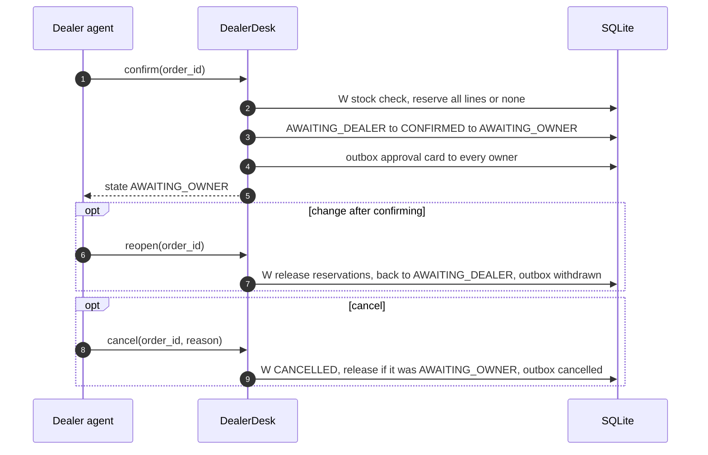

1. `confirm_order` → `DealerDesk.confirm()` **W**: AWAITING_OWNER already → same success (replay) → `_require_state(AWAITING_DEALER)` → `apply_stock_check()` → open lines → 3.2 step 4 → `orders.active_items()` (SKU → summed qty of `ok`/`assumed` lines; empty → `invalid_input`) → `stock.reserve()` (all-or-none; `not_enough_stock` when summed qty > sellable, e.g. two lines of one SKU) → INSERT `reservations` `active` → AWAITING_DEALER→CONFIRMED (DEALER, `dealer:<tg>`) → CONFIRMED→AWAITING_OWNER (SYSTEM) → `DealerDesk._send_approval_card()` (`stock.levels()` after the reservation = "[left after: N]", total at current `pricing.unit_price_paise()`, `credit.summary().one_line()`) → `messages.approval_card()` → `outbox.notify_staff("owner", …)` outbox `approval:{order}:{version}:{chat}` → `{ok, order_id, state:"AWAITING_OWNER", message}`.
2. `reopen_order` → `DealerDesk.reopen()` **W**: `_require_state(AWAITING_OWNER)` → `stock.release()` (rows → `released`, kept) → AWAITING_OWNER→AWAITING_DEALER (DEALER) → deadline reset → owners get `messages.owner_withdrawn()` (outbox `withdrawn:{order}:{version}:{chat}`) → read-back. The next `confirm` calls `stock.reserve()`, which makes the order's `released` rows `active` again (new quantity) and INSERTs only SKUs the order never held, because of `UNIQUE (order_id, sku)` (`schema.sql`); this was KI-001, fixed 2026-10-27, tests `test_confirm_again_after_reopen_*`.
3. `cancel_order` → `DealerDesk.cancel()` **W**: already CANCELLED → ok → transition to CANCELLED (DEALER; legal from RECEIVED, PARSED, AWAITING_DEALER, AWAITING_OWNER; `state_reason`) → if it was AWAITING_OWNER: `stock.release()` + owners get `owner_cancelled` (outbox `cancelled:{order}:{chat}`). Later states → `illegal_transition`.
4. "Add more" → `start_order(linked_to_order_id=P)`: P must be the caller's and APPROVED/PACKING/PACKED, else `invalid_input` → an independent order with `orders.linked_order_id` (own reservation, card, bill); the link is not shown on the card or in `v_orders`.

- **Tables**: W `reservations`, `orders`, `order_events`, `outbox` · R `v_stock`, `bills`, `products`, `dealer_prices`, `staff`.
- **Failure**: everything is one W; any raise (`not_enough_stock`, `conflict`) leaves no reservation and no card. No owner in `staff` → `notify_staff()` queues nothing, silently.

### 3.4 Owner review and fulfilment: approve / reject / packed / dispatched

**Trigger**: owner replies `APPROVE 12 [with line 3 = 10 | without line 4]` or `REJECT 12 <reason>`; packer `PACKED 12`, `SENT 12` (`agent/instructions/shop.md` short commands).

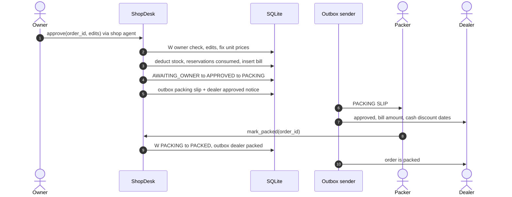

1. `approve_order` → `shop_desk.ShopDesk.approve()` **W**: `_staff(OWNER)` → APPROVED/PACKING/PACKED/DISPATCHED → "already approved" → not AWAITING_OWNER → `illegal_transition` → `shop_desk._apply_owner_edits()` (`{line_index,qty}` | `{line_index,remove}` only) → `active_items()` empty → `invalid_input` → per line `pricing.unit_price_paise()` → `order_lines.unit_price_paise` (prices fixed now) → `stock.deduct_for_order()` (available = sellable + this order's active reservation, else `not_enough_stock`; `order_deduct` movement per SKU; reservations → `consumed`) → `credit.create_bill()` (`due_at` = now + `dealers.payment_terms_days`) → `owner_note` → AWAITING_OWNER→APPROVED (OWNER, detail `changes`) → APPROVED→PACKING (SYSTEM) → `notify_staff("packer", messages.packing_slip())` (no packer → owners) → `credit.discount_offers()` → dealer `messages.dealer_approved()` → `{ok, order_id, state:"PACKING", value, changes, message}`.
2. `reject_order` → `ShopDesk.reject()` **W**: reason required → REJECTED already → ok → AWAITING_OWNER→REJECTED (OWNER, reason; any other state → `illegal_transition`) → `stock.release()` → dealer `messages.dealer_rejected()`.
3. `mark_packed` / `mark_dispatched` → `ShopDesk._simple_move()` **W**: `_staff(ANY_STAFF)` → already target → "Already done." → source must be PACKING / PACKED → actor from `staff.role` → transition → dealer `dealer_packed()` / `dealer_dispatched()`. No stock or bill change; nothing tracks delivery after DISPATCHED.
4. Read helpers: `list_orders` (R `v_orders`), `get_order_details` (R order, dealer, lines with `sellable_now`, value at current prices, credit line, `order_events` history).

- **Tables**: W `order_lines`, `stock_movements`, `reservations`, `bills`, `orders`, `order_events`, `outbox` · R `staff`, `dealers`, `products`, `dealer_prices`, `discount_tiers`, `v_stock`.
- **Failure / idempotency**: one W, so a raise rolls back edits, prices, stock, bill and messages together. Double approval is stopped by the state check, `ux_moves_order_deduct` and `bills.order_id UNIQUE`.

### 3.5 Stock-in from a supplier invoice, shelf count, catalog edits

**Trigger**: owner sends an invoice photo, then corrections, then "OK" (`shop.md` "Stock-in"); or a shelf count / new product request.

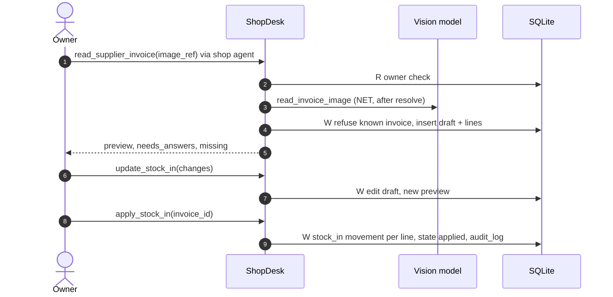

1. `read_supplier_invoice` → `ShopDesk.read_supplier_invoice()`: **R** `_staff(OWNER)` → **NET** `deps.shop_images.resolve()` (+ **W** `uploads`) → **NET** `reader.read_invoice_image()` → `reader.InvoiceReading{supplier, invoice_no, invoice_date, lines}` (tool args win over read values) → **W**: both known → `shop_desk._refuse_known_invoice()` (supplier case-insensitive + exact number, any non-discarded row → `conflict`) → INSERT `supplier_invoices` `draft` → per line `shop_desk._insert_invoice_line()` (`match_line()` + `_convert_quantity()`; `ok` only if SKU and sell units are certain, a missing unit with `pack_size>1` asks) → `ShopDesk._invoice_preview()` → `{invoice_id, preview, needs_answers, missing}`.
2. `update_stock_in` **W**: `_draft_invoice()` (must be `draft`) → `{supplier}`/`{invoice_no}` (re-checked), `{line_index, sku, sell_units}`, `{line_index, remove}`, `{add_sku, sell_units}` → preview.
3. `apply_stock_in` **W**: `applied` → "already added" → not `draft` → `illegal_transition` → supplier + number, all lines `ok`, ≥1 line, else `invalid_input` → `stock.add_movement(reason='stock_in', ref_type='supplier_invoice', ref_id)` per line → `state='applied'`, `applied_at` → `shop_desk._audit('stock_in')`. `discard_stock_in` **W** → `discarded`.
4. `adjust_stock` **W**: `stock.level()` → delta = counted − on_hand → `add_movement(reason='adjustment', ref_type='count')` → `{before, after, difference}`; no check against active reservations. `add_product` **W** INSERT `products` (0 stock, audit) · `add_product_alias` **W** INSERT OR IGNORE `product_aliases`.

- **Messages**: none queued (the agent sends `preview`). **States**: `supplier_invoices.state` draft → applied | discarded.
- **Failure / idempotency**: a retried read without supplier+number makes a second draft; with them → `conflict`. Re-reading a discarded invoice passes `_refuse_known_invoice()` but hits `UNIQUE (supplier, invoice_no)` → `internal_error`. Apply replays are safe.

### 3.6 Credit, bills, payments, dealer prices

**Trigger**: a bill is created inside approval (3.4); owner asks for bills, records a payment, or sets a special price (`shop.md` "Payments and prices").

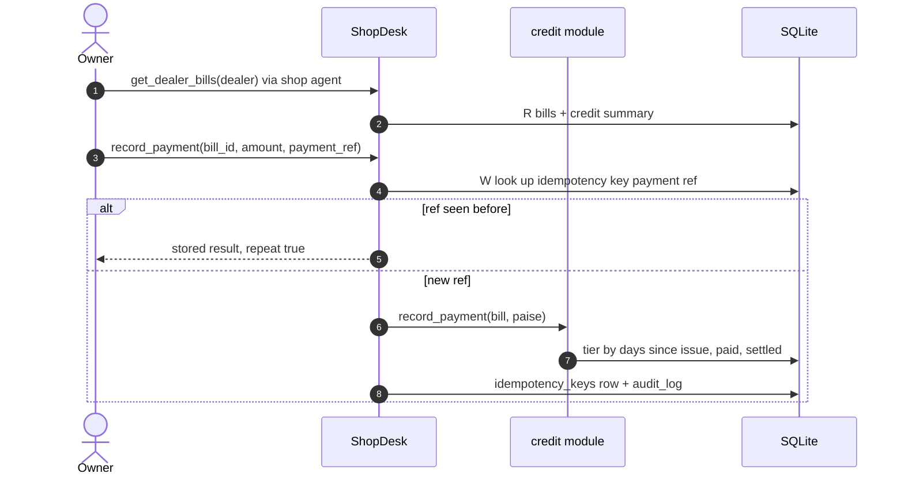

1. Bills: only `credit.create_bill()` (from `ShopDesk.approve()`) and `seed._seed_old_bills()` (opening balances, `order_id` NULL).
2. Credit is shown, never enforced (only `dealers.status` pending/blocked stops orders): `credit.summary()` on the approval card, `get_order_details`, `get_dealer_bills`, `reports.debtors()`; `v_dealer_credit` for SQL.
3. `record_payment` → `ShopDesk.record_payment()` **W**: `payment_ref` required → `idempotency_keys` key `payment:{payment_ref}` → hit → stored `result_json` + `repeat:true` → `credit.record_payment()` (days = now − `issued_at`; smallest `discount_tiers.within_days` ≥ days; discount on the full amount; settled when paid + discount ≥ amount → `paid_at`, `discount_paise`) → INSERT `idempotency_keys` → `_audit('payment')` → `{ok, bill_id, paid, discount, settled}`.
4. `set_dealer_price` **W** upsert `dealer_prices` + audit; read by `pricing.unit_price_paise()` (cards, approval) and `catalog_pdf.build_catalog_pdf()`. Dealer message `messages.dealer_approved()` carries `credit.discount_offers()`.

- **Failure / idempotency**: the key is global, not per bill; a settled bill can be paid again; overpayment is not checked; `dealers.credit_limit_paise` is never read or written.

### 3.7 Dealer account: onboarding, block, /start catalog PDF

**Trigger**: a new chat or `/start` (`dealer.md` "A new chat"); owner `APPROVE DEALER <id>` / `BLOCK DEALER <id>`.

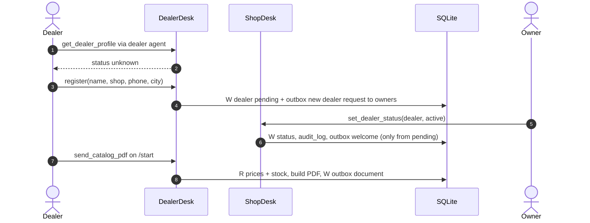

1. `get_dealer_profile` → `DealerDesk.profile()` **R** → `{status:"unknown", next_step}` or `{status, name, shop_name, open_orders}` (not DISPATCHED/REJECTED/EXPIRED/CANCELLED/PACKED, ≤10).
2. `register_dealer` → `DealerDesk.register()` **W**: name required; existing → "already registered" → INSERT `dealers` `pending` → `notify_staff("owner", messages.new_dealer_request())`. The card can be lost (Telegram 400 "chat not found" until the owner has pressed START in the shop bot, KI-066); `get_report` `pending_work` (`reports.pending_work()`) reads the same request from `dealers`.
3. `set_dealer_status` → `ShopDesk.set_dealer_status()` **W**: UPDATE `dealers.status` → `_audit('dealer_status')` → pending→active only → dealer `messages.dealer_welcome_active()`. Block/unblock sends nothing; `orders.require_dealer_can_order()` refuses new orders (existing orders untouched).
4. `send_catalog_pdf` → `DealerDesk.send_catalog()`: **R** dealer (unknown allowed → base prices) → `catalog_pdf.build_catalog_pdf()` (**R** products + `v_stock` + `dealer_prices`; `generated_dir/catalog_{dealer_id|all}_{YYYYMMDD}.pdf`, overwritten) → **W** outbox document to the `telegram_user_id` argument. One message per UTC hour; the PDF is rebuilt on every call.

### 3.8 Outbound messages: outbox → sender → Telegram

**Trigger**: any producer below commits; `order-desk sender` polls.

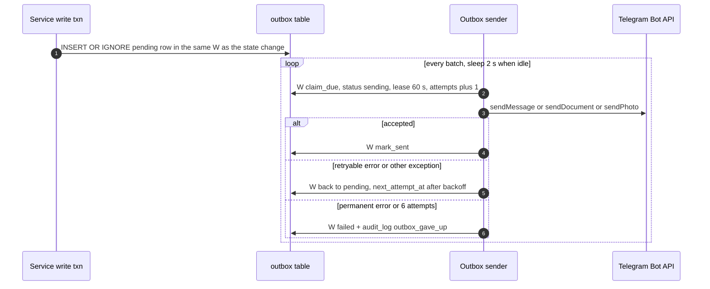

| Producer (inside its W) | bot → chat | kind | `dedupe_key` |
|---|---|---|---|
| `DealerDesk.register()` | shop → each owner | text | `dealer_request:{tg}:{chat}` |
| `DealerDesk.send_catalog()` | dealer → `telegram_user_id` arg | document | `catalog:{tg}:{YYYY-MM-DDTHH}` |
| `DealerDesk._send_approval_card()` | shop → owners | text | `approval:{order}:{version}:{chat}` |
| `DealerDesk.reopen()` / `cancel()` | shop → owners | text | `withdrawn:{order}:{version}:{chat}` / `cancelled:{order}:{chat}` |
| `ShopDesk.approve()` | shop → packers (else owners); dealer | text | `packing:{order}:{chat}`; `approved:{order}` |
| `ShopDesk.reject()` / `mark_packed()` / `mark_dispatched()` | dealer | text | `rejected:{order}` / `packed:{order}` / `dispatched:{order}` |
| `ShopDesk.set_dealer_status()` | dealer | text | `welcome:{dealer_id}` |
| `ShopDesk.make_chart()` | shop → caller | photo | `chart:{png name}` (unique per call) |
| `maintenance.expire_unconfirmed_orders()` / `remind_owner()` | dealer / shop → owners | text | `expired:{order}` / `reminder:{order}:{bucket}:{chat}` |

1. `outbox_sender.main()`: `senders = {"dealer": BotApi(DEALER_BOT_TOKEN), "shop": BotApi(SHOP_BOT_TOKEN)}` (empty token → fails at start) → `StopFlag().install()` → loop `run_batch()`.
2. `outbox.claim_due(limit=20)` **W** one `UPDATE … RETURNING`: `pending` and due, or `sending` with an expired lease (crash recovery) → `sending`, `lease_until` = now + `LEASE_SECONDS` (60), `attempts+1` → `OutboxMessage{id, bot, chat_id, kind, payload, attempts}` by id.
3. Per row: stop flag → break → `outbox_sender.deliver()` → `BotApi.send_message()` (split into ≤4000-char chunks at line ends) | `send_document()` | `send_photo()` (caption ≤1000) → `outbox.mark_sent()` **W**.
4. `TelegramError` → `outbox.mark_failed_attempt(permanent=not retryable)`; other exceptions (missing file, bug) → retryable. `finally` → `outbox.release_leases(unsent)` (back to `pending`, `attempts-1`).

- **Retry rules**: retryable = network error, HTTP 429, HTTP ≥500 (`BotApi._call()`); anything else is permanent (e.g. chat not found, bot blocked). Delay `min(10·2^(attempts−1), 600)` s; give up at `MAX_ATTEMPTS`=6 → waits 10, 20, 40, 80, 160 s, then `failed` ~5 min after the first try (the 600 s cap is never reached).
- **Guarantees**: at-least-once (crash after Telegram accepted → resend after the lease; a multi-chunk text that fails mid-way is resent whole). Ordering per chat is not guaranteed once a row is retried (inferred). `failed` rows are never retried and no tool or `v_*` view shows them. An exception outside the per-row `try` (e.g. `database is locked` in `claim_due()`) ends `outbox_sender.main()` (its loop has no `try`).

### 3.9 Owner questions: fixed reports, read-only SQL, charts

**Trigger**: owner asks a business question (`shop.md` "Questions about the business"). No report is scheduled: `maintenance.run_once()` has no report job.

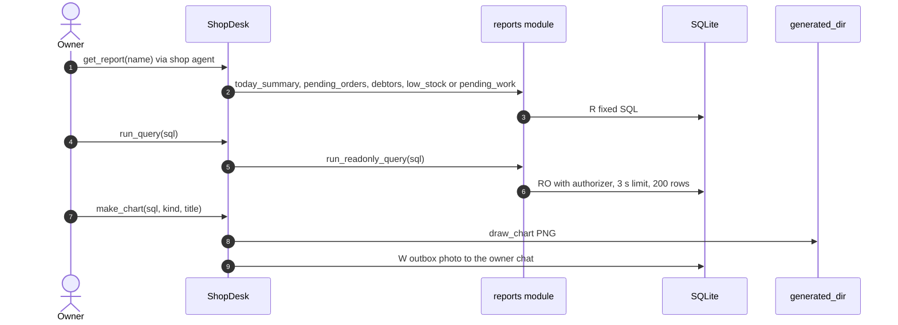

1. `get_report` → `ShopDesk.report()` **R** `_staff(ANY_STAFF)` (packers too, incl. `debtors`) → `reports.today_summary()` (UTC date) | `pending_orders()` | `debtors()` | `low_stock()` | `pending_work()` (`pending_dealers` only for the owner, `orders_waiting_for_approval` for any staff) → `{ok, report, data}`.
2. `describe_reporting_views` (owner) → `reports.describe_views()` (`PRAGMA table_info` per `REPORT_VIEWS`).
3. `run_readonly_query` (owner) → `reports.run_readonly_query()`: reject inner `;` → **RO** → `set_authorizer()` (SELECT; READ of `v_*` or on their behalf, whole-table reads of `_VIEW_BASE_TABLES`, CTE names; `_SAFE_FUNCTIONS`; deny the rest) → progress handler stops at `TIME_LIMIT_S` (3 s) → `{columns, rows, row_count ≤ MAX_ROWS (200), truncated}`; refusals/errors → `invalid_input` with the reason.
4. `send_chart` (owner) → `ShopDesk.make_chart()` → `run_readonly_query()` → `charts.draw_chart()` (column 1 labels, column 2 numbers; `bar`|`line`; `chart_<UTC timestamp>.png`) → **W** outbox photo (shop bot → caller).

- **Failure**: guard errors are `invalid_input` the agent can fix; a retried `send_chart` sends a second chart.

### 3.10 Scheduled and lifecycle jobs

**Trigger**: `order-desk scheduler` runs `maintenance.run_once()` at start ("recovery on boot") and every 60 s.

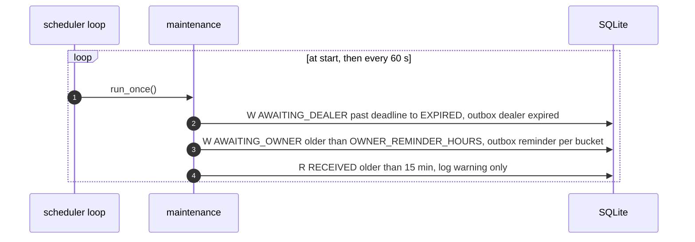

1. `maintenance.expire_unconfirmed_orders()` **W**: `dealer_check_deadline < now` → AWAITING_DEALER→EXPIRED (SYSTEM, reason) + dealer `messages.dealer_expired()`; no stock to release (none held in AWAITING_DEALER).
2. `maintenance.remind_owner()` **W**: `updated_at` older than `OWNER_REMINDER_HOURS` → bucket = waited hours // window → `notify_staff("owner", messages.owner_reminder())`. Its return value counts waiting orders, not new rows, so `scheduler.main()` logs every minute while one waits (inferred).
3. `maintenance.report_stuck_reads()` **R**: RECEIVED older than 15 min → `log.warning` only.
4. Errors → `log.exception`, retried next run. All three are safe to repeat (state checks + dedupe keys).

- **Lifecycle**: `cli.cmd_init()` → `Database.initialize()` (WAL; `schema.sql` CREATE IF NOT EXISTS + re-created views; `meta.schema_version`) → `seed.seed_demo()` (demo data only when `products` is empty; staff upserted from `OWNER_TELEGRAM_IDS` / `PACKER_TELEGRAM_IDS` every run). No migration step: column changes in `schema.sql` do not reach an existing DB (inferred).
- **SIGTERM** (`lifecycle.StopFlag`, flag only): sender finishes the current row and releases its other leases; scheduler finishes `run_once()`; devbot finishes the current update batch, but its offset is only confirmed on the next `getUpdates`, so a restart re-delivers the last batch (inferred from Bot API semantics; `start_order` idempotency absorbs it); `server.main()` uses uvicorn `timeout_graceful_shutdown=20`.

## 4. Cross-cutting mechanics

### 4.1 Transaction boundaries

| Pattern | Tools / jobs |
|---|---|
| one **W** | `start_order`, `update_order_lines`, `confirm_order`, `reopen_order`, `cancel_order`, `register_dealer`, `approve_order`, `reject_order`, `mark_packed`, `mark_dispatched`, `set_dealer_status`, `set_dealer_price`, `record_payment`, `adjust_stock`, `add_product`, `add_product_alias`, `update_stock_in`, `apply_stock_in`, `discard_stock_in` |
| **R** only | `get_dealer_profile`, `search_catalog`, `get_order_status`, `list_orders`, `get_order_details`, `get_dealer_bills`, `get_report`, `describe_reporting_views` |
| R → NET (+W `uploads`) → W → NET vision → W | `read_chitti_photo` |
| R → NET vision → W | `read_text_order` |
| R → NET (+W `uploads`) → NET vision → W | `read_supplier_invoice` |
| R → file I/O → W outbox | `send_catalog_pdf`; `send_chart` (R → RO → PNG → W) |
| RO | `run_readonly_query` |
| per row: W claim → NET → W mark | `outbox_sender.run_batch()` |
| W → W → R | `maintenance.run_once()` |

- Rule: no network inside **W** (`connection` docstring). Pattern for model calls: short txn → NET → short txn that re-checks `orders.version` (`DealerDesk._save_reading()`).
- `BEGIN IMMEDIATE` serializes writers; a waiting writer gives up after 10 s (`timeout=10`, `busy_timeout`) with `sqlite3.OperationalError` → `internal_error` for tools.
- `orders.transition()` is the only state writer: `states.check_transition()` + `UPDATE … WHERE version = ?` (`conflict` on mismatch) + `order_events` row.
- **R** connections are autocommit, so multi-statement reads (e.g. `ShopDesk.order_details()`) are not one snapshot (inferred).

### 4.2 Idempotency keys and dedup

| Mechanism | Key / guard | Replay result |
|---|---|---|
| `orders.create()` | `orders.idempotency_key` UNIQUE = `dealer:{dealer_id}:src:{source_ref}` | same order, `created:false` |
| `DealerDesk._already_read()` | order state PARSED/AWAITING_DEALER | existing read-back, no model call (not for `append`) |
| `DealerDesk._same_file_recently()` | `orders.image_sha256`, 24 h, same dealer | new order CANCELLED, `duplicate_of` |
| `orders.similar_recent_order()` | SKU Jaccard ≥0.8 in `DUPLICATE_WINDOW_HOURS` | `possible_duplicate_of` + read-back question (no block) |
| `confirm` / `approve` / `reject` / `cancel` / `_simple_move` | current state already at target | ok "already …" (`confirm` only from AWAITING_OWNER) |
| stock deduction | `ux_moves_order_deduct` (`ref_id, sku` where `order_deduct`) + `bills.order_id` UNIQUE | IntegrityError backstop |
| `record_payment` | `idempotency_keys` `payment:{payment_ref}` | stored result + `repeat:true` |
| stock-in | `_refuse_known_invoice()` + `UNIQUE (supplier, invoice_no)`; `state='applied'` | `conflict` / "already added" |
| outbox | `dedupe_key` UNIQUE + `INSERT OR IGNORE` (3.8 table) | row not queued twice |
| `register` / `add_alias` / `set_dealer_price` | `dealers.telegram_user_id` UNIQUE / INSERT OR IGNORE / upsert | no duplicate rows |
| `images.store()` | file name = sha256 | same file on disk, but a new `uploads` row per call |

### 4.3 Outbox pattern (end to end)

`outbox.enqueue()` / `outbox.notify_staff()` run on the caller's `conn`, so the state change and its messages commit or roll back together; the sender (3.8) delivers at-least-once. Agent replies (read-backs, previews, answers) are **not** outboxed: Hermes or `dev_bot._safe_send()` sends them, and a failed send is only logged (devbot). `INSERT OR IGNORE` also silently drops a row that breaks a CHECK or NOT NULL constraint (e.g. a misspelt `bot`) (inferred from SQLite semantics).

### 4.4 Clock and time

- All app time comes from `clock.now()` / `now_iso()` / `iso_in()`: UTC text `YYYY-MM-DDTHH:MM:SSZ` (second precision; string compare = time compare). Tests freeze it with `clock.set_clock()` (`tests/conftest.py` `fixed_clock`).
- Exceptions: `v_dealer_credit` uses SQLite `strftime(…, 'now')` (wall clock, ignores `set_clock`); `loop.Trace` uses `time.time()`; the SQL guard uses `time.monotonic()`.
- Day boundaries are UTC: `reports.today_summary()`, `catalog:{tg}:{hour}` dedupe, PDF file date, `credit.discount_offers()` dates (IST is UTC+5:30, inferred impact on "today").
- Timers: `dealer_check_deadline` (set by `_save_reading()`, `update_lines()`, `reopen()`; not by a failed `confirm`), `updated_at` for reminders, outbox `next_attempt_at` / `lease_until`.

### 4.5 How errors reach the agent and the human

| Source | Handling | Agent / human sees |
|---|---|---|
| `errors.OrderDeskError` subclass in a service | `tools._safe()` → `to_dict()`; the open W rolls back | `{ok:false, error:<code>, message}`; agent relays `message` (`dealer.md` rule 7, `shop.md` rule 6) |
| any other exception (bug, IntegrityError, bad model JSON shape) | `_safe()` logs with traceback | `internal_error` + generic text |
| `confirm` with open lines | returned, not raised (commits) | `needs_dealer_answer` + read-back |
| `external_service_error` (download, sandbox copy, vision) | earlier txns of the tool stay committed | dealer agent: "We could not read it now…", retries once |
| wrong / missing bearer token | `BearerAuth` 401 before any tool | Hermes-side handling (unverified) |
| devbot only | `_execute()` → `unknown_tool`, `invalid_arguments`; 10 rounds → "Sorry, this needs a person…"; exception in `agent.run()` → "Sorry, something went wrong…" | sent directly to the user |
| outbox delivery | silent retries, then `failed` + `audit_log` | nobody is told |
| scheduler job | `log.exception`, next run retries | logs only |

## 5. Where to hook in

| To change … (flow) | Edit | Also update / tests |
|---|---|---|
| read-back wording or marks (3.1, 3.2) | `src/order_desk/services/messages.py` `readback()`, `STATUS_MARK` | `tests/test_order_flow.py` (asserts "Reply YES"); `evals/run_conversations.py` `readback_fidelity()` |
| approval card content (3.3) | `src/order_desk/services/dealer_desk.py` `DealerDesk._send_approval_card()` + `src/order_desk/services/messages.py` `approval_card()` | `tests/test_order_flow.py` `test_approval_card_shows_overdue_credit`; README example output goes stale |
| SKU matching rules (3.1, 3.5) | `src/order_desk/services/matching.py` `match_line()`, `_convert_quantity()` | `tests/test_matching.py`; `evals/golden/matching.jsonl` via `evals/run_matching.py` |
| what the vision model returns (3.1, 3.5) | `src/order_desk/vision/prompts.py` + `src/order_desk/domain/chitti.py` `_parse_line()` | golden labels (`evals/golden/README.md`), `tests/test_evals.py` |
| image sources / limits (3.1, 3.5) | `src/order_desk/vision/images.py` `ImageResolver.resolve()`, `store()` | `tests/test_images.py`, `tests/test_mcp_http.py` `test_upload_returns_image_ref` |
| duplicate detection (3.1) | `src/order_desk/services/dealer_desk.py` `DealerDesk._same_file_recently()` (24 h hard-coded); `src/order_desk/services/orders.py` `similar_recent_order()` | `tests/test_order_flow.py` `test_same_photo_two_times_keeps_one_order`, `test_similar_chitti_is_flagged_as_possible_duplicate` |
| dealer edit forms (3.2) | `src/order_desk/services/orders.py` `apply_dealer_changes()` + `src/order_desk/mcp_server/tools.py` `update_order_lines` text + `src/order_desk/agent/instructions/dealer.md` | `tests/test_order_flow.py` `test_unclear_line_blocks_confirmation_until_answered`; run `order-desk export-skills` |
| short-stock / reservation rules (3.2, 3.3) | `src/order_desk/services/orders.py` `apply_stock_check()`; `src/order_desk/services/stock.py` `reserve()`, `release()` (fix the reopen bug here) | `tests/test_order_flow.py` `test_short_stock_is_marked_and_lower_quantity_fixes_it`, `test_two_dealers_cannot_both_reserve_the_last_units`, `test_reopen_returns_order_to_dealer_and_releases_stock` |
| states or transitions (all) | `src/order_desk/domain/states.py` `TRANSITIONS` + every `_require_state()` and hard-coded state list (`DealerDesk.profile()`, `src/order_desk/services/reports.py` `pending_orders()`, `ShopDesk.approve()`) | `src/order_desk/services/invariants.py` `check()`; `docs/04-order-states.md` |
| when stock leaves / prices fix / bill is made (3.4) | `src/order_desk/services/shop_desk.py` `ShopDesk.approve()`; `src/order_desk/services/stock.py` `deduct_for_order()`; `src/order_desk/services/credit.py` `create_bill()` | `invariants.check()` (`AFTER_APPROVAL`); `tests/test_order_flow.py` `test_approve_twice_deducts_once` |
| owner edit forms (3.4) | `src/order_desk/services/shop_desk.py` `_apply_owner_edits()` + `src/order_desk/mcp_server/tools.py` `approve_order` text + `src/order_desk/agent/instructions/shop.md` | `tests/test_order_flow.py` `test_owner_edit_is_reported_to_dealer` |
| stock-in strictness (3.5) | `src/order_desk/services/shop_desk.py` `_insert_invoice_line()`, `ShopDesk.apply_stock_in()`, `_refuse_known_invoice()` | `tests/test_stock_in.py` |
| payments / discounts (3.6) | `src/order_desk/services/credit.py` `record_payment()`, `discount_offers()`; tiers in `src/order_desk/db/seed.py` `seed_demo()` | `tests/test_stock_in.py` `test_payment_with_same_reference_is_recorded_once` |
| prices (3.3, 3.4, 3.7) | `src/order_desk/services/pricing.py` `unit_price_paise()` (the one price entry point) | card, approval and catalog PDF follow automatically |
| a new outbound message (any) | text in `src/order_desk/services/messages.py`; `src/order_desk/services/outbox.py` `enqueue()` / `notify_staff()` inside the same `db.write()`, stable `dedupe_key` | assert with `tests/conftest.py` `outbox_rows()`; add a row to the 3.8 table |
| a new message kind (3.8) | `src/order_desk/services/outbox.py` `enqueue()`, `src/order_desk/db/schema.sql` `outbox.kind` CHECK, `src/order_desk/workers/outbox_sender.py` `deliver()` + `Sender`, `src/order_desk/telegram/bot_api.py` | `tests/test_reliability.py` `RecordingSender` |
| retry / backoff / lease (3.8) | `src/order_desk/services/outbox.py` `MAX_ATTEMPTS`, `LEASE_SECONDS`, `mark_failed_attempt()`; retryable rules in `src/order_desk/telegram/bot_api.py` `BotApi._call()` | `tests/test_reliability.py` |
| a scheduled job, e.g. a daily report (3.10) | new idempotent function in `src/order_desk/services/maintenance.py`, called from `run_once()`; one `dedupe_key` per period | `tests/test_reliability.py` with `fixed_clock` |
| expiry / reminder timing (3.10) | `src/order_desk/config.py` `Settings.dealer_check_hours` / `owner_reminder_hours` (`DEALER_CHECK_HOURS`, `OWNER_REMINDER_HOURS`) | `tests/test_reliability.py` `test_unconfirmed_order_expires_and_dealer_is_told`, `test_owner_reminder_once_per_window` |
| a fixed report (3.9) | `src/order_desk/services/reports.py` new function + `ShopDesk.report()` handlers + `src/order_desk/mcp_server/tools.py` `get_report` text + `src/order_desk/agent/instructions/shop.md` | `tests/test_pending_work.py` (example), `tests/test_readonly_sql.py` |
| text-to-SQL surface (3.9) | `src/order_desk/services/reports.py` `REPORT_VIEWS`, `_VIEW_BASE_TABLES`, `_SAFE_FUNCTIONS`; views in `src/order_desk/db/schema.sql` | `tests/test_readonly_sql.py`, `evals/run_text2sql.py` |
| a new tool (2) | `src/order_desk/mcp_server/tools.py` `dealer_tools()` / `shop_tools()` + desk method + `src/order_desk/agent/instructions/*.md`, then `order-desk export-skills` | `tests/test_mcp_http.py` `test_dealer_scope_cannot_see_owner_tools`, `tests/test_agent_loop.py` |
| caller identity (2) | `src/order_desk/agent/loop.py` `ToolAgent._execute()`; `src/order_desk/mcp_server/tools.py` `ToolSpec.identity_param` | `tests/test_agent_loop.py`; `docs/09-security.md` |

## 6. Data lifecycle

| Record | Created | Mutated | Read by | Archived / deleted |
|---|---|---|---|---|
| `dealers` | `DealerDesk.register()` (pending), `seed._seed_dealers()` | `ShopDesk.set_dealer_status()` (status only) | desks, `credit`, `reports`, `v_orders`, `v_dealer_credit` | never |
| `staff` | `seed._seed_staff()` via `order-desk init` | same (owner re-activated each init) | `shop_desk._staff()`, `outbox.staff_chat_ids()` | never; no tool |
| `products`, `product_aliases` | seed, `ShopDesk.add_product()`, `add_alias()` | never (no price/active change tool) | matching, search, pricing, PDF, views | never |
| `dealer_prices` | `ShopDesk.set_dealer_price()` | upsert | `pricing.unit_price_paise()`, `build_catalog_pdf()` | never |
| `stock_movements` | seed `opening`, `approve` `order_deduct`, `apply_stock_in` `stock_in`, `adjust_stock` `adjustment` | never (append-only) | `v_stock` | never |
| `reservations` | `stock.reserve()` (confirm) | `release()` → released (reopen, cancel, reject); `deduct_for_order()` → consumed; `reserve()` → `released` back to `active` (reopen, then confirm again) | `v_stock`, `deduct_for_order()` | never |
| `orders` | `orders.create()` | `transition()`; `image_sha256`, `dealer_check_deadline`, `possible_duplicate_of`, `owner_note` | everything | never |
| `order_lines` | `replace_lines()`, `_add_line()` | dealer changes, stock check, owner edits, `unit_price_paise` at approval | read-back, card, slip, `v_order_lines` | `replace_lines()` DELETE on a non-append read only |
| `order_events` | `orders._event()` on create and every transition | never | `order_details()`, `invariants.check()` | never |
| `bills` | `credit.create_bill()`, seed opening balances | `credit.record_payment()` | credit summary, reports, `v_*` | never |
| `supplier_invoices` + lines | `read_supplier_invoice()`, `update_stock_in()` (add) | `update_stock_in()`, `apply_stock_in()`, `discard_stock_in()` | preview, apply | never (discarded rows still block the same number) |
| `uploads` + files | `images.store()` per resolve / upload | never | `ImageResolver._from_upload()` | never (files in `ORDER_DESK_UPLOAD_DIR` kept) |
| `idempotency_keys` | `ShopDesk.record_payment()` | never | `record_payment()` | never |
| `outbox` | `outbox.enqueue()` | `claim_due()`, `mark_sent()`, `mark_failed_attempt()`, `release_leases()` | sender, `demo._last_outbox()` | never |
| `audit_log` | `shop_desk._audit()`, `mark_failed_attempt()` (gave up) | never | no code reads it; not in any view | never |
| generated PDF / PNG | `build_catalog_pdf()` (overwritten per dealer per day), `draw_chart()` | — | sender | never |
| `data/traces/<role>.jsonl` | `dev_bot.main()` per turn | append | evals / humans | never |

## Keep this doc current

- Any change to a desk method's transaction steps, a `dedupe_key`, or an outbox producer (`src/order_desk/services/dealer_desk.py`, `shop_desk.py`, `outbox.py`, `maintenance.py`) → update 3.x, 3.8 table and 4.1/4.2.
- Changes to `src/order_desk/domain/states.py`, `src/order_desk/db/schema.sql` constraints, or `stock.py` reservation logic → update journeys 3.3–3.4, 4.2 and section 6 (fixing the reopen bug changes 3.3).
- New tools, image sources, runtimes or workers (`mcp_server/tools.py`, `vision/images.py`, `agent/*`, `workers/*`) → update sections 1, 2 and 5.
- Retry/backoff/lease constants or `bot_api.py` error classification → update 3.8 and 4.5.
