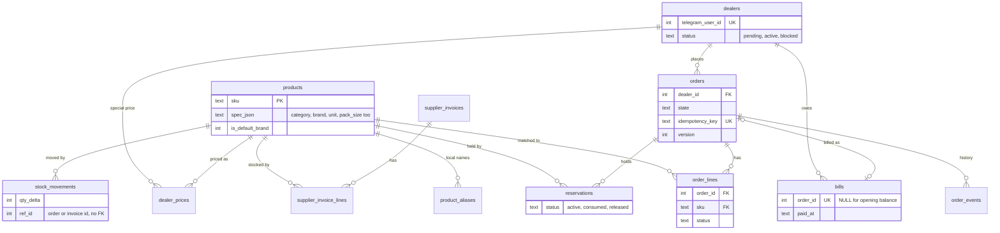
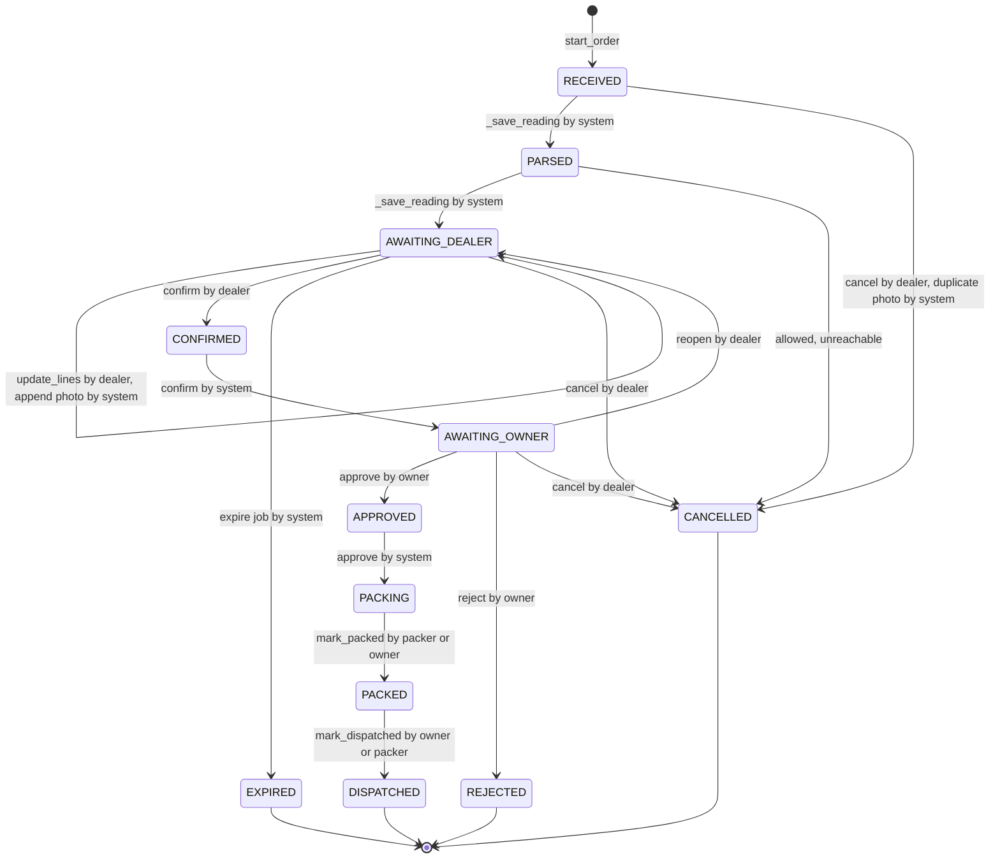
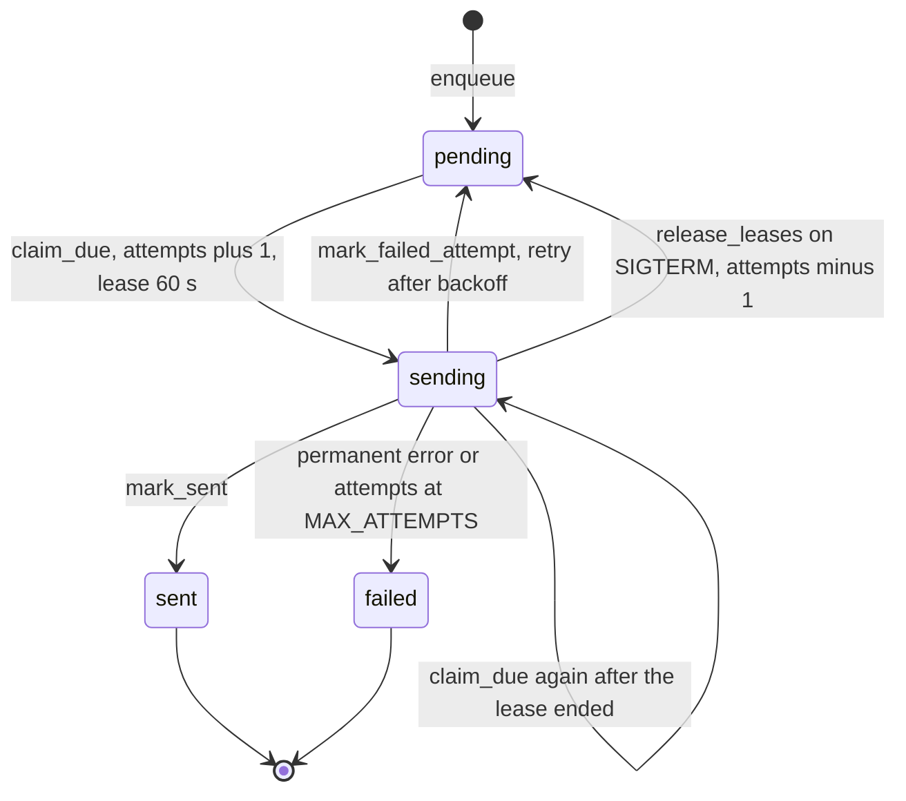

# Domain and Data Model

> Verified against code on 2026-10-26 · Scope: vocabulary, SQLite schema, state machines, invariants, service API and business rules (`src/order_desk/domain/`, `src/order_desk/db/`, `src/order_desk/services/`) · Related: [DATA_FLOW](DATA_FLOW.md), [AGENT_MCP_AND_VISION](AGENT_MCP_AND_VISION.md), [RUNTIME_AND_OPERATIONS](RUNTIME_AND_OPERATIONS.md), [CHANGE_GUIDE](CHANGE_GUIDE.md), [CODEBASE_MAP](CODEBASE_MAP.md), [KNOWN_ISSUES](KNOWN_ISSUES.md)

Design rule: the model reads, deterministic code decides, the owner approves. The SQLite file is the only source of truth (`src/order_desk/db/schema.sql` header). All paths below are under `src/order_desk/` unless they start with `tests/`, `evals/` or `docs/`.

## 1. Glossary

| Term (code spelling) | Meaning in code | Represented by |
|---|---|---|
| chitti / chit | Handwritten order list (photo) or typed order. User text says "chitti"; identifiers say `chit` (`read_chit`, `ChitReading`); MCP tool `read_chitti_photo` | `domain/chitti.py` `ChitReading` → one `orders` row (`source_kind` photo/text) |
| chit line | One written line, top to bottom | `ChitLine` → one `order_lines` row |
| read-back | Code-built text of how each line was read, `(?)` marks on doubtful lines | `services/messages.py` `readback()`; `readback` key of dealer tool results |
| shop / shop desk | The electrical shop (`Settings.shop_name`); the staff-side bot, MCP scope and facade | `outbox.bot='shop'`, `services/shop_desk.py` `ShopDesk` |
| dealer / dealer desk | Customer who orders through the dealer bot, identified by Telegram user ID | `dealers`; `services/dealer_desk.py` `DealerDesk` |
| staff: owner / packer | Shop people; role gates shop tools (`shop_desk._staff()`) | `staff.role`; `domain/states.py` `Actor.OWNER` / `Actor.PACKER` |
| actor | Who may cause a state move | `Actor` (system, dealer, owner, packer); text labels `system`, `dealer:<tg id>`, `staff:<tg id>` in `order_events.actor`, `stock_movements.actor`, `audit_log.actor` |
| product / catalog item / SKU | Sellable item; SKU text key, convention (not enforced) `TYPE-SPEC-BRAND`, e.g. `WIRE-1.5-RED-FINOLEX`, `SW-6A-ANCHOR` | `products`; `services/matching.py` `Product` |
| catalog terms | The one vocabulary: `CATEGORIES` (21 incl. `other`), `UNITS`, `SPEC_KEYS`, `BRANDS` (17), `BRAND_CODES`, `COLOR_CODES`, `UNIT_CODES` | `domain/catalog_terms.py` |
| spec | Facts that decide a match: size_sqmm, color, rating_amp, watt, size_mm, ways, modules | `products.spec_json`, `ChitLine.spec` |
| sell unit / pack size | Unit the shop sells in (coil, nos, box, pcs, metre); sell units per supplier pack | `products.unit`, `products.pack_size` |
| default brand | Product chosen when a line names no brand → line `assumed` | `products.is_default_brand` |
| alias | Local name ("1.5 r fin"), lower-case, single spaces. Used by catalog search only | `product_aliases` |
| base / dealer price | List price; optional per-dealer override | `products.base_price_paise`, `dealer_prices` |
| stock movement | Append-only change: opening, stock_in, order_deduct, adjustment | `stock_movements` |
| on hand / reserved / sellable / low | see §6.5 | `v_stock`; `services/stock.py` `StockLevel` |
| reservation | Stock held for a confirmed order until the owner decides | `reservations` |
| stock-in | Stock added from a supplier invoice photo: draft → applied / discarded | `supplier_invoices`, `supplier_invoice_lines`; `vision/reader.py` `InvoiceReading` |
| shelf count | Owner sets on-hand to the counted quantity | `ShopDesk.adjust_stock()` → `adjustment` movement, `ref_type='count'` |
| order / line status | see §3 | `orders.state`, `order_lines.status` |
| order event | One row per state change (history + audit) | `order_events` |
| approval card / packing slip | Owner card at confirm; team checklist at approval | `messages.approval_card()`, `messages.packing_slip()` |
| linked order | "Add more" after approval = new order pointing at the parent | `orders.linked_order_id` |
| duplicate | Same image file (SHA-256) → cancelled; similar SKU set → flagged | `orders.image_sha256`, `orders.possible_duplicate_of` |
| dealer check deadline | When an AWAITING_DEALER order expires | `orders.dealer_check_deadline` |
| bill / opening balance | Debt from an approved order / seeded old debt (`order_id` NULL) | `bills` |
| credit | Outstanding + overdue summary. Shown to the owner, never enforced | `services/credit.py` `CreditSummary`, `v_dealer_credit` |
| payment terms / cash discount | Days until due / pay within N days for P % off | `dealers.payment_terms_days`; `discount_tiers` |
| outbox | Messages written in the state-change transaction, sent later by a worker | `outbox`; `services/outbox.py` `OutboxMessage` |
| dedupe key / idempotency key | Stops a duplicate message / duplicate order or payment | `outbox.dedupe_key`; `orders.idempotency_key`, `idempotency_keys` |
| upload / image_ref | Stored image; tools pass a reference `sandbox:` / `tg:` / `up:` / `file:` | `uploads`; `vision/images.py` `StoredImage`, `ImageResolver` |
| version | Optimistic-concurrency counter, +1 per transition | `orders.version` |
| invariant | DB rule checked after tests and eval chats | `services/invariants.py` `check()` |
| mark / legibility / ambiguity / ditto | Reader doubt signals | `ChitLine.mark`, `.legibility`, `.ambiguity`, `.uses_ditto` |

## 2. Database

### 2.1 Engine, connections, transactions (`db/connection.py` `Database`)
- SQLite file at `Settings.db_path` (env `ORDER_DESK_DB`, default `data/order_desk.sqlite3`). `initialize()` sets `PRAGMA journal_mode = WAL`.
- Each call opens a new connection (`_open()`): `isolation_level=None` (explicit transactions only), `timeout=10`, `PRAGMA foreign_keys = ON`, `PRAGMA busy_timeout = 10000`, `row_factory = sqlite3.Row`.
- `read()`: plain connection, no explicit transaction (each statement autocommits, so a multi-query read is not one snapshot — inferred).
- `write()`: `BEGIN IMMEDIATE` → yield → `COMMIT`; any exception → `ROLLBACK` and re-raise. The write lock is taken at BEGIN, so writers are serialized; a waiting writer gives up after ~10 s with `sqlite3.OperationalError` (surfaces as `internal_error`, §8). An early `return` inside the block commits.
- `read_only()`: URI `file:<abs path>?mode=ro` + `PRAGMA query_only = ON`; used only by `reports.run_readonly_query()`.
- Rule (module docstring): never call the network (model, Telegram, sandbox copy) inside `write()`. Model-calling methods use read → network → write with an `orders.version` check (§5.2).
- `outbox.claim_due()` uses `UPDATE … RETURNING` (needs SQLite ≥ 3.35, inferred).

### 2.2 Schema application and evolution
- `Database.initialize()` loads the packaged `db/schema.sql` (`importlib.resources`), runs it with `executescript` (autocommit, so not atomic — inferred), then upserts `meta.schema_version = SCHEMA_VERSION` (`"1"`).
- It runs at every process start: `cli.py` `cmd_init`, `mcp_server/server.py` `create_app()`, `workers/outbox_sender.py` `main()`, `workers/scheduler.py` `main()`, `agent/dev_bot.py` `main()`, `demo.py` `run_demo()`, `tests/conftest.py`, `evals/common.py` `fresh_deps()`.
- Tables and indexes use `CREATE … IF NOT EXISTS`: a new table/index appears in an old DB at the next start, but a changed column, CHECK or UNIQUE on an existing table is silently NOT applied. Views are `DROP VIEW IF EXISTS` + `CREATE VIEW`, so they are rebuilt every start.
- No migrations, no `ALTER TABLE`; `meta.schema_version` is written but never read. Changing an existing table needs a hand-written migration or a fresh DB file (inferred).

### 2.3 Seeding (`db/seed.py` `seed_demo(db, settings)`; called by `order-desk init`, demo, tests, evals)
- One write transaction. If `products` has rows: only `_seed_staff()` runs, returns False. Else `_seed_catalog()` (products + one `opening` movement per SKU with `ref_type='seed'`, actor `system`; aliases `INSERT OR IGNORE`), `_seed_dealers()`, `_seed_staff()`, `discount_tiers` (30 d → 300 bp, 60 d → 200 bp), `_seed_old_bills()` (4 opening balances, dates relative to now).
- `_seed_staff()`: IDs from `OWNER_TELEGRAM_IDS` are upserted as `owner`, active (a packer is promoted); `PACKER_TELEGRAM_IDS` are inserted only if new. Nothing is ever deactivated or removed.

| CSV (`db/seed_data/`) | Columns | Contents |
|---|---|---|
| `catalog.csv` | sku, name, category, brand, spec_json, unit, pack_size, base_price_rupees (whole rupees, ×100), safety_stock, is_default_brand (0/1), opening_stock | 76 products, 20 categories (no `other`), 17 brands; units nos 47, coil 27, pcs 1, box 1; each multi-brand (category, spec) group has exactly one default |
| `aliases.csv` | alias, sku | 184 rows, already normalized; 33 aliases map to several SKUs (e.g. `1.5 sq wire red` → 3 brands) |
| `dealers.csv` | telegram_user_id, name, shop_name, phone, city, status, payment_terms_days | 4 demo dealers with placeholder IDs: 3 active, 1 blocked |

Gotchas: an `opening_stock` of 0 violates `CHECK (qty_delta <> 0)` and rolls back the whole seed. `_seed_old_bills()` hard-codes the dealer IDs of `dealers.csv`; changing them breaks seeding.

### 2.4 Tables (19). FKs are enforced (no ON DELETE actions). No triggers exist.

| Table | Purpose | Keys / constraints | Written by | Read by |
|---|---|---|---|---|
| `meta` | key/value | PK key | `Database.initialize()` | nobody |
| `dealers` | one per dealer | PK id; UNIQUE telegram_user_id; CHECK status ∈ pending/active/blocked; payment_terms_days default 60; `credit_limit_paise` never used | `DealerDesk.register()` (pending), `ShopDesk.set_dealer_status()`, seed | every desk method, `maintenance.expire_unconfirmed_orders()`, `reports.debtors()`, `v_orders`, `v_dealer_credit` |
| `staff` | owner and packers | UNIQUE telegram_user_id; CHECK role ∈ owner/packer; `active` | seed only | `shop_desk._staff()`, `outbox.staff_chat_ids()` |
| `products` | catalog | PK sku; CHECK base_price_paise ≥ 0, safety_stock ≥ 0; `active` (no code sets 0); `is_default_brand` (only seed sets 1); category/unit NOT checked in SQL | seed, `ShopDesk.add_product()` | `matching.load_products()`, `orders` helpers, `pricing.unit_price_paise()`, `search_products()`, `documents/catalog_pdf.py`, `v_stock`, `v_order_lines` |
| `product_aliases` | local names | PK (alias, sku); FK sku | seed, `ShopDesk.add_alias()` | `dealer_desk.search_products()` only |
| `dealer_prices` | per-dealer price | PK (dealer_id, sku); CHECK price_paise ≥ 0 | `ShopDesk.set_dealer_price()` (upsert) | `pricing.unit_price_paise()`, `catalog_pdf.build_catalog_pdf()` |
| `stock_movements` | append-only stock ledger | CHECK qty_delta ≠ 0; CHECK reason ∈ opening/stock_in/order_deduct/adjustment; partial UNIQUE `ux_moves_order_deduct (ref_id, sku) WHERE reason='order_deduct'`; `ref_type` order/supplier_invoice/count/seed, `ref_id` has no FK | seed, `stock.add_movement()` (from `adjust_stock`, `apply_stock_in`, `deduct_for_order`) | `v_stock`, `invariants.check()` |
| `reservations` | stock held per order+SKU | CHECK qty > 0; CHECK status ∈ active/consumed/released; UNIQUE (order_id, sku) over ALL statuses, so `reserve()` makes a `released` row active again instead of inserting (KI-001) | `stock.reserve()`, `release()`, `deduct_for_order()` | `v_stock`, `stock.deduct_for_order()`, invariants |
| `orders` | one per chitti / typed order | UNIQUE idempotency_key; CHECK source_kind ∈ photo/text; `state` has NO CHECK; self-FKs linked_order_id, possible_duplicate_of; `owner_note` is write-only | `orders.create()`, `orders.transition()`, `DealerDesk.read_chit()` (image_sha256), `_save_reading()` / `update_lines()` / `reopen()` (deadline, duplicate), `ShopDesk.approve()` (owner_note) | nearly everything |
| `order_lines` | one per chit line | UNIQUE (order_id, line_index); CHECK status ∈ ok/assumed/unclear/unmatched/short/removed; FK sku; `unit_price_paise` set at approval | `orders.replace_lines()`, `apply_stock_check()`, `apply_dealer_changes()`, `_add_line()`; `shop_desk._apply_owner_edits()`, `ShopDesk.approve()` | `orders.get_lines()`, `v_orders`, `v_order_lines`, invariants |
| `order_events` | state history | FK order_id; `from_state` NULL on creation | `orders._event()` (via `create`, `transition`) | `ShopDesk.order_details()`, invariants |
| `bills` | order bills + opening balances | UNIQUE order_id (NULL repeats allowed); CHECK amount_paise ≥ 0 | `credit.create_bill()`, `credit.record_payment()`, seed | `credit.summary()`, `ShopDesk.dealer_bills()`, `reports.today_summary()`, `v_orders`, `v_dealer_credit`, `v_sales_daily`, invariants |
| `discount_tiers` | cash-discount tiers | PK within_days; percent_bp | seed only | `credit.discount_offers()`, `credit.record_payment()` |
| `supplier_invoices` | stock-in drafts | CHECK state ∈ draft/applied/discarded; UNIQUE (supplier, invoice_no) incl. discarded rows (NULLs never collide) | `ShopDesk.read_supplier_invoice()`, `update_stock_in()`, `apply_stock_in()`, `discard_stock_in()` | the same + `_invoice_preview()`, `_refuse_known_invoice()` |
| `supplier_invoice_lines` | invoice lines | UNIQUE (invoice_id, line_index); CHECK status ∈ ok/unclear/unmatched/removed; `packs` as written, `sell_units` converted | `shop_desk._insert_invoice_line()`, `update_stock_in()` | `apply_stock_in()`, `_invoice_preview()` |
| `uploads` | stored images | PK id (`up_` + 16 hex); sha256; `source` telegram/upload/sandbox/file | `vision/images.py` `store()` | `ImageResolver._from_upload()` |
| `idempotency_keys` | first result of a call | PK key | `ShopDesk.record_payment()` | the same |
| `outbox` | Telegram message queue | UNIQUE dedupe_key; CHECK bot ∈ dealer/shop, kind ∈ text/document/photo, status ∈ pending/sending/sent/failed | `outbox.enqueue()` / `notify_staff()`; worker functions | `outbox.claim_due()` |
| `audit_log` | staff actions outside order states | — | `shop_desk._audit()` (dealer_status, dealer_price, payment, add_product, stock_in); `outbox.mark_failed_attempt()` (`outbox_gave_up`) | nobody in code |

### 2.5 Views — the only objects text-to-SQL may read (`reports.REPORT_VIEWS`)

| View | Columns | Notes | Read by |
|---|---|---|---|
| `v_stock` | sku, name, category, brand, unit, safety_stock, on_hand, reserved, sellable, is_low | active products only | `stock.levels()`, `search_products()`, `catalog_pdf`, `reports.low_stock()`, invariants, SQL |
| `v_orders` | order_id, state, dealer_name, dealer_shop, source_kind, created_at, updated_at, created_date, line_count, bill_amount_rupees | line_count excludes removed lines | `ShopDesk.list_orders()`, `reports.pending_orders()`, SQL |
| `v_order_lines` | order_id, order_state, line_index, raw_text, sku, product_name, category, brand, qty, unit, line_status, unit_price_rupees | price NULL before approval | SQL only |
| `v_dealer_credit` | dealer_id, dealer_name, dealer_shop, dealer_status, outstanding_rupees, overdue_bills, oldest_overdue_due_at | "now" = SQLite wall clock, not `clock` | SQL only |
| `v_sales_daily` | sale_date, bills, amount_rupees | order bills only, UTC date | SQL only |

Indexes: `ix_products_category`, `ix_moves_sku`, `ux_moves_order_deduct` (partial UNIQUE), `ix_res_active` (partial, status='active'), `ix_orders_dealer_state`, `ix_orders_state`, `ix_events_order`, `ix_bills_dealer`, `ix_outbox_due (status, next_attempt_at)`, `ix_uploads_sha` (no query uses it), plus 15 automatic PK/UNIQUE indexes.

### 2.6 ER diagram (core tables)

## 3. State machines

### 3.1 Order lifecycle (`domain/states.py`: `State`, `Actor`, `TRANSITIONS`, `check_transition()`)
- Only `services/orders.py` `transition(conn, order, target, actor, actor_label, reason=, detail=)` changes `orders.state`: `check_transition()` (raises `IllegalTransition`) → `UPDATE … SET state, version = version + 1, updated_at, state_reason = COALESCE(reason, state_reason) WHERE id = ? AND version = ?` (no row → `Conflict`) → `order_events` row. The `order` dict must be read in the same transaction.
- PARSED, CONFIRMED and APPROVED are entered and left inside one transaction, so they are never committed in `orders.state` (only in `order_events`). Persisted states: RECEIVED, AWAITING_DEALER, AWAITING_OWNER, PACKING, PACKED, DISPATCHED, REJECTED, EXPIRED, CANCELLED.
- `OPEN_FOR_DEALER`, `HOLDS_RESERVATION`, `FINAL` are unused. State groups are retyped as string lists in `dealer_desk.py` (`profile`, `start_order`, `_same_file_recently`), `shop_desk.py` `approve`, `orders.similar_recent_order()`, `invariants.py`, `reports.pending_orders()`, `maintenance.py`.

| Move | Allowed actors | Performed by | Preconditions | Side effects (stock / credit / outbox) |
|---|---|---|---|---|
| new → RECEIVED | (event actor `system`) | `orders.create()` via `DealerDesk.start_order()` | dealer registered and `active`; key `dealer:{dealers.id}:src:{source_ref}` not seen (else the existing order is returned) | none |
| RECEIVED → PARSED → AWAITING_DEALER | system | `DealerDesk._save_reading()` (from `read_chit`, `read_text_order`) | state RECEIVED; ≥ 1 line read; `version` unchanged since the check | lines matched and stock-checked (nothing held); deadline = now + `DEALER_CHECK_HOURS` (6); `possible_duplicate_of` set |
| AWAITING_DEALER → AWAITING_DEALER | dealer, system | `DealerDesk.update_lines()` (dealer); `read_chit(append=True)` (system) | — | lines changed / appended, stock re-check, deadline reset |
| AWAITING_DEALER → CONFIRMED → AWAITING_OWNER | dealer, then system | `DealerDesk.confirm()` | after re-check no line unclear/unmatched/short; ≥ 1 ok/assumed line | `stock.reserve()` (all or nothing); approval card to owners |
| AWAITING_OWNER → AWAITING_DEALER | dealer | `DealerDesk.reopen()` | — | `stock.release()`; deadline reset; owners told "withdrawn" |
| AWAITING_OWNER → APPROVED → PACKING | owner, then system | `ShopDesk.approve()` | ≥ 1 line after owner edits; qty ≤ sellable + own reservation | prices fixed; `order_deduct` movements; reservations consumed; bill created; packing slip; dealer told (changes, bill, discounts) |
| AWAITING_OWNER → REJECTED | owner | `ShopDesk.reject()` | reason not empty | `stock.release()`; dealer told the reason |
| PACKING → PACKED / PACKED → DISPATCHED | packer, owner | `ShopDesk.mark_packed()` / `mark_dispatched()` | — | dealer told |
| AWAITING_DEALER → EXPIRED | system | `maintenance.expire_unconfirmed_orders()` (scheduler) | `dealer_check_deadline < now`; `confirm()` itself never checks the deadline | dealer told; nothing to release |
| RECEIVED → CANCELLED | dealer, system | `DealerDesk.cancel()`; `read_chit()` duplicate check (system) | duplicate: same dealer, same SHA-256, other order created < 24 h ago and not CANCELLED/EXPIRED/REJECTED | `state_reason` set |
| AWAITING_DEALER → CANCELLED | dealer, system | `DealerDesk.cancel()` (no system caller) | — | none |
| AWAITING_OWNER → CANCELLED | dealer | `DealerDesk.cancel()` | — | `stock.release()`; owners told |

### 3.2 Order line status (`order_lines.status`)

| Status | Set by | Effect |
|---|---|---|
| `ok` | `matching.match_line()`; any answered line in `orders.apply_dealer_changes()`; `orders._add_line()`; `apply_stock_check()` (short → ok, note cleared) | in the order |
| `assumed` | `match_line()` when the default brand was chosen | in the order; read-back shows `(?)` |
| `unclear` | `match_line()`: reader doubt, unknown or unstocked brand, missing varying spec, qty/unit problem, several brands and no single default | blocks `confirm()` |
| `unmatched` | `match_line()`: category None/`other`, or no product with that spec | blocks `confirm()`; needs a SKU or removal |
| `short` | `orders.apply_stock_check()`: ok/assumed/short line with qty > sellable | blocks `confirm()` |
| `removed` | dealer `{"remove": true}`; owner edit `{"remove": true}` | ignored everywhere |

"In the order" = `orders.active_items()` (status ok/assumed with sku and qty, summed per SKU). "Needs an answer" = `orders.lines_needing_answers()` (unclear, unmatched, short).

### 3.3 Other state machines

| Entity | States and moves | Code |
|---|---|---|
| `outbox.status` | diagram above; backoff `min(10 · 2^(attempts−1), 600)` s → 10, 20, 40, 80, 160 s; the 6th failure (`MAX_ATTEMPTS = 6`) or a permanent error → `failed` + `audit_log` `outbox_gave_up`; `failed` is never retried | `services/outbox.py` (worker: [DATA_FLOW](DATA_FLOW.md)) |
| `reservations.status` | active → consumed (`deduct_for_order`, approve) / released (`release`: reject, cancel from AWAITING_OWNER, reopen); released → active again (`reserve()` when a reopened order is confirmed again) | `services/stock.py` |
| `supplier_invoices.state` | draft → applied (`apply_stock_in`) / discarded (`discard_stock_in`); only drafts change (`_draft_invoice()`) | `ShopDesk` |
| `supplier_invoice_lines.status` | ok / unclear / unmatched at read → ok or removed by `update_stock_in` | `_insert_invoice_line()` |
| `dealers.status` | none → pending (`register`) → active or blocked (`set_dealer_status`, both ways; never back to pending). Welcome message only on pending → active | `DealerDesk`, `ShopDesk` |
| bill | unpaid (`paid_at` NULL) → settled when `paid + discount ≥ amount` | `credit.record_payment()` |

## 4. Invariants

### 4.1 `services/invariants.py` `check(db) -> list[str]` (empty = OK)

| # | Rule | Fails when |
|---|---|---|
| 1 | Stock never negative, never over-reserved | `v_stock` row with on_hand < 0 or reserved > on_hand (active products only) |
| 2 | Stock removed only after approval | `order_deduct` movement for an order not in APPROVED/PACKING/PACKED/DISPATCHED |
| 3 | Approved ⇒ movements and bill | order in those states without an `order_deduct` movement or without a bill |
| 4 | Reservations only while waiting | `active` reservation for an order not in CONFIRMED/AWAITING_OWNER |
| 5 | Only legal moves recorded | `order_events` (from_state, to_state) pair not in `TRANSITIONS` (actors and chain continuity not checked) |
| 6 | No open question reaches the owner | order in AWAITING_OWNER or later with a line unclear/unmatched/short |

When: `tests/conftest.py` `deps` fixture asserts `check() == []` after every test that uses it; `evals/run_conversations.py` after each simulated chat; `tests/test_invariants.py` tests the checker. Nothing runs it in production.

### 4.2 Enforced by the database
- CHECKs on status / role / reason / kind / bot / source_kind columns, non-negative prices and bill amounts, `qty_delta ≠ 0`, `reservations.qty > 0` (see §2.4). No CHECK on `orders.state`, `products.category`, `products.unit`, `order_lines.unit`, `stock_movements.ref_type`, `uploads.source`, `bills.paid_paise`.
- UNIQUE backstops for retries: `orders.idempotency_key`, `ux_moves_order_deduct`, `bills.order_id`, `reservations (order_id, sku)`, `supplier_invoices (supplier, invoice_no)`, `outbox.dedupe_key`, `idempotency_keys.key`. A UNIQUE hit raises `sqlite3.IntegrityError` → `internal_error`, not a friendly result; the friendly path is always the state check before it.
- FKs (`PRAGMA foreign_keys = ON` on every connection): lines/reservations/movements need an existing SKU; orders need an existing dealer.

### 4.3 Enforced only in code
- Legal state moves and allowed actors: `check_transition()`; lost updates: `orders.version` in `transition()` and `_save_reading()`.
- Stock never over-promised: `stock.reserve()` and `deduct_for_order()` check sellable inside the write lock; `apply_stock_check()` marks `short`. `ShopDesk.adjust_stock()` can still set on-hand below active reservations (breaks rule 1; a later approval can drive on-hand negative).
- Roles: `shop_desk._staff()`; dealer ownership: `orders.order_owned_by()` (NotFound for others' orders); ordering status: `orders.require_dealer_can_order()` in `start_order()` only.
- Vocabulary: `catalog_terms` checks in `ChitReading.from_model_json()` and `ShopDesk.add_product()` (seed CSV is trusted).

## 5. Services reference

Legend — Tx: R = `db.read()`, W = one `db.write()`, `→` = separate steps with network in between. Callers: every public desk method is exposed 1:1 as an MCP tool in `mcp_server/tools.py` (`dealer_tools()`, `shop_tools()`), which the reference agent (`agent/dev_bot.py`, `evals/run_conversations.py`) also uses; `demo.py`, `evals/scenario.py` and `tests/` call desks directly.

### 5.1 `services/shop_desk.py` `ShopDesk(deps)` — owner and packer
Every method first calls `_staff(conn, staff_telegram_user_id, roles)`: `NotAllowed` if not an active staff row or wrong role. Owner-only unless "any".

| Method → MCP tool | Tx | Behaviour | Outbox (dedupe key) | Errors |
|---|---|---|---|---|
| `list_orders(staff, state=None, limit=20)` → `list_orders` (any) | R | `v_orders` newest first, limit clamped 1–100 | — | InvalidInput (unknown state) |
| `order_details(staff, order_id)` → `get_order_details` (any) | R | dealer, credit line, non-removed lines + `sellable_now`, value at CURRENT prices of ok/assumed lines, event history | — | NotFound |
| `approve(staff, order_id, edits=None, note=None)` → `approve_order` | W | already APPROVED/PACKING/PACKED/DISPATCHED → ok "already approved"; else must be AWAITING_OWNER; `_apply_owner_edits()` (`{line_index, qty}` / `{line_index, remove}`); writes `order_lines.unit_price_paise`; total = Σ price × qty; `stock.deduct_for_order()`; `credit.create_bill()`; owner_note; → APPROVED → PACKING (event detail `changes`) | packers, else owners: slip `packing:{id}:{chat}`; dealer `approved:{id}` (changes, bill, `discount_offers()`) | IllegalTransition, NotFound, InvalidInput (no line left, bad qty), NotEnoughStock, Conflict |
| `reject(staff, order_id, reason)` → `reject_order` | W | reason required; already REJECTED → ok; → REJECTED (only from AWAITING_OWNER); `stock.release()` | dealer `rejected:{id}` | InvalidInput, IllegalTransition |
| `mark_packed` / `mark_dispatched(staff, order_id)` (any) | W | `_simple_move()`: at target → ok "Already done."; else must be PACKING / PACKED; actor from role | dealer `packed:{id}` / `dispatched:{id}` | IllegalTransition |
| `set_dealer_status(staff, dealer_tg, status)` | W | status active/blocked; audit `dealer_status` | dealer `welcome:{dealers.id}` on pending → active only | InvalidInput, NotFound |
| `set_dealer_price(staff, dealer_tg, sku, price_rupees)` | W | upsert `dealer_prices`; audit `dealer_price` | — | InvalidInput, NotFound |
| `dealer_bills(staff, dealer_tg)` → `get_dealer_bills` | R | bills newest first + `credit.summary().one_line()` | — | NotFound |
| `record_payment(staff, bill_id, amount_rupees, payment_ref)` | W | key `payment:{payment_ref}` in `idempotency_keys` → stored result + `repeat: true`; else `credit.record_payment()`, store result, audit `payment` | — | InvalidInput, NotFound |
| `adjust_stock(staff, sku, counted_qty, note="")` | W | delta = counted − on_hand → `adjustment` movement (`ref_type='count'`), none if 0; no audit row | — | InvalidInput, NotFound (inactive or unknown SKU) |
| `add_product(staff, sku, name, category, unit, price_rupees, brand=None, spec=None, pack_size=1, safety_stock=0)` | W | category/unit must be in `catalog_terms`; unknown spec keys dropped; stock 0; `is_default_brand` always 0; audit `add_product` | — | InvalidInput |
| `add_alias(staff, alias, sku)` → `add_product_alias` | W | lower-case + single spaces; `INSERT OR IGNORE`; no audit | — | InvalidInput, NotFound |
| `read_supplier_invoice(staff, image_ref, supplier=None, invoice_no=None)` | R → image + model → W | args override the reading; `_refuse_known_invoice()` when both known; insert draft; `_insert_invoice_line()` per line; returns `_invoice_preview()` (`preview`, `needs_answers`, `missing`) | — | Conflict, ExternalServiceError, InvalidInput |
| `update_stock_in(staff, invoice_id, changes)` | W | forms `{supplier}`, `{invoice_no}`, `{line_index, sku?, sell_units?}` (sets ok), `{line_index, remove}`, `{add_sku, sell_units}` | — | IllegalTransition (not draft), Conflict, NotFound, InvalidInput |
| `apply_stock_in(staff, invoice_id)` | W | applied → ok "already added"; needs supplier + invoice_no and every non-removed line `ok`; +`stock_in` movement per line (`ref_type='supplier_invoice'`); state applied; audit `stock_in` | — | NotFound, IllegalTransition, InvalidInput |
| `discard_stock_in(staff, invoice_id)` | W | draft → discarded; no audit | — | NotFound, IllegalTransition |
| `report(staff, name)` → `get_report` (any) | R | `today`, `pending_orders`, `debtors`, `low_stock`, `pending_work` (§6.7) | — | InvalidInput |
| `describe_views(staff)` → `describe_reporting_views` | R | `reports.describe_views()` + notes | — | — |
| `run_query(staff, sql)` → `run_readonly_query` | read_only | `reports.run_readonly_query()` | — | InvalidInput |
| `make_chart(staff, sql, kind, title)` → `send_chart` | read_only → PNG → W | `documents/charts.py` `draw_chart()` | shop photo `chart:{png name}` | InvalidInput |

Stock-in line rule (`_insert_invoice_line()`): stricter than ordering — `ok` only if `match_line()` status is `ok` (an assumed brand is not enough) AND qty converts; unit missing on a product with `pack_size > 1` → question "Is this N nos or N packs of P?". The shop-scope `search_catalog` tool calls `DealerDesk.search_catalog()` (no staff check).

### 5.2 `services/dealer_desk.py` `DealerDesk(deps)` — dealer
Every order method calls `_dealer()` (`NotAllowed` if the Telegram ID is not registered) and `orders.order_owned_by()`. Dealer status (blocked/pending) is checked only in `start_order()`.

| Method → MCP tool | Tx | Behaviour | Outbox (dedupe key) | Errors |
|---|---|---|---|---|
| `profile(tg)` → `get_dealer_profile` | R | unknown → `next_step` hint; else status, name, shop, ≤ 10 open orders (excludes PACKED and final) | — | — |
| `register(tg, name, shop_name, phone, city)` → `register_dealer` | W | existing → ok "already registered"; insert `pending` | owners `dealer_request:{tg}:{chat}` | InvalidInput |
| `search_catalog(query, category=None, limit=10)` | R | `search_products()` (§6.2) | — | InvalidInput |
| `send_catalog(tg)` → `send_catalog_pdf` | R → PDF → W | dealer prices if registered, else base | dealer document `catalog:{tg}:{UTC hour}` | — |
| `start_order(tg, source_kind, source_ref, linked_to_order_id=None)` | W | `require_dealer_can_order()`; linked parent must be own and APPROVED/PACKING/PACKED; `orders.create()` → `{order_id, state, created}` | — | InvalidInput, NotAllowed, NotFound |
| `read_chit(tg, order_id, image_ref, append=False)` → `read_chitti_photo` | R → resolve image → W → model → W | `_already_read()`: PARSED/AWAITING_DEALER returns the stored read-back (no model call); append needs AWAITING_DEALER; same-file duplicate → CANCELLED + `duplicate_of`; stores `image_sha256`; `_save_reading()` | — | IllegalTransition, InvalidInput (no lines), ExternalServiceError, Conflict |
| `read_text_order(tg, order_id, text)` | R → model → W | same without image or duplicate check | — | same |
| `update_lines(tg, order_id, changes)` → `update_order_lines` | W | AWAITING_DEALER only; `apply_dealer_changes()` (all or nothing); `apply_stock_check()`; self-move; deadline reset; returns read-back + `changes` | — | IllegalTransition, InvalidInput, NotFound |
| `confirm(tg, order_id)` → `confirm_order` | W | AWAITING_OWNER → ok (retry); else must be AWAITING_DEALER; `apply_stock_check()`; open questions → returns read-back with `ok: false, error: "needs_dealer_answer"` and COMMITS the short marks; `stock.reserve(active_items)`; → CONFIRMED → AWAITING_OWNER | owners approval card `approval:{id}:{version}:{chat}` | IllegalTransition, InvalidInput (no lines), NotEnoughStock |
| `reopen(tg, order_id)` → `reopen_order` | W | AWAITING_OWNER only; `stock.release()`; → AWAITING_DEALER; deadline reset | owners `withdrawn:{id}:{version}:{chat}` | IllegalTransition |
| `cancel(tg, order_id, reason="")` → `cancel_order` | W | CANCELLED → ok; → CANCELLED (default reason "cancelled by dealer"); from AWAITING_OWNER also `stock.release()` | owners `cancelled:{id}:{chat}` (only from AWAITING_OWNER) | IllegalTransition |
| `order_status(tg, order_id=None)` → `get_order_status` | R | last 10 orders, or read-back + state + reason | — | NotFound |

Internals: `_save_reading()` re-reads the order, `version` mismatch → `Conflict`; `match_line()` per line; `orders.replace_lines()` (delete + insert, or append after the max `line_index`); `apply_stock_check()`; transitions; `similar_recent_order()`; deadline. `_readback_result()` returns `{ok, order_id, state, readback, lines[{line_index, raw_text, sku, product, qty, unit, status, note, candidates}], needs_answers, possible_duplicate_of}`. `_send_approval_card()` shows `[left after: sellable]` per line (after this order's reservation), total at current prices and the credit line.

### 5.3 Other service modules

| Module | Responsibility | Public API | Tables | Tx | Errors | Callers |
|---|---|---|---|---|---|---|
| `orders.py` | order/line operations on the caller's connection; no network | `get_order`, `get_lines` (decodes `candidates`, `item`), `product_names`, `active_items`, `order_owned_by`, `create`, `transition`, `replace_lines`, `apply_stock_check`, `apply_dealer_changes`, `lines_needing_answers`, `require_dealer_can_order`, `similar_recent_order` | orders, order_lines, order_events; products, v_stock (R) | caller's | NotFound, Conflict, InvalidInput, NotAllowed, IllegalTransition | desks, `maintenance` |
| `stock.py` | stock arithmetic and holds | `StockLevel`, `levels`, `level`, `add_movement`, `reserve`, `release`, `deduct_for_order` | v_stock (R), stock_movements, reservations | caller's W | InvalidInput, NotEnoughStock, NotFound | desks, `orders` |
| `credit.py` | ledger summary, bills, payments | `CreditSummary` (`one_line()`; `is_clear` unused), `summary`, `discount_offers`, `create_bill`, `record_payment` | bills, discount_tiers | caller's | NotFound | desks, `reports` |
| `pricing.py` | price lookup and money text | `unit_price_paise`, `rupees` | products, dealer_prices | caller's | NotFound | desks, credit, messages, reports, catalog_pdf |
| `matching.py` | deterministic line → SKU | `Product`, `MatchResult`, `load_products`, `match_line`, `_convert_quantity` (also used by `shop_desk`) | products (R) | caller's | none | desks, `evals/run_matching.py`, `evals/run_chit_reader.py`, `tests/test_matching.py` |
| `outbox.py` | transactional outbox | `enqueue`, `staff_chat_ids`, `notify_staff` (packer → owners fallback; key `{key}:{chat_id}`), `claim_due`, `mark_sent`, `mark_failed_attempt`, `release_leases`; `MAX_ATTEMPTS=6`, `LEASE_SECONDS=60` | outbox, staff (R), audit_log | enqueue: caller's W; worker fns: own W | none | desks, `maintenance`, `workers/outbox_sender.py` |
| `messages.py` | every user-facing text (ASD-STE100 English) | `readback`, `approval_card`, `packing_slip`, `dealer_*`, `owner_*`, `new_dealer_request`, `STATUS_MARK` | none | — | — | desks, `maintenance` |
| `reports.py` | fixed reports + guarded SQL | `today_summary`, `pending_orders`, `debtors`, `low_stock`, `pending_work`, `describe_views`, `run_readonly_query`; `REPORT_VIEWS`, `MAX_ROWS=200`, `TIME_LIMIT_S=3.0` | views, orders, bills, dealers | own R / read_only | InvalidInput | `ShopDesk`, `evals/run_text2sql.py` |
| `maintenance.py` | idempotent timed jobs | `expire_unconfirmed_orders`, `remind_owner`, `report_stuck_reads`, `run_once` | orders, dealers, outbox | one W per job | — | `workers/scheduler.py` (start + every 60 s), tests |
| `invariants.py` | rule checker | `check` | views + tables (R) | own R | — | tests, evals |
| `deps.py` | wiring | `Deps`, `Deps.build`, `Deps.reader` | — | — | ExternalServiceError (lazy, no API key) | server, dev_bot, demo, tests, evals |

## 6. Business rules

### 6.1 Matching (`services/matching.py` `match_line(line, products)`; inputs normalized by `domain/chitti.py`)
1. `legibility == "unreadable"` or empty `raw_text` → unclear "The line cannot be read."
2. No category and a reader doubt → unclear with the doubt text. No category or `other` → unmatched.
3. Pool = active products of that category whose spec agrees on every key BOTH sides have (`_spec_agrees()`: floats within 1e-6, text case-insensitive; keys only on one side are ignored). Empty → unmatched "We do not stock this item with this specification."
4. Brand: written and known → keep that brand (none left → unclear, candidates = first 5 of pool); only `brand_raw` (unknown code) → unclear "Brand 'X' is not known to us."
5. A spec key that varies inside the pool and is missing on the line → unclear "Please give the colour." (wording from `SPEC_WORDS`, keys sorted).
6. One product left → `ok`. Several → exactly one `is_default_brand` → `assumed` ("No brand written; we chose X."), else unclear "Please give the brand."
7. Quantity (`_convert_quantity()`): missing → unclear; `box` → nos/pcs ×`pack_size`; nos ↔ pcs same; other unit mismatch → unclear; result must be a whole number > 0 (tolerance 1e-9).
8. Reader doubt on a matched line (`_reader_doubt()`, precedence: ambiguity text, strike, tick, unclear mark, partial legibility) → unclear, but SKU/qty kept; `candidates` = up to 4 other pool SKUs.
- Uses only category, spec, brand, `is_default_brand`, unit, `pack_size`. It never reads `product_aliases`, product names or `raw_text` content. `COLOR_CODES` are applied by the model prompt only: a spec color `"r"` does not match `"red"`.

### 6.2 Catalog search and aliases (`dealer_desk.search_products(db, query, category=None, limit=10)`)
- Tokens = regex `[a-z0-9.&-]+` over the lower-cased query (non-Latin text such as Telugu is dropped; no tokens and no category → InvalidInput). Score = number of query tokens found in name + category + brand + all aliases of the product. Keep score > 0 (or all rows when only a category is given); sort by score desc, then name; return `sku, name, unit, price` (base price, not the dealer's), `in_stock` (sellable > 0).
- Aliases are learned only when the owner calls `add_product_alias` (`ShopDesk.add_alias()`) or from `aliases.csv`; nothing learns them automatically.

### 6.3 Pricing (`services/pricing.py`)
- `unit_price_paise(conn, dealer_id, sku) = COALESCE(dealer_prices.price_paise, products.base_price_paise)`.
- Line value = unit price × qty (integer paise); no tax, no rounding. The approval card and `order_details` use current prices; `approve()` freezes `order_lines.unit_price_paise` and the bill amount.

### 6.4 Credit (`services/credit.py`)
- Unpaid bill = `paid_at IS NULL`. `outstanding = Σ(amount − paid)`; overdue = unpaid with `due_at < now` (text compare); `oldest_overdue_days = floor((now − min due_at) / 1 day)`. Includes opening balances.
- `create_bill()`: issued now, due = now + `dealers.payment_terms_days`.
- `discount_offers()`: per tier ascending: "Pay by {issued + within_days, '%d %b'} for P% off (save ₹X)", saving = `amount × percent_bp // 10000`.
- `record_payment(conn, bill_id, amount_paise)`: `days = (now − issued_at).days`; tier = smallest `within_days ≥ days` (none → 0 %); `discount = amount × bp // 10000`; `paid += amount`; settled if `paid + discount ≥ amount` → `paid_at = now`, `discount_paise` stored. No guard against already-settled bills or overpayment.
- Never enforced: only `dealers.status = 'blocked'` stops new orders (`start_order`).

### 6.5 Stock (`services/stock.py`, `v_stock`)
- `on_hand = Σ stock_movements.qty_delta`; `reserved = Σ active reservations.qty`; `sellable = max(on_hand − reserved − safety_stock, 0)`; `is_low = (on_hand − reserved ≤ safety_stock)`.
- `reserve(conn, order_id, items)`: all SKUs must have `sellable ≥ qty` else `NotEnoughStock`, then one `active` row per SKU: a `released` row of the same order and SKU is made `active` again (new `qty` and `created_at`, `closed_at` cleared), otherwise a row is inserted (KI-001, fixed 2026-10-27). `release()`: active → released. `deduct_for_order()`: available = sellable + this order's active reservation; then `−qty` `order_deduct` movements and reservations → consumed.
- Movement reasons: opening (seed), stock_in (`apply_stock_in`), order_deduct (`approve`), adjustment (`adjust_stock`).

### 6.6 Duplicates and idempotency
- Same file: `read_chit()` (not append) cancels the new order if the same dealer has another order with the same `image_sha256` created in the last 24 h (fixed) and not CANCELLED/EXPIRED/REJECTED. `image_sha256` is stored before the model call.
- Similar chitti: `orders.similar_recent_order()` — Jaccard of SKU sets (`active_items`) ≥ 0.8 against the dealer's orders created within `DUPLICATE_WINDOW_HOURS` (6), not CANCELLED/EXPIRED/REJECTED → `possible_duplicate_of` (newest match) and a read-back note; confirmation is not blocked.
- Repeats: `start_order` (idempotency_key), `read_chit` (stored read-back), `confirm`, `approve`, `reject`, `mark_*`, `cancel`, `apply_stock_in` (state checks), `record_payment` (`idempotency_keys`, global per `payment_ref`), messages (`dedupe_key`). Full table: [DATA_FLOW](DATA_FLOW.md).

### 6.7 Reports (`services/reports.py`)
- `today_summary`: today = UTC date (`clock.now_iso()[:10]`): orders created today by state, approved bills and value today, count AWAITING_OWNER and PACKING now. `pending_orders`: `v_orders` in RECEIVED, PARSED, AWAITING_DEALER, AWAITING_OWNER, PACKING, PACKED. `debtors`: dealers with outstanding > 0, sorted by oldest overdue days desc, then name. `low_stock`: `v_stock.is_low = 1`. `pending_work`: `pending_dealers` = `dealers` with status `pending` (`dealer_telegram_user_id`, `name`, `shop`, `phone`, `city`, `requested_at`; left out for a packer) and `orders_waiting_for_approval` = `v_orders` in AWAITING_OWNER (`order_id`, `dealer`, `shop`, `line_count`, `created_at`). It reads the tables, not the outbox, so a lost Telegram card does not hide the work (KI-066, KI-067).
- `run_readonly_query(db, sql)`: one statement (any `;` left after stripping a trailing one → InvalidInput); read-only connection; authorizer allows SELECT, reads of `REPORT_VIEWS` (or base tables on behalf of a view), whole-table count checks on `_VIEW_BASE_TABLES`, CTE names, `_SAFE_FUNCTIONS`, `WITH RECURSIVE`; denies everything else; progress handler stops after 3 s; returns ≤ 200 rows `{columns, rows, row_count, truncated}`. Security review: [RUNTIME_AND_OPERATIONS](RUNTIME_AND_OPERATIONS.md).

### 6.8 Maintenance (`services/maintenance.py`, run by `workers/scheduler.py`)
- `expire_unconfirmed_orders()`: AWAITING_DEALER with `dealer_check_deadline < now` → EXPIRED + dealer `expired:{id}`.
- `remind_owner()`: AWAITING_OWNER with `updated_at` older than `OWNER_REMINDER_HOURS` (2); `waited` = whole hours since `updated_at`, `bucket = waited // OWNER_REMINDER_HOURS`; owners `reminder:{id}:{bucket}:{chat}` → one reminder per window. Its returned count includes ignored duplicates.
- `report_stuck_reads(minutes=15)`: logs RECEIVED orders older than 15 min (no state change).

### 6.9 Dependency wiring (`services/deps.py`)
- `Deps(settings, db, dealer_images, shop_images, _reader)`. `Deps.build(settings, reader=None, allow_local_files=False)` makes `Database(settings.db_path)` and two `vision/images.py` `ImageResolver`s (dealer bot token + `DEALER_SANDBOX`; shop bot token + `SHOP_SANDBOX`; shared upload dir). `allow_local_files=True` (`file:` refs) only in demo, tests, evals.
- `Deps.reader` builds `vision/reader.py` `TokenFactoryReader` on first use, so the server starts without `NEBIUS_API_KEY`; tests pass a fake `Reader`.

## 7. Representations

| Aspect | What the code does |
|---|---|
| Money | INTEGER paise in every table (`*_paise`). Input rupees → `shop_desk._rupees_to_paise()` = `int(round(float(v) × 100))`, refuses bool, non-number, negative. Seed `base_price_rupees` is whole rupees × 100. Display: `pricing.rupees()` → `₹1,23,456.78` (Indian grouping, `.00` omitted, `-` prefix; `catalog_pdf` swaps ₹ for "Rs "). Views: `paise / 100.0` → REAL `*_rupees`. Percent in basis points |
| Quantities | INTEGER sell units (`order_lines.qty`, `reservations.qty`, `qty_delta`, `sell_units`). Chit quantities are floats until `_convert_quantity()`; `supplier_invoice_lines.packs = int(quantity)` as written |
| Units | `UNITS` = coil, nos, box, pcs, metre; after matching, the line takes the product's unit |
| IDs | integer rowids (orders `#N`, bills, stock-in drafts, dealers); SKU text PK; tools identify people by Telegram user ID (`telegram_user_id`, `staff_telegram_user_id`); internal `dealers.id` appears in FKs, `idempotency_key` and `welcome:` keys; uploads `up_` + 16 hex |
| Time | TEXT UTC `%Y-%m-%dT%H:%M:%SZ` (`clock.ISO_FORMAT`), second precision, compared as strings in SQL. Always via `clock.now()`, `now_iso()`, `iso_in()`, `from_iso()`; tests freeze it with `clock.set_clock()`. "Today"/dates are UTC (`today_summary`, `created_date`, `sale_date`, discount dates); the IST day boundary is not handled. `v_dealer_credit` uses SQLite's own `now` |
| JSON columns | `spec_json`, `item_json` (category, spec, brand, brand_raw, mark), `candidates_json`, `detail_json`, `payload_json`, `result_json`; `ensure_ascii=False` for item, event and outbox JSON |
| Text | brand: strip, lower, drop trailing `.`, `BRAND_CODES` then exact brand name, else None; unit: `UNIT_CODES`; category: exact match only; spec text lower-case; aliases lower-case single-spaced; search tokens ASCII only; no transliteration; all message templates English |

## 8. Error model (`domain/errors.py`)

| Class | `code` | Raised by (main) |
|---|---|---|
| `OrderDeskError` | `error` | base; `to_dict()` → `{"ok": false, "error": code, "message": str(exc)}` |
| `NotFound` | `not_found` | `orders.get_order` / `order_owned_by` (also hides other dealers' orders), unknown SKU/line/bill/dealer/draft/upload |
| `NotAllowed` | `not_allowed` | `dealer_desk._dealer` (unregistered), `orders.require_dealer_can_order` (blocked/pending), `shop_desk._staff` |
| `IllegalTransition` | `illegal_transition` | `check_transition`, `_require_state`, `_already_read`, `approve`, `_simple_move`, `_draft_invoice`, `apply_stock_in` |
| `InvalidInput` | `invalid_input` | argument checks, `reports.run_readonly_query`, `charts.draw_chart`, `images.store` |
| `NeedsDealerAnswer` | `needs_dealer_answer` | never raised; `confirm()` returns this code in a dict so its writes commit |
| `NotEnoughStock` | `not_enough_stock` | `stock.reserve`, `stock.deduct_for_order` |
| `Conflict` | `conflict` | `orders.transition` (version), `_save_reading` (version), `_refuse_known_invoice` |
| `ExternalServiceError` | `external_service_error` | `vision/reader.py` (no key, model down, invalid JSON twice), `vision/images.py` (Telegram download, sandbox copy) |

- Raising inside `db.write()` rolls back everything in that transaction (messages included).
- MCP boundary (`mcp_server/tools.py` `_safe()`): `OrderDeskError` → `to_dict()`; any other exception (`sqlite3.IntegrityError`, `OperationalError` "database is locked", `ValueError` from `ChitReading.from_model_json`, bugs) → logged, `{"ok": false, "error": "internal_error"}`. `POST /uploads` returns `to_dict()` with HTTP 400. Direct callers (demo, tests, evals) get the exception.
- Success results always carry `"ok": true`; idempotent repeats return ok with an "already …" message (`record_payment` adds `"repeat": true`).

## 9. Parsed chit (`domain/chitti.py`)
- `ChitReading(shop_name_raw, date_raw, lines: list[ChitLine], model)`; `to_dict()`; `from_model_json(text_or_obj, model="")`. Header fields and `model` are not stored on the order (`model` goes into the PARSED event detail). Invoices reuse `ChitLine` inside `vision/reader.py` `InvoiceReading(supplier, invoice_no, invoice_date, lines)`.
- `ChitLine` fields: `line_index` (1-based position in the model's list; `order_lines.line_index` is renumbered by `orders.replace_lines()`), `raw_text`, `line_no_written`, `mark` (none/tick/strike/unclear), `category`, `spec`, `brand` (normalized), `brand_raw`, `quantity` (float), `unit`, `uses_ditto`, `legibility` (clear/partial/unreadable), `ambiguity`. `needs_question` (ambiguity, a mark, or not clear) is used by `evals/run_chit_reader.py` only.
- Parsing never invents a value: text input may be wrapped in a json code fence (outermost `{…}` taken); `lines` must be a list (`ValueError` otherwise), non-dict items skipped; `spec` keeps only `SPEC_KEYS` with non-empty values (numbers and numeric strings → float, text → lower-case); `category` kept only if in `CATEGORIES`; `brand = normalize_brand(brand) or normalize_brand(brand_raw)`; `unit` kept if in `UNITS`, else `normalize_unit()`; invalid `mark` → "none" and invalid `legibility` → "clear" (this silently removes doubt); `quantity` → float or None (bool → None); empty strings → None.
- `uses_ditto` and `line_no_written` are parsed but not stored; `order_lines.item_json` keeps category, spec, brand, brand_raw, mark.

## 10. Known pitfalls (from code reading; consolidated in [KNOWN_ISSUES](KNOWN_ISSUES.md))
- Re-confirm after `reopen_order` (KI-001, fixed 2026-10-27): `stock.release()` keeps the row (`released`) and `stock.reserve()` makes it `active` again. `reservations UNIQUE (order_id, sku)` still covers all statuses, so never INSERT a second row for the same order and SKU. Tests: `test_confirm_again_after_reopen_*`.
- Re-reading a discarded supplier invoice: `_refuse_known_invoice()` ignores discarded drafts but `UNIQUE (supplier, invoice_no)` does not → `internal_error` after the model call.
- `adjust_stock()` below the reserved quantity breaks invariant 1; the later `approve()` deducts the full reservation and on-hand goes negative.
- Two lines with the same SKU pass the per-line `apply_stock_check()` but `reserve()` sums them → `not_enough_stock` without a read-back.
- Expiry happens only while the scheduler runs (`confirm()` ignores `dealer_check_deadline`); `add_product()` cannot set `is_default_brand`, so a new multi-brand group answers unbranded lines with "Please give the brand."

## Keep this doc current
- Any edit to `db/schema.sql` or `db/seed_data/*.csv` / `db/seed.py`: update §2 (tables, views, indexes, CSV columns, counts) and §4.2.
- Any edit to `domain/states.py`, `orders.transition()` callers or desk methods that move states: update §3.1 table and diagram, §4.1 and §5.
- Any change in `services/matching.py`, `pricing.py`, `credit.py`, `stock.py`, `reports.py`, `maintenance.py` formulas or constants: update §6; new error classes or `_safe()` changes: update §8.
- Changes to `domain/chitti.py` or `domain/catalog_terms.py`: update §1, §6.1 and §9.
