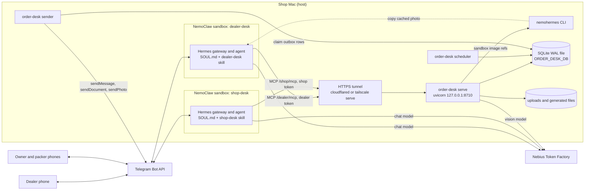
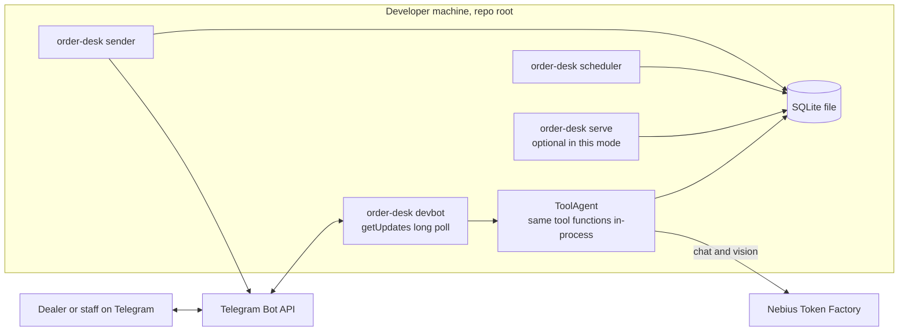

# Runtime and Operations

> Verified against code on 2026-10-26 · Scope: processes, entry points, commands, configuration, time, workers, Telegram client, MCP server transport/auth, Hermes/NemoClaw deployment, security as implemented, dependencies · Related: [AGENT_MCP_AND_VISION](AGENT_MCP_AND_VISION.md), [DATA_FLOW](DATA_FLOW.md), [DOMAIN_AND_DATA_MODEL](DOMAIN_AND_DATA_MODEL.md), [CHANGE_GUIDE](CHANGE_GUIDE.md), [CODEBASE_MAP](CODEBASE_MAP.md), [KNOWN_ISSUES](KNOWN_ISSUES.md)

## 1. What the product is

Chitti Order Desk is a Telegram order desk for one electrical shop (Vijayawada demo; `SHOP_NAME` titles the catalog PDF). Dealers send a photo of a handwritten order list ("chitti") or a typed order to the **dealer bot**; the owner and packers use a separate **shop bot**. A vision model on Nebius Token Factory reads the photo, plain code matches SKUs, checks stock and credit and moves the order state machine, and only the owner's `approve_order` removes stock, makes the bill and queues the packing slip and dealer notices. It also automates stock-in from supplier-invoice photos, dealer registration, payments, expiry and reminders, and owner questions (fixed reports, guarded read-only SQL, charts). The rule from `README.md`: the model reads, the code decides, the owner approves.

## 2. Runtime topology

### 2.1 Processes, stores, external services

| Component | Started by | Talks to | Auth |
|---|---|---|---|
| MCP server | `order-desk serve` → `src/order_desk/mcp_server/server.py` `main()` | HTTP on `MCP_HOST:MCP_PORT` (default `127.0.0.1:8710`), SQLite, Token Factory (vision), `nemohermes`, Telegram (`tg:` downloads) | bearer token per path prefix (`BearerAuth`) |
| Outbox sender | `order-desk sender` → `src/order_desk/workers/outbox_sender.py` `main()` | SQLite `outbox`, Telegram Bot API (both bots) | bot tokens |
| Scheduler | `order-desk scheduler` → `src/order_desk/workers/scheduler.py` `main()` | SQLite | — |
| Reference bot (optional) | `order-desk devbot --role dealer` / `--role shop` → `src/order_desk/agent/dev_bot.py` `main()` | Telegram `getUpdates`, Token Factory (chat + vision), SQLite (tools in-process, no MCP hop) | bot token of the role |
| Hermes agents (deployed) | `scripts/setup_nemoclaw.sh` → NemoClaw sandboxes `dealer-desk`, `shop-desk` | Telegram, Token Factory (`AGENT_MODEL`), MCP server through the tunnel | MCP token held by NemoClaw |
| HTTPS tunnel (deployed) | manual: `cloudflared tunnel --url http://127.0.0.1:8710` or `tailscale serve` (`docs/08-nemoclaw-setup.md` §8.3) | public HTTPS → `127.0.0.1:8710` | — |
| SQLite file | `Database.initialize()` in every process at start | `ORDER_DESK_DB` + WAL side files `-wal`/`-shm` | file system |
| File folders | services | `ORDER_DESK_UPLOAD_DIR` (images named by SHA-256), `ORDER_DESK_GENERATED_DIR` (catalog PDFs, chart PNGs), `data/logs/*.log` (`start_local.sh`), `data/traces/<role>.jsonl` (devbot) | — |
| Nebius Token Factory | `src/order_desk/vision/reader.py` `TokenFactoryReader`, `dev_bot.build_agent()`, `evals/run_*.py` | `NEBIUS_BASE_URL` (OpenAI-compatible) | `NEBIUS_API_KEY` |
| Telegram Bot API | `src/order_desk/telegram/bot_api.py` `BotApi` | `https://api.telegram.org` | token in the URL path; no webhook anywhere |

### 2.2 Deployed setup (Hermes in NemoClaw)



### 2.3 Local-dev setups

| Mode | Processes | Network |
|---|---|---|
| Offline demo | `order-desk demo` (one process, `StaticReader`) | none |
| Tests | `pytest -q` (fake reader; `tests/test_mcp_http.py` starts uvicorn on a free `127.0.0.1` port in a thread) | loopback only |
| Reference runtime | `make local` (init + serve + sender + scheduler) plus `order-desk devbot --role dealer` and/or `--role shop` | Telegram, Token Factory |
| Deploy rehearsal | `make local` + tunnel + `scripts/setup_nemoclaw.sh` | Telegram, Token Factory, tunnel |



- devbot builds `dealer_tools()` / `shop_tools()` in-process (`agent/dev_bot.py` `build_agent()`), so `serve` is optional there; `sender` is still required for every queued message (approval cards, packing slips, notices, PDFs, charts) and `scheduler` for expiry and reminders.
- **Setup step (checked 2026-10-27): the owner presses START in the shop bot before any dealer registers.** Telegram refuses a bot's first message to a person who never started it (`sendMessage` answers 400 "chat not found", permanent in `BotApi._call()`), so the "new dealer" card that `DealerDesk.register()` queues is marked `failed` at once (KI-066, KI-031, KI-032). The owner is the account in `OWNER_TELEGRAM_IDS`. Fallback: `/start` or "what is pending" on the shop bot makes the agent call `get_report` `pending_work`, which reads the pending dealers (Telegram ID, name, shop, phone, city) and the orders in `AWAITING_OWNER` from the database.
- All processes must share one host, one file system and one working directory: default paths are relative (`data/...`), `.env` is read from CWD, and outbox rows store the PDF/PNG path as the server wrote it (`services/dealer_desk.py` `send_catalog()`, `services/shop_desk.py` `make_chart()`) (inferred).

### 2.4 SQLite connection settings (`src/order_desk/db/connection.py` `Database`)
- New connection per call (`_open()`): `isolation_level=None`, `timeout=10`, `PRAGMA busy_timeout=10000`, `PRAGMA foreign_keys=ON`, `row_factory=sqlite3.Row`.
- `initialize()`: creates the parent folder, runs packaged `schema.sql`, sets `PRAGMA journal_mode=WAL`, upserts `meta.schema_version` = `SCHEMA_VERSION` ("1", never compared). Tables use `CREATE TABLE IF NOT EXISTS` (no migrations); views are dropped and recreated on every start.
- `write()` = `BEGIN IMMEDIATE` … `COMMIT`, `ROLLBACK` on any exception: one writer at a time, others wait up to 10 s. `read()` = no transaction. `read_only()` = URI `mode=ro` + `PRAGMA query_only=ON` (text-to-SQL).
- Rule (module docstring): never call the network (model, Telegram, `nemohermes`) inside `db.write()`.

## 3. Entry points

### 3.1 `order-desk` CLI (`src/order_desk/cli.py` `main()`)
Global `--env PATH` (default `.env`) must come before the subcommand (`order-desk --env other.env serve`); only `init`, `serve`, `sender`, `scheduler`, `devbot` call `load_settings()`. Importing `cli.py` has no side effects, so `order-desk --help` is safe.

| Subcommand | Args | Behaviour (symbol) | Side effects / needs |
|---|---|---|---|
| `init` | — | `cmd_init()`: `Database.initialize()` + `src/order_desk/db/seed.py` `seed_demo()`; prints DB path and row counts (products, dealers, staff, bills); warns if staff = 0 | Creates the DB. On an empty catalog loads demo data (catalog, aliases, 4 demo dealers, discount tiers, old bills). Every run upserts staff from `OWNER_TELEGRAM_IDS`/`PACKER_TELEGRAM_IDS` (`_seed_staff()`); removed IDs stay active. |
| `demo` | `--workdir` (default `data/demo`) | `cmd_demo()` → `demo.run_demo()` | Deletes `--workdir` recursively (`shutil.rmtree`), then rebuilds it. Ignores `--env`. No network. |
| `serve` | — | `cmd_serve()` → `mcp_server/server.py` `main()` | Exits unless `DEALER_MCP_TOKEN` and `SHOP_MCP_TOKEN` are set. |
| `sender` | — | `workers/outbox_sender.py` `main()` | Needs both bot tokens: `BotApi("")` raises `TelegramError` and the process exits. |
| `scheduler` | — | `workers/scheduler.py` `main()` | DB writes only. |
| `devbot` | `--role` `dealer` or `shop` (required) | `agent/dev_bot.py` `main()` | Needs the role's bot token and, in practice, `NEBIUS_API_KEY`; appends traces to `<db folder>/traces/<role>.jsonl`. |
| `export-skills` | `--out` (default `hermes`) | `agent/skills_export.py` `export()` | Overwrites `hermes/<role>-desk/SOUL.md` and `hermes/<role>-desk/skills/<role>-desk/SKILL.md` from `agent/instructions/<role>.md` (in sync on 2026-10-26). |
| `new-token` | — | `cmd_new_token()`: `secrets.token_hex(32)` | Prints 64 hex characters. |

### 3.2 Console scripts and module entry points
- `pyproject.toml` `[project.scripts]`: `order-desk = "order_desk.cli:main"` (the only one); `python -m order_desk.cli` is equivalent.
- Eval modules (run from the repo root; `evals/common.py` adds `src/` to `sys.path` and reads `<repo>/.env`): `evals.run_matching` (offline), `evals.run_chit_reader [--include-examples] [--model M] [--limit N]`, `evals.run_text2sql [--model M]`, `evals.run_conversations [--only ID] [--model M] [--sim-model M]`, `evals.report`, `evals.make_review` (writes `evals/golden/review.html`; no Make target). Results go to `evals/results/<eval>/<UTC stamp>/` plus `history.jsonl`. Details: [CHANGE_GUIDE](CHANGE_GUIDE.md).

### 3.3 Make targets (`Makefile`, `PY ?= python3`)

| Target | Runs |
|---|---|
| `help` | lists targets from `##` comments |
| `install` | `$(PY) -m venv .venv && . .venv/bin/activate && pip install -e ".[dev]"` |
| `init`, `demo`, `serve`, `sender`, `scheduler` | `order-desk <same name>` |
| `local` | `./scripts/start_local.sh` |
| `devbot-dealer`, `devbot-shop` | `order-desk devbot --role dealer` / `--role shop` |
| `skills` | `order-desk export-skills` |
| `test` | `pytest -q` |
| `eval-offline`, `eval-reader`, `eval-sql`, `eval-chat` | `$(PY) -m evals.run_matching` / `.run_chit_reader` / `.run_text2sql` / `.run_conversations` |
| `scorecard` | `$(PY) -m evals.report` |

All targets except `install` take `order-desk`/`pytest` from PATH: activate `.venv` first.

### 3.4 Scripts
- `scripts/start_local.sh`: `cd` to the repo root, `mkdir -p data/logs`, `order-desk init`, then `serve`, `sender`, `scheduler` in the background with logs in `data/logs/{serve,sender,scheduler}.log`; `trap stop INT TERM` sends SIGTERM to all three and waits. No restart if a child dies. The banner port comes from the shell's `MCP_PORT`, not from `.env`.
- `scripts/setup_nemoclaw.sh`: §10.1.

### 3.5 `src/order_desk/demo.py` `run_demo()`
Builds `Settings` in code with the fake `OWNER`/`PACKER`/`DEALER` constants, `Deps.build(..., reader=StaticReader(), allow_local_files=True)`, seeds, writes a blank JPEG, then runs `start_order` → `read_chit` (fixed reading `HARD_01`) → `update_lines` → `confirm` → `approve` with an edit → `mark_packed` → `read_supplier_invoice` + `apply_stock_in` (fixed `INVOICE`) → `report("today")` → `run_query` → a refused `DELETE`. It prints the queued outbox texts (`_last_outbox()`); nothing is sent.

## 4. Commands cheat-sheet

```bash
make install PY=python3.13 && source .venv/bin/activate   # needs Python >= 3.11 (default python3 here is 3.10.0)
cp .env.example .env            # fill secrets; `order-desk new-token` for DEALER_MCP_TOKEN, SHOP_MCP_TOKEN, UPLOAD_TOKEN
order-desk init                 # DB + demo data + staff IDs          (make init)
order-desk demo                 # full offline flow in data/demo      (make demo)
make local                      # init + serve + sender + scheduler; Ctrl-C stops all
curl http://127.0.0.1:8710/health                          # {"ok": true}
order-desk devbot --role dealer # reference runtime; stop the Hermes sandbox on that token first
pytest -q                       # offline tests                       (make test)
python -m evals.run_matching    # offline eval (make eval-offline); reader/sql/chat evals need NEBIUS_API_KEY
python -m evals.report          # evals/results/SCORECARD.md          (make scorecard)
order-desk export-skills        # after editing src/order_desk/agent/instructions/*.md   (make skills)
scripts/setup_nemoclaw.sh       # create both sandboxes (tunnel and filled .env first)
```
- Reset the DB: no command. Stop all processes, remove the `ORDER_DESK_DB` file and its `-wal`/`-shm` files, run `order-desk init` (inferred). Backup while running: `sqlite3 ... ".backup ..."` (`docs/06-reliability.md` §6.5).
- Verified on this Mac on 2026-10-27: the venv steps above with `/opt/homebrew/bin/python3.13` (3.13.7), `pytest` (86 passed), `python -m evals.run_matching` (41 of 41) and a free `GET {NEBIUS_BASE_URL}models` (HTTP 200, 30 models). Details: [CHANGE_GUIDE](CHANGE_GUIDE.md) §2.1 and §3; the model ID is KI-059.
- Lint, format, type-check: **not configured** (no ruff/black/mypy/pre-commit config, no Make target).
- Runtime data is gitignored: `.env`, `local.env`, `data/`, `evals/results/*` except `SCORECARD.md` (`.gitignore`).

## 5. Configuration

### 5.1 Loading rules (`src/order_desk/config.py`)
- `load_settings(env_file=".env")` runs `_load_dotenv()` then builds the frozen dataclass `Settings`. The path is relative to CWD; evals always use `<repo>/.env`.
- `_load_dotenv()`: `KEY=VALUE` lines, skips blank and `#` lines, strips surrounding quotes, uses `os.environ.setdefault` (a real env var always wins). No `export` prefix, no inline comments. `setup_nemoclaw.sh` instead does `set -a; source .env` (bash rules).
- Ints use `int()` (an empty value such as `MCP_PORT=` raises `ValueError`); ID lists use `_int_list()` (commas, spaces removed); `MCP_ALLOWED_HOSTS` is split on commas without stripping each entry.
- `Settings(...)` built directly (tests, `demo.py`) uses the dataclass defaults and ignores the environment.

### 5.2 Variables (`.env.example` ↔ `Settings`)

| Env var → field | Default | Required? | Purpose | Read by |
|---|---|---|---|---|
| `NEBIUS_API_KEY` → `nebius_api_key` | "" | vision tools, devbot, model evals, setup script | Token Factory key | `services/deps.py` `Deps.reader` → `TokenFactoryReader` (raises `ExternalServiceError` on first use if empty); `dev_bot.build_agent()`; `evals/run_*.py`; script → `COMPATIBLE_API_KEY` |
| `NEBIUS_BASE_URL` → `nebius_base_url` | `https://api.tokenfactory.nebius.com/v1/` | no | OpenAI-compatible base URL | same; script → `NEMOCLAW_ENDPOINT_URL` (trailing `/` removed) |
| `VISION_MODEL` → `vision_model` | `nvidia/Nemotron-3.5-Super-VL` (listed by the provider on 2026-10-27) | no | chitti and invoice reader | `Deps.reader`, `evals/run_chit_reader.py` |
| `AGENT_MODEL` → `agent_model` | `nvidia/Nemotron-3.5-Lightning` (not in the provider's model list on 2026-10-27, which has `nvidia/Nemotron-3_5-Lightning`; KI-059) | no (the script needs it set) | chat model for devbot, evals and Hermes | `dev_bot.build_agent()`, `evals/run_text2sql.py`, `evals/run_conversations.py`, `setup_nemoclaw.sh` `onboard()` (`NEMOCLAW_MODEL`) |
| `DEALER_BOT_TOKEN` → `dealer_bot_token` | "" | sender, dealer devbot, script | dealer bot | `outbox_sender.main()`, `dev_bot.main()`, `Deps.build()` → `dealer_images` (`tg:` downloads) |
| `SHOP_BOT_TOKEN` → `shop_bot_token` | "" | sender, shop devbot, script | shop bot | same, `shop_images` |
| `OWNER_TELEGRAM_IDS` → `owner_telegram_ids` | [] | yes for a working shop (init warns); script | staff role `owner` | `db/seed.py` `_seed_staff()`; script → shop `TELEGRAM_ALLOWED_IDS` |
| `PACKER_TELEGRAM_IDS` → `packer_telegram_ids` | [] | no (packing slips fall back to owners, `outbox.notify_staff()`) | staff role `packer` | `_seed_staff()`; script allowlist |
| `MCP_HOST` → `mcp_host` | `127.0.0.1` | no | bind address | `server.main()` |
| `MCP_PORT` → `mcp_port` | `8710` | no | bind port; also added to allowed hosts | `server.main()`, `create_app()` |
| `DEALER_MCP_TOKEN` → `dealer_mcp_token` | "" | serve, script | bearer for `/dealer/*` and `/uploads` | `create_app()`; script `add_mcp()` `--env` |
| `SHOP_MCP_TOKEN` → `shop_mcp_token` | "" | serve, script | bearer for `/shop/*` and `/uploads` | same |
| `UPLOAD_TOKEN` → `upload_token` | "" | no | upload-only bearer | `create_app()` |
| `MCP_PUBLIC_URL` (not in `Settings`) | — | script only | HTTPS tunnel base URL | `setup_nemoclaw.sh` `add_mcp()` |
| `MCP_ALLOWED_HOSTS` → `mcp_allowed_hosts` | [] | no; empty = DNS-rebinding protection off | Host/Origin allowlist | `create_app()` `TransportSecuritySettings` |
| `DEALER_SANDBOX` → `dealer_sandbox` | `dealer-desk` | for `sandbox:` refs | sandbox that dealer photos are copied from | `Deps.build()`; script |
| `SHOP_SANDBOX` → `shop_sandbox` | `shop-desk` | for `sandbox:` refs | shop sandbox | same |
| `NEMOHERMES_BIN` → `nemohermes_bin` | `nemohermes` | for `sandbox:` refs | CLI path | `vision/images.py` `ImageResolver._from_sandbox()` (the script calls `nemohermes` from PATH) |
| `SHOP_NAME` → `shop_name` | `Sri Lakshmi Electricals` | no | catalog PDF title and caption | `dealer_desk.send_catalog()` |
| `DEALER_CHECK_HOURS` → `dealer_check_hours` | 6 | no | AWAITING_DEALER deadline | `dealer_desk` `update_lines()`, `reopen()`, `_save_reading()` → `maintenance.expire_unconfirmed_orders()` |
| `OWNER_REMINDER_HOURS` → `owner_reminder_hours` | 2 | no | owner reminder window | `maintenance.remind_owner()` |
| `DUPLICATE_WINDOW_HOURS` → `duplicate_window_hours` | 6 | no | "similar chitti" window | `dealer_desk._save_reading()` → `orders.similar_recent_order()` |
| `ORDER_DESK_DB` → `db_path` | `data/order_desk.sqlite3` | no | SQLite file | every process; devbot trace folder |
| `ORDER_DESK_UPLOAD_DIR` → `upload_dir` | `data/uploads` | no | stored images | `vision/images.py` `store()` |
| `ORDER_DESK_GENERATED_DIR` → `generated_dir` | `data/generated` | no | PDFs and charts | `build_catalog_pdf()`, `draw_chart()` |

Set only by scripts (for `nemohermes onboard`, `setup_nemoclaw.sh` `onboard()`): `NEMOCLAW_PROVIDER=custom`, `NEMOCLAW_ENDPOINT_URL`, `NEMOCLAW_MODEL`, `COMPATIBLE_API_KEY`, `TELEGRAM_BOT_TOKEN`, `TELEGRAM_ALLOWED_IDS`, `TELEGRAM_REQUIRE_MENTION=1`. `docs/08-nemoclaw-setup.md` also mentions `NEMOCLAW_DISABLE_TELEMETRY` and `NEMOCLAW_NON_INTERACTIVE`. No other `os.environ` read exists in `src/`, `evals/`, `tests/`.

## 6. Time (`src/order_desk/clock.py`)
- One module-global clock `_now`, default `datetime.now(timezone.utc)`. API: `now()`, `now_iso()`, `to_iso(dt)`, `from_iso(text)`, `iso_in(hours=, days=, seconds=)`; `ISO_FORMAT = "%Y-%m-%dT%H:%M:%SZ"` (UTC, whole seconds).
- Every stored timestamp is UTC text in that format; SQL compares them as strings, which works because the format is fixed-width (inferred).
- No local timezone anywhere: "today" in `services/reports.py` `today_summary()` is the UTC date (`now_iso()[:10]`), so 00:00–05:30 IST counts as the day before (inferred).
- Tests: `clock.set_clock(fn)` / `clock.reset_clock()`; the `tests/conftest.py` `fixed_clock` fixture freezes 2026-10-25T06:00Z in a mutable dict and tests move time with `fixed_clock["now"] += timedelta(...)` (`tests/test_reliability.py`). The clock is global, not per thread.
- **Rule:** business time comes only from `order_desk.clock` — never `datetime.now()`, `date.today()` or SQLite `'now'`; pass timezone-aware datetimes to `to_iso()` (a naive one is read as local time by `astimezone`); store `now_iso()` / `iso_in()` strings. `time.time()` / `time.monotonic()` are fine for durations (`agent/loop.py` traces, `reports.py` query deadline).
- Known exception: view `v_dealer_credit` in `src/order_desk/db/schema.sql` computes `overdue_bills` and `oldest_overdue_due_at` with `strftime(..., 'now')`, so it ignores `set_clock()`.

## 7. Workers

| Worker | Cadence | Unit of work | Stop |
|---|---|---|---|
| scheduler | `run_once()` at start, then every 60 s (`main(every_seconds=60.0)`, code-only setting) | all due rows per job | `StopFlag`: finishes the current `run_once()` |
| sender | loops at once after a non-empty batch, else sleeps 2 s (`poll_seconds=2.0`) | `claim_due(limit=20)`, lease 60 s | `StopFlag`: finishes the current message, releases the rest |
| serve | per request | one tool call | uvicorn, `timeout_graceful_shutdown=20` |
| devbot | `getUpdates` long poll 25 s; on error sleep 5 s | one update, sequentially | `StopFlag` |

### 7.1 Clean stop (`src/order_desk/workers/lifecycle.py` `StopFlag`)
`install()` binds SIGTERM and SIGINT to `_handle()`, which only sets a `threading.Event`; `stopped` reads it; `sleep(s)` is `Event.wait(s)` and wakes at once on a stop; `set()` is for tests. Python allows `signal.signal` only in the main thread. After `kill -9` or a power cut, outbox leases expire (60 s) and the next sender takes the rows again.

### 7.2 Scheduler (`workers/scheduler.py` → `services/maintenance.py` `run_once()`)
- `expire_unconfirmed_orders()`: AWAITING_DEALER with `dealer_check_deadline < now` → EXPIRED (`orders.transition()`), dealer notice with dedupe `expired:<order>`.
- `remind_owner()`: AWAITING_OWNER with `updated_at` older than `OWNER_REMINDER_HOURS`; dedupe `reminder:<order>:<bucket>` (+ `:<chat>` from `notify_staff()`), so one reminder per window.
- `report_stuck_reads(minutes=15)`: logs RECEIVED orders older than 15 min; writes nothing.
- Each job is one `db.write()` and safe to repeat; any exception is logged and retried on the next tick. The `scheduler: {...}` log line fires whenever expired/reminders > 0, but `remind_owner()` counts targeted orders even when the dedupe key dropped the insert, so it repeats every minute while an order waits past the window.

### 7.3 Outbox sender (`workers/outbox_sender.py` + `services/outbox.py`)
- `main(settings, make_api=BotApi, poll_seconds=2.0)` builds `{"dealer": BotApi(DEALER_BOT_TOKEN), "shop": BotApi(SHOP_BOT_TOKEN)}` and loops `run_batch()`.
- `claim_due(db, limit=20)`: one `UPDATE … RETURNING` inside `BEGIN IMMEDIATE` takes `pending` rows with `next_attempt_at <= now` and `sending` rows whose `lease_until` passed; sets `status='sending'`, `lease_until = now + LEASE_SECONDS (60)`, `attempts + 1`; returns them in id order.
- `deliver()` by `kind`: `text` → `send_message`, `document` → `send_document`, `photo` → `send_photo`, via `senders[row.bot]`; unknown kind → permanent `TelegramError`.
- Results: success → `mark_sent()`; `TelegramError` → `mark_failed_attempt(permanent=not exc.retryable)`; any other exception (missing file, bug) → retryable `mark_failed_attempt()`; a stop mid-batch → `release_leases()` puts unsent rows back to `pending` with `attempts - 1`.
- Backoff: delay `min(10 * 2**(attempts-1), 600)` s; give up when `attempts >= MAX_ATTEMPTS (6)` or permanent → `status='failed'` + `audit_log` row `outbox_gave_up`. Effective delays 10/20/40/80/160 s: a message fails for good after about 5 minutes of retryable errors (the 600 s cap is never reached). No command requeues `failed` rows.
- Guarantees: enqueue is idempotent (`outbox.dedupe_key` UNIQUE + `INSERT OR IGNORE` in `enqueue()`); delivery is at-least-once. After a retry, message order per chat is not guaranteed (inferred).
- Concurrency: claiming is safe for several senders (write lock + lease), but only one is started; a slow batch (20 rows × up to 30 s HTTP timeout) can outlive its 60 s lease, so a second sender could resend (inferred).

## 8. Telegram (`src/order_desk/telegram/bot_api.py`)

| Symbol | Endpoint | Behaviour |
|---|---|---|
| `BotApi(token, timeout_s=30)` | — | one `httpx.Client`; empty token → `TelegramError(retryable=False)` |
| `send_message(chat_id, text)` | `sendMessage` | plain text (no `parse_mode`); `_split()` cuts at line ends into chunks of ≤ 4000 chars, one call each |
| `send_document(chat_id, path, caption)` | `sendDocument` (multipart) | caption cut to 1000 chars (`_caption()`) |
| `send_photo(chat_id, path, caption)` | `sendPhoto` (multipart) | same |
| `download_file(file_id)` | `getFile`, then `GET /file/bot<token>/<file_path>` | refuses `file_size` > 20 MB (`MAX_DOWNLOAD_BYTES`) |
| `get_updates(offset, timeout_s=25)` | `getUpdates`, `allowed_updates=["message"]`, HTTP timeout 35 s | used only by `agent/dev_bot.py` |
| `_call(method, data, files, timeout)` | `POST https://api.telegram.org/bot<token>/<method>` | error mapping below |

- Errors (`_call()`): network error → retryable; non-JSON body → retryable only if HTTP ≥ 500; `ok: false` → retryable only for 429 or ≥ 500; every other status (400, 401 bad token, 403 blocked or never started) is permanent. No `retry_after` parsing, no client-side rate limiting: bursts rely on 429 + outbox backoff.
- Inbound under **Hermes**: the Hermes gateway in each sandbox is the single update reader for its bot (`bot_api.py` docstring; polling vs webhook inside Hermes is unverified). Photos are cached at `/sandbox/.hermes/image_cache/…` and shown as `[Image attached at: <path>]`; the agent passes `image_ref="sandbox:<path>"` and copies the caller ID from Hermes' "Current Session Context" (`agent/instructions/dealer.md`, `shop.md`).
- Inbound under **devbot**: `get_updates()` loop, private chats only; `describe_update()` turns a photo (largest size) or an `image/*` document into `image_ref=tg:<file_id>`, passes text through, ignores the rest. Dealer photos get an instant "Got your chitti…" reply. The caller ID comes from `message.from.id` (`agent/loop.py` `ToolAgent._execute()` injects it). Replies go out directly via `_safe_send()`, not via the outbox. `offset` lives in memory, so after a restart Telegram re-delivers unconfirmed updates (tools are idempotent, e.g. `start_order` by `source_ref`).
- Outbound under **devbot** (checked 2026-10-27): every send goes through `dev_bot._safe_send()`. It first runs `plain_text()` (removes `**bold**`, `__bold__` and a leading `#`, because `send_message` has no `parse_mode`; `services/messages.py` is not touched), then tries up to 3 times (`SEND_RETRY_WAITS = (1.0, 3.0)` s) while `TelegramError.retryable` is true (network error, 429, 5xx). 400, 401 and 403 are not retried. `waits` and `sleep` are arguments, so tests run at once (KI-068, KI-069). A network error can come after Telegram took the message, so a reply can show twice; a reply over 4000 characters is sent in parts and a retry starts at part 1; `retry_after` is still ignored (KI-032).
- `tg:` downloads: `vision/images.py` `ImageResolver._from_telegram()` with the scope's bot token; failures become `ExternalServiceError`.
- One update reader per bot token: never run devbot and the Hermes sandbox on the same token (`docs/08-nemoclaw-setup.md` §8.7). Extra senders on a token are fine.

## 9. MCP server (`src/order_desk/mcp_server/server.py`)
Tool catalog, schemas and agent behaviour: [AGENT_MCP_AND_VISION](AGENT_MCP_AND_VISION.md).

### 9.1 Routes (`create_app(settings, deps=None)`)

| Route | Token | Handler |
|---|---|---|
| `POST /dealer/mcp` | `DEALER_MCP_TOKEN` | MCP streamable HTTP, `MCPServer("order-desk-dealer")`, 12 tools |
| `POST /shop/mcp` | `SHOP_MCP_TOKEN` | `MCPServer("order-desk-shop")`, 22 tools |
| `POST /uploads` | dealer, shop or `UPLOAD_TOKEN` | raw body → `vision/images.py` `store(source="upload")` → `{"ok": true, "image_ref": "up:up_<16 hex>"}`; 400 + error dict on bad input |
| `GET /health` | none (exact path) | `{"ok": true}`; does not touch the DB |
| anything else | — | 401 (no prefix matches) |

### 9.2 Auth (`BearerAuth` ASGI middleware)
- Takes the first prefix of `{"/dealer/": [dealer], "/shop/": [shop], "/uploads": [dealer, shop, upload]}` that matches the path, reads `Authorization: Bearer <token>`, compares with `hmac.compare_digest`, and skips empty configured tokens (an unset token closes its path). Failure → 401 `{"error": "unauthorized"}` with `WWW-Authenticate: Bearer`. Non-HTTP scopes (lifespan) pass through.
- Tests: `tests/test_mcp_http.py` `test_wrong_or_missing_token_is_refused`, `test_dealer_scope_cannot_see_owner_tools`, `test_upload_returns_image_ref`.

### 9.3 How the shop and dealer roles are separated
1. Token → path prefix → separate `MCPServer` with its own tool list (`mcp_server/tools.py` `dealer_tools()` vs `shop_tools()`; only `search_catalog` is in both).
2. Inside the tools: dealer methods resolve the caller (`dealer_desk.py` `_dealer()`) and check `orders.order_owned_by()` (another dealer's order looks "not found"); shop methods call `shop_desk.py` `_staff(conn, id, roles)` with `OWNER` or `ANY_STAFF` against the `staff` table.
3. Per-scope image resolvers (`Deps.dealer_images`: dealer bot token + `DEALER_SANDBOX`; `Deps.shop_images`: shop ones). The server builds `Deps` with `allow_local_files=False`, so `file:` refs are refused.
4. Caller identity is a tool argument (`ToolSpec.identity_param`: `telegram_user_id` / `staff_telegram_user_id`): filled by code in devbot, copied by the model under Hermes (§10.3).

### 9.4 Tool registration
`tools.py` defines plain sync functions with `Annotated[..., Field(description=...)]` hints, wraps each in `_safe()` (`OrderDeskError` → `{"ok": false, "error": <code>, "message": ...}`; other exceptions → logged + `internal_error`) and returns `ToolSpec(name, fn, scope, identity_param)`. `build_mcp()` calls `MCPServer.add_tool(spec.fn, name=spec.name)`; the SDK builds the JSON schema from the hints and docstrings (`tools.py` docstring). Server-level instructions: `DEALER_INSTRUCTIONS`, `SHOP_INSTRUCTIONS`.

### 9.5 Transport and lifecycle
- Per scope `streamable_http_app(stateless_http=True, json_response=True, transport_security=..., host="0.0.0.0")`, mounted at `/dealer` and `/shop`; the outer Starlette `lifespan()` runs both `session_manager.run()` because mounted apps do not run their own lifespan. Stateless: no MCP session survives between requests.
- `host="0.0.0.0"` only stops the SDK from adding its localhost-only Host check (code comment); the socket binds `MCP_HOST`. With `MCP_ALLOWED_HOSTS` set: `TransportSecuritySettings(enable_dns_rebinding_protection=True, allowed_hosts=<hosts> + 127.0.0.1:<port> + localhost:<port>, allowed_origins=https://<host>)`. The `mcp>=2.3` semantics of these arguments are unverified (no copy of the SDK on this machine).
- `main()`: token check → `logging.basicConfig(level=INFO)` → `uvicorn.run(create_app(settings), host, port, timeout_graceful_shutdown=20)`. `create_app()` runs `Deps.build()` and `db.initialize()`; the vision reader is made on first use, so the server starts without `NEBIUS_API_KEY`.
- Tools are synchronous and block on SQLite, `nemohermes` (60 s timeout) and the vision model (`TokenFactoryReader`: 90 s timeout, `max_retries=2`, plus one re-ask on bad JSON). Whether the SDK runs sync tools in a worker thread or on the event loop is unverified; `db/connection.py` assumes worker threads.

## 10. Deployment: Hermes + NemoClaw

### 10.1 What `scripts/setup_nemoclaw.sh` does
Preconditions (script header): NemoClaw installed, Colima or Docker running, `.env` filled including `MCP_PUBLIC_URL`, `make local` running behind an HTTPS tunnel.
Not checked by the script, but needed before dealers register: the owner has pressed START in the shop bot (§2.3, KI-066).
1. `set -euo pipefail`, `cd` to the repo root, `set -a; source .env`. Aborts unless `MCP_PUBLIC_URL`, `NEBIUS_API_KEY`, `DEALER_BOT_TOKEN`, `SHOP_BOT_TOKEN`, `DEALER_MCP_TOKEN`, `SHOP_MCP_TOKEN`, `OWNER_TELEGRAM_IDS` are set; `NEBIUS_BASE_URL` and `AGENT_MODEL` are needed too (`set -u`).
2. For `dealer-desk` (dealer bot, empty `TELEGRAM_ALLOWED_IDS` → Hermes pairing) and `shop-desk` (shop bot, allowlist = owner + packer IDs):
   - `onboard()`: `nemohermes onboard --name <sandbox> --non-interactive --yes-i-accept-third-party-software` with the §5 script variables.
   - `add_mcp()`: `nemohermes <sandbox> mcp add order-desk --url <MCP_PUBLIC_URL>/dealer/mcp` (or `/shop/mcp`) `--env DEALER_MCP_TOKEN` (or `SHOP_MCP_TOKEN`), then `mcp status order-desk`.
   - `instructions()`: `nemohermes <sandbox> skill install hermes/<role>-desk/skills/<role>-desk`, `nemohermes <sandbox> upload hermes/<role>-desk/SOUL.md /sandbox/`, `nemohermes <sandbox> gateway restart`.
3. Prints the pairing commands (`nemohermes dealer-desk exec -- hermes pairing approve telegram <CODE>`, `pairing list`) and the second gate: the owner sends `APPROVE DEALER <id>` on the shop bot.

Not scripted: NemoClaw install (`docs/08-nemoclaw-setup.md` §8.4), the tunnel, `MCP_ALLOWED_HOSTS`, any NemoClaw network policy, Hermes `privacy.redact_pii` (must stay `false`, §8.6), re-running `mcp add` when a quick-tunnel URL changes, and whether a second run of `onboard` is safe (unverified). Evidence of a real run: none — `FEEDBACK.md` Part B (hands-on setup) is empty and `README.md` "Limits" asks to confirm the photo path on the real bot. Treat the Hermes path as scripted but unverified.

### 10.2 Host-side wiring the deployed path depends on
- The three host processes run on the same Mac as NemoClaw; `nemohermes` is on the server's PATH (or `NEMOHERMES_BIN`) and the sandbox names match `DEALER_SANDBOX` / `SHOP_SANDBOX`.
- `sandbox:` refs (`ImageResolver._from_sandbox()`): the path must start with one of `SANDBOX_MEDIA_DIRS` (`/sandbox/.hermes/image_cache/`, `/sandbox/.hermes/document_cache/`, `/sandbox/.hermes/cache/`), contain no `..`, be ≤ 300 chars with no control characters; the server runs `[nemohermes, <sandbox>, "download", <path>, <tmp>/]` (60 s) and `store()` keeps only JPEG/PNG/WEBP ≤ 15 MB.
- NemoClaw must send the MCP token as `Authorization: Bearer ...`, because that is all `BearerAuth` accepts; the script only names the env var (how NemoClaw injects it is unverified). A mismatch shows as 401 (`docs/08-nemoclaw-setup.md` §8.8).
- NemoClaw caps an MCP request at about 128 KB, which is why images travel by reference (`vision/images.py` docstring, `docs/10-decisions.md` #12).

### 10.3 Security model (`docs/09-security.md`): implemented vs only described

| Protection | Status | Evidence |
|---|---|---|
| Dealer agent cannot reach shop tools (two scopes, two tokens) | Implemented + scripted | `BearerAuth`, `create_app()`, `dealer_tools()`/`shop_tools()`, `test_dealer_scope_cannot_see_owner_tools`, `setup_nemoclaw.sh` `add_mcp()` |
| Constant-time token check; unset token closes its path; serve will not start without both tokens | Implemented | `BearerAuth.__call__`, `server.main()` |
| TLS | External only (tunnel) | `server.py` docstring; `docs/08-nemoclaw-setup.md` §8.3 |
| DNS-rebinding protection | Implemented, opt-in, off by default | `create_app()` + `MCP_ALLOWED_HOSTS` |
| Keys kept outside the sandbox, added at egress | Delegated to NemoClaw (unverified); the host `.env` still holds every secret for serve/sender | `setup_nemoclaw.sh` `onboard()`, `add_mcp()` |
| Network policy limits sandbox egress | Described only; nothing in the repo configures it | `docs/09-security.md` |
| Shop bot allowlist, dealer pairing | Scripted, enforced by Hermes; devbot has no allowlist (tools still check staff) | `setup_nemoclaw.sh` `TELEGRAM_ALLOWED_IDS` |
| Staff role gate (owner / packer) | Implemented | `shop_desk.py` `_staff()`; `test_packer_cannot_approve`, `test_only_owner_may_run_sql` |
| Dealer sees only own orders | Implemented | `orders.order_owned_by()`; `test_dealer_cannot_see_another_dealers_order` |
| "Only `approve_order` removes stock" | Partly: `approve()` is owner-only, but owner-only `adjust_stock()` can also lower stock | `shop_desk.py` `approve()`, `adjust_stock()` |
| Text-to-SQL guard | Implemented: read-only connection, authorizer, 200 rows, 3 s | `reports.py` `run_readonly_query()`, `Database.read_only()`, `tests/test_readonly_sql.py` |
| Upload limits | Implemented with gaps: 15 MB checked after the whole body is read; any `RIFF` file passes as WEBP; PDF refused; images resized to 2000 px before the model | `images.py` `store()`, `sniff_mime()`; `server.py` `upload()`; `reader.py` `prepare_image()` |
| `sandbox:` copy limited to the media cache | Implemented | `_from_sandbox()`; `tests/test_images.py` |
| `payment_ref` idempotency | Implemented | `shop_desk.py` `record_payment()` (`idempotency_keys`) |
| Strong caller ID in devbot | Implemented | `agent/loop.py` `openai_tool_schemas()`, `ToolAgent._execute()`; `tests/test_agent_loop.py` |
| Caller ID under Hermes | Not verified by the server (model-copied) | `tools.py` `ToolSpec.identity_param` |
| "An impersonator never sees the victim's read-back" | Partly: outbox notices go to `dealers.telegram_user_id`, but `read_chitti_photo`, `update_order_lines` and `get_order_status` return the read-back and lines to the calling chat | `dealer_desk.py` `_readback_result()`, `order_status()` |
| Tool errors do not leak internals | Implemented | `tools.py` `_safe()` |
| Daily DB backup | Described only (manual) | `docs/06-reliability.md` §6.5 |

Not covered by `docs/09-security.md`: bot tokens travel in URL paths (`_call()`, `download_file()`) and every process sets root logging to INFO, so httpx request logging likely writes them into `data/logs/*.log` (not run here); devbot traces (`data/traces/*.jsonl`) keep full tool arguments and results, including dealer names and phones.

## 11. Dependencies (`pyproject.toml`)
Python `>=3.11` (`requires-python`); build backend `setuptools>=69`; package data: `order_desk.db` (`schema.sql`, `seed_data/*.csv`) and `order_desk.agent` (`instructions/*.md`).

| Package | Kind | Used for |
|---|---|---|
| `mcp>=2.3,<3` | runtime | `MCPServer`, `TransportSecuritySettings` (`server.py`); `Tool.from_function` argument validation (`agent/loop.py`); MCP client in `tests/test_mcp_http.py` |
| `openai>=1.40` | runtime | `TokenFactoryReader` (`vision/reader.py`), `dev_bot.build_agent()`, model evals |
| `httpx>=0.27` | runtime | `BotApi`; health probe in tests |
| `uvicorn>=0.30` | runtime | `server.main()`; test server |
| `starlette>=0.37` | runtime | `Starlette`, `Route`, `Mount`, `JSONResponse` (`server.py`) |
| `reportlab>=4.0` | runtime | `documents/catalog_pdf.py` `build_catalog_pdf()` |
| `matplotlib>=3.8` | runtime | `documents/charts.py` `draw_chart()` (Agg backend) |
| `pillow>=10.0` | runtime | `reader.py` `prepare_image()`, `demo.py`, `tests/conftest.py` |
| `pytest>=8.0` | dev extra | tests (`[tool.pytest.ini_options]`: `testpaths=["tests"]`, `pythonpath=["src"]`) |
| `pydantic` | undeclared; comes with `mcp` (inferred) | `Field` in `tools.py`, `ValidationError` in `agent/loop.py` |
| `httpx2` | undeclared; source unverified | imported in `tests/test_mcp_http.py` `_call()` |

Standard library with real work: `sqlite3` (`UPDATE … RETURNING` in `claim_due()` needs SQLite ≥ 3.35, inferred), `subprocess` (`nemohermes`), `hmac`, `secrets`, `signal`/`threading`.

## 12. Operational gotchas
- This Mac's `python3` is 3.10.0 (checked 2026-10-26): `make install` with the default `PY` fails on `requires-python >=3.11`; use `PY=python3.13` (Homebrew).
- `order-desk init` (and so `make local`) loads demo dealers, catalog and old bills into an empty DB; there is no "empty init".
- `order-desk demo --workdir X` deletes X first; never point it at `data/`.
- Run every process from the repo root (relative `.env`, `data/...`, file paths stored in outbox rows).
- A wrong bot token (401) or a chat that never started the bot (400/403) fails messages permanently on the first try; more than ~5 minutes of network errors fails queued messages for good. Look at `outbox.status = 'failed'` and `audit_log.action = 'outbox_gave_up'`. The owner does not depend on those cards to learn of pending work: `/start` on the shop bot reads it from the database (`get_report` `pending_work`, KI-066).
- Schema changes do not reach an existing DB (`CREATE TABLE IF NOT EXISTS`, `SCHEMA_VERSION` unused); views are recreated on every start.

## Keep this doc current
- `cli.py`, `Makefile`, `scripts/*.sh` or `pyproject.toml` (scripts, dependencies, Python floor) change → update §3, §4, §11.
- A setting is added or renamed in `config.py` or `.env.example` → update the §5 table.
- `workers/*`, `services/outbox.py` (lease, backoff, `MAX_ATTEMPTS`), `services/maintenance.py` or `telegram/bot_api.py` error mapping change → update §7 and §8.
- `mcp_server/server.py` routes/auth/transport, `vision/images.py` ref kinds or limits, the NemoClaw/Hermes wiring, or `docs/09-security.md` change → update §9 and §10.
